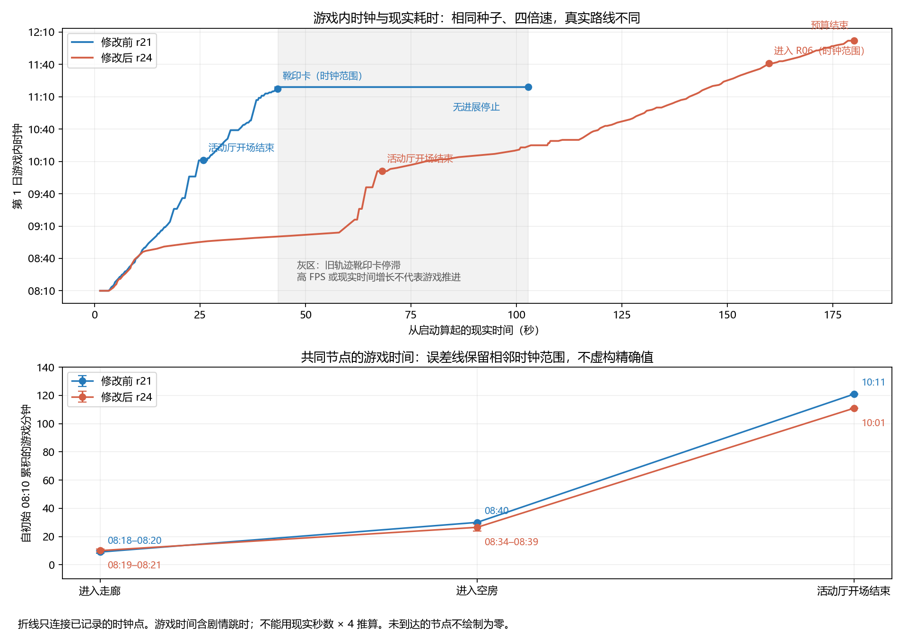
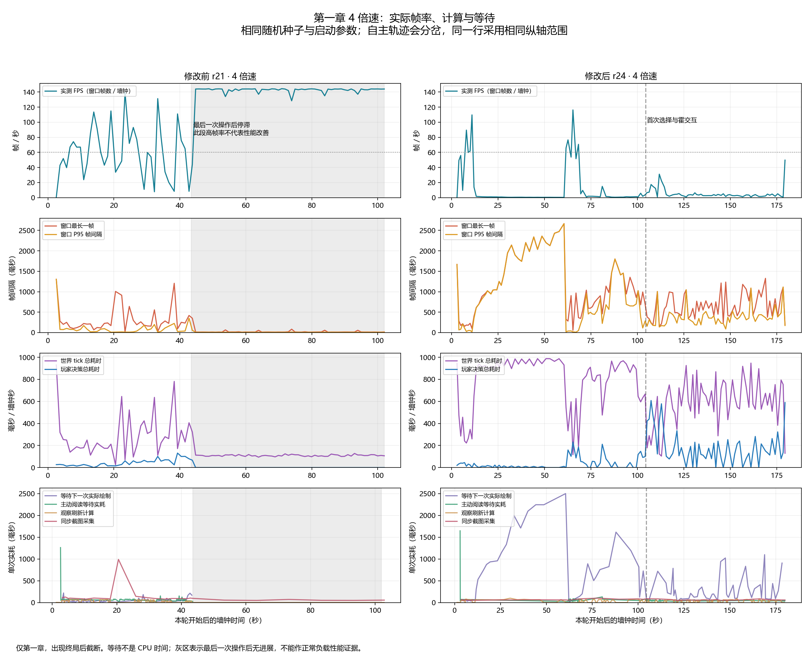

# 四倍速三级测试与历史轨迹比较

本轮由引擎侦探提供全部实际输入，从新正式游戏会话开始；没有代选路线、答案或注入状态。总体结论是：本轮能脱离空房和门区，交互仍在继续；门区徘徊、重复查看和严重掉帧仍存在，尚不能确认原靴印卡片死锁或下一章推进已修复。停止原因是预设现实时间预算结束，不是空候选或无公开进展超时。

## 设置与证据

比较修改前 `runs/unified-r21` 与本轮 r24。双方均为 seed=0、time_scale=4、现实预算180秒、无公开进展60秒、对白0.6秒、截图间隔10秒。原始 start 记录确认四倍速实际配置；不能把严重掉帧时的现实秒数乘4当游戏时间。源码指纹确认本轮运行期间没有源文件变化，但当前工作树与r21的主体、导航、剧本绑定等源码都有差异，不能将整个运行结果单独归因于Gemini某处修改。最近的一倍速r22与本轮源码相同，但参数和实际路线不同；被关闭的r23不作为完成测试。

本轮[公开轨迹](raw/trajectory.jsonl)、[停止记录](raw/summary.json)、[独立审查](reviewer/review.md)和全部截图按原字节留存；[封存指纹](raw-manifest.json)记录来源。旧轨迹关键片段另按原字节复制到[对照片段](comparison/baseline-r21-excerpt.jsonl)，[旧停止截图](comparison/baseline-r21-stop.png)已实际查看。完整原始目录仍保留在本机。仓库保存公开轨迹、摘要、图表和关键截图；其他原始截图及隐藏诊断保留在本机的raw目录。

## 关键节点的游戏时间与现实耗时

初始公开游戏时钟均为第一日08:10。节点对应真实室内状态或正式卡片输出，不将选择目标、门区的room_region或可见家具当作到达。非时钟事件使用前后 `decision.GameTime` 的范围；前后值相同才给单值，停止使用 `stop.time`。没有插值或用倍速推算。精确序号、相邻时钟与累计游戏分钟见[节点数据](charts/key-nodes.json)和[节点表](charts/key-nodes.csv)。

| 节点 | 修改前r21：游戏时钟／现实秒 | 本轮r24：游戏时钟／现实秒 |
| --- | --- | --- |
| 实际进入走廊 | 08:18–08:20／4.917 | 08:19–08:21／5.480 |
| 实际进入空房 | 08:40／9.763 | 08:34–08:39／8.749 |
| 开场结束且已在活动厅内 | 10:11／25.729 | 10:01／68.179 |
| 实际进入门厅 | 10:39–10:41／34.096 | 本轮未到达 |
| 首次打开石板卡 | 旧轨迹未发生 | 10:23–10:25／103.244 |
| 首次打开靴印卡 | 11:16–11:19／43.385 | 本轮未发生 |
| 实际进入R06 | 旧轨迹未到达 | 11:40–11:42／159.886 |
| 结束 | 11:19／102.793，无公开进展 | 12:02／180.005，时间预算 |

停止行现实耗时取驱动摘要；其他节点取轨迹事件的elapsed_ms。记录停止事件本身还包括最后截图等开销，因此事件时间略晚于摘要的停止时刻。第一章终局与第二章交接均没有本轮完成证据。

到活动厅开场结束，r24的游戏时间较旧轨迹早10分钟（自08:10耗111分钟，旧轨迹121分钟），但现实耗时多42.450秒。因此此前仅按现实秒数说“推进更慢”不完整：这个共同节点的游戏时间没有变慢，实际等待却显著变长；不能凭该节点宣称整体调查效率提高，之后路线已经分岔。两轮都未完成作答。

## 实际行为的比较

旧r21在43.385秒打开靴印卡，43.416秒被苏泠插话覆盖，继续后候选持续为空；停止截图仍画着靴印卡和按钮，最终无公开进展超时。本轮没有走到这个原始场景，所以不能宣布卡片底层模态恢复修复已经实测成立。

本轮8.749秒进入空房，9.183秒的实际移动已离开。11.2–46.35秒在R07门区反复试探后自主脱离，61.344秒开始活动厅见面对白。103.193秒石板交互获得真实到达/接受反馈，之后霍铎辨字与回忆能接续，到108.750秒显示带新增笔记的石板卡，仍有可用卡片动作。这里验证的是选中动作被插话替换后的重新交互及解释后出卡，不是“整卡打开时插话后恢复原整卡”的同一场景。

159.886秒真实进入R06；这比最近一倍速r22始终未离开空房并在119.662秒遭遇绘制等待超时有更多实际推进。但R07门区局部反复仍明显，113.337秒再问已经讲过的石板字得到“我说了”，171.290和174.919秒重复书架卡内容相同。四倍速没有消除徘徊和重复劳动，也没有证明下一章已能进入。

独立审查还发现：角色在R06接触本地书架，卡片却署“R-05 · 书架”，且比对提示要求R05。主代理核对剧本发现`热点与布局.story`的E11a/b/c/d确实把不同房间书架绑定到同一证物E11；所以这是公开位置与内容署名的冲突，现有证据不能直接归因于这轮导航修改。没有在测试中修改绑定或机制。

依设计规范§六.14及共同主体要求，长时间门区反复、没有新增内容的重复查看不能由“仍然在移动”视作合理调查。霍铎主动搭话确实提供了新信息并使调查继续，但仅观察到局部帮助，人物重大取舍（包括苏泠已知代价后的拒绝）尚未触发，不能据此确认DecideRecall修改的效果。178秒后有正午开门剧情输出，终止时铜口对白正文尚未完整画出；题尚未作答，不能把开门输出视作已完成章节交接。

## 耗时折线与卡顿

沿用此前性能图的实测口径，补齐FPS、帧间隔、世界tick/决策耗时，以及实际绘制等待、主动阅读、观察与截图耗时。双列同一行用相同纵轴范围；CSV分别保留[帧指标](charts/performance/frames.csv)、[操作计时](charts/performance/timings.csv)、[计算阶段](charts/performance/managed-stages.csv)。

本轮30–58秒窗口实际帧率约0.40–0.57FPS，帧间隔约1.74–2.47秒。实际绘制等待最长2.499秒，旧轨迹最长0.220秒；长等待不能都解释成侦探犹豫。计算分解显示该时段世界tick占用了大量现实时间，但这是负载定位证据，尚不足以确定具体哪处修改造成退化。旧轨迹43.486秒后已经卡死，其高FPS区属于低负载停滞，不得拿来证明旧版本正常游玩性能更好。

## 结论范围

工程准备能够构建并启动正式场景；构建和剧本一致性检查不作为行为改善依据。机制上，实际进房、交互及失效动作衔接发生了；原靴印模态丢失场景未复现到。人物行为上，能自主脱离门区并受到本人所见信息的帮助，但反复和内容来源冲突仍在，重大取舍未验证。游玩体验上，严重掉帧与局部徘徊使体验仍不合格；游戏内时间与现实时间必须分别报告。未执行一级、二级或独立盲玩，没有用流程回归、通过率或断言计数作评价。
