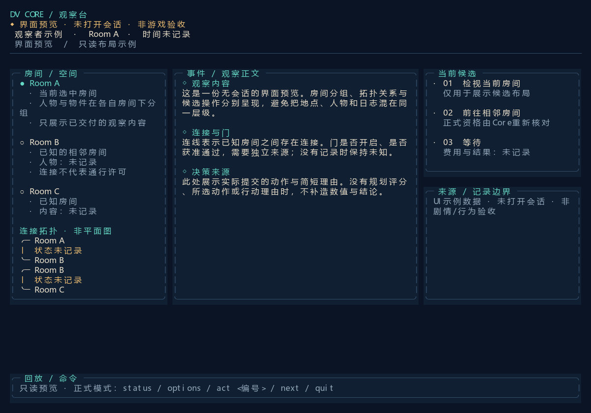
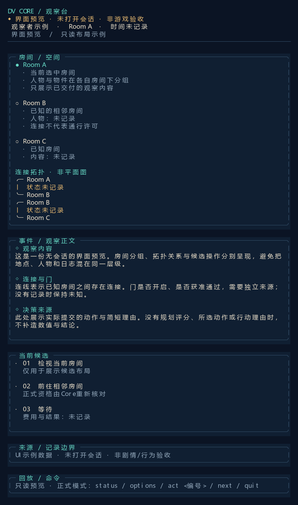
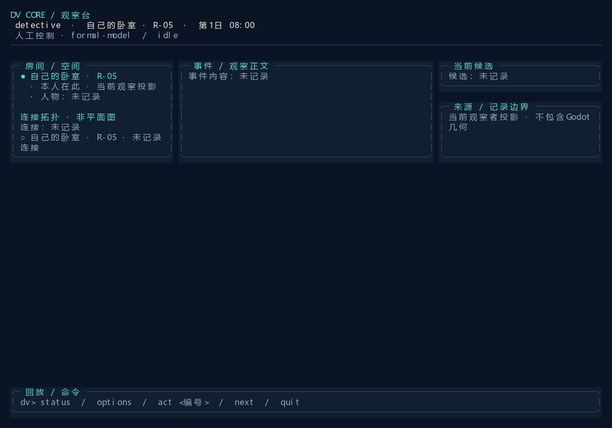

# 命令行UI交付与实际渲染核查

2026-10-22，基于main的f95f6097，工作分支codex/terminal-ui-20261022。没有覆盖同时出现的Godot UID文件。

## 文档先行修订

已先保留下载原稿为dv_core_ui.original.md，再修改C:/Users/iii/Downloads/dv_core_ui.md；仓库版本在docs/dv-core-terminal-ui.md。修订取消了无依据的“完全一致/零卡顿”、任意历史分叉、控制者热切换、普通界面的真值透视、虚构评分/置信度以及“思维链摘要”。外部行动理由与人物采信分开；实际时间与展示节拍分开。当前未实现的左箭头、LIVE等不写作现成功能。已有JSON-Lines、正式动作链和SmartReplay继续沿用。

## 实现

TerminalView是零第三方依赖的ANSI真彩/Unicode单元画布，TerminalProjection只消费观察者投影。房间标题及其条目逐组排列；每条拓扑连接只来自map_knowledge.doors。门状态缺失时保持未记录，连接不代表通过许可。120列三栏、78列单列，长内容纵向流入滚动区，不按string.Length切断中文。控制序列在渲染前过滤。

实时与记录回放共用模型和渲染器，重播清除显示缓存。未增加世界执行路径、预算或角色知识。CLI的--preview在创建会话之前返回；--export-ui独占创建SVG，由同一画布导出。mcp/verification/render_terminal_export.py将该rect/text子集转成PNG，并注册diagnostics / terminal-export。PNG为实际终端单元渲染导出，不是操作系统终端窗口屏幕截取。

## 工程和UI结果

- build-01与build-02均完成，0警告0错误。第二次是只读当前帧导出与终端输入行换行的接线修补；没有执行Core AI验收或禁止的流程回归。
- preview-wide-01：无会话示例，120列，导出1200×840，退出0；已实际查看PNG。
- preview-narrow-01：无会话示例，78列，内容展开为780×1320，退出0；已实际查看PNG。previous完整携带上轮全部预览、原稿及工程记录，并逐文件SHA-256核对。
- readonly-start-01：真实新开局的`--tui --command status`只读投影，1200×840，退出0；已实际查看PNG。没有调用Prepare/Complete或启动自主调度。当前本人房间已知，其他房间、连接和候选没有被补造；此截图不证明人物行动或剧情进展。
- readonly-start-01/previous再次完整携带两次既有UI预览、嵌套历史、原稿、修订稿和两个构建日志，二进制manifest保留来源与SHA。实际查询控制台原文保存在console.dvlog，不落JSON轨迹。所有原件仍在。

本轮未运行真实动作、AI会话、Godot几何或长程回放验收，也未实现历史分叉/切换控制者、评分诊断或外部reason参数。组合emoji显示受终端字体影响；普通CJK按双格处理。PNG转换需Pillow和中文字体。未产生需清理的.scratch脚本或临时Godot工程。

## 图片

宽屏UI示例，Room A/B/C与候选均为明示的界面示例：

窄屏纵向重排：

真实开局只读投影，未推进调度：

