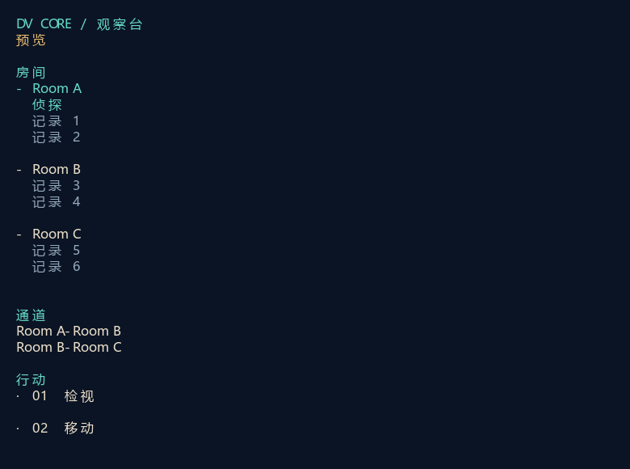
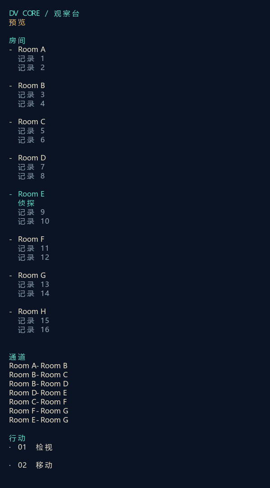

# 列表版

- 房间逐组列在上方，通道逐条列在下方，连接采用`Room A-Room B`。
- 取消房间卡片、连线绘图、全部外框及说明段落；本人仅列在所属房间中。
- `zoom`只调整列表行距；新增房间和连接自然纵向展开，宽度不足完整换行。
- 两次必要构建均完成，0警告0错误。第二次取消空候选详情的默认占位文字。
- 实际查看3房间/78列与8房间/60列渲染导出；后者本人在Room E，含分支、环和未连接的Room H。没有补出不存在的连接。
- 未打开正式会话或启动Core AI。图片均为标有“预览”的UI数据；PNG来自同单元画布SVG。
- 前一房间卡片方案的构建、图片和源码证据保留在refinement-02，其中TerminalTopology.cs仅为弃用方案证据，不进入工程。每次预览前逐文件复制并SHA-256核对前轮全部原始记录；完整previous目录本地保留，版本库保存manifest与本轮输出。
- 与本轮无关的Godot UID文件未纳入提交。没有创建.scratch临时脚本。

