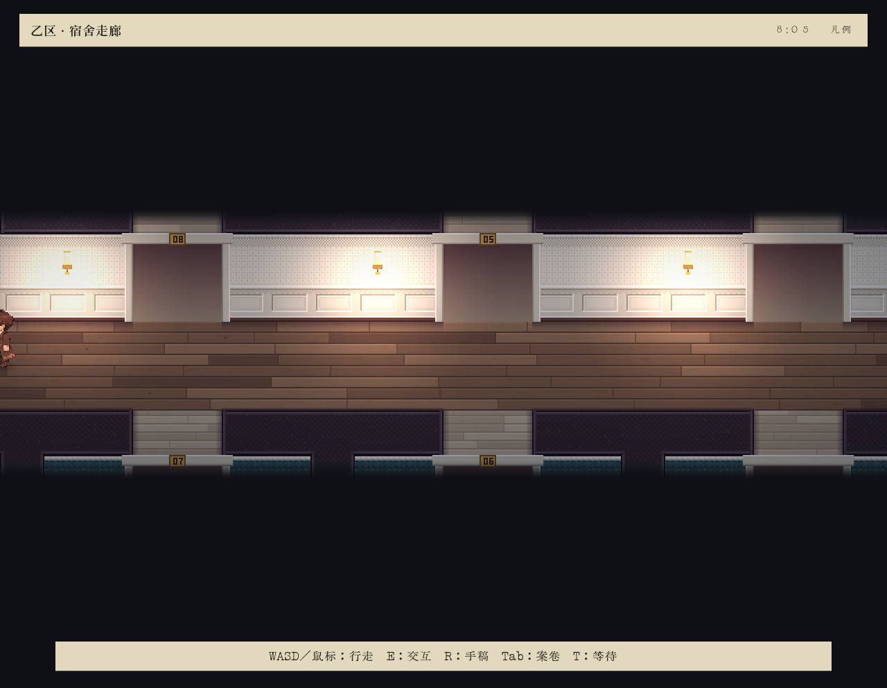
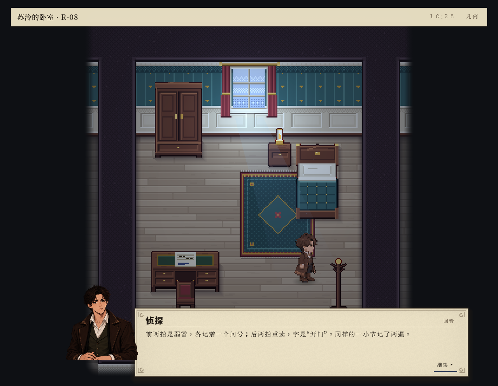
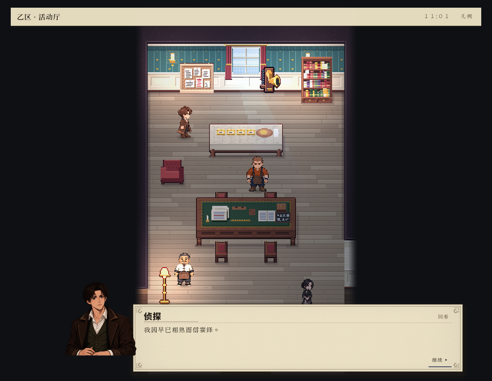

# 当前验收：整体未通过，局部改善成立

2026-10-21，应用户要求按已经关闭的正式会话与独立盲玩给出结论。未启动准备中的600秒08窗口，也未把计划中的复测算作结果。

## 已有实测支持

- 07冻结版的新正式会话中，侦探本人四次答辩均被权威接受，真实离开寝区并进入公共起居厅。接受事件为e2915、e2997、e3172、e3344，不能替代完整正确推演或结局。
- 原规划器在评分之后才排除路径内重复任务，06已前移检查。旧04记录候选含419条重复E2任务路径，07记录中未再观察到该任务重复；实际两房往返从144次变为23次。前提及行为已改变，不作同条件提速结论，也不声称消除全部往返。
- 人工推演表单的未选初值、显式组合提交、三语切换已通过有限原生UI核查；正式推演准入、完整假设传递、当前本人条件重核保留。
- 最新工程构建0警告0错误，冻结来源2252文件前后吻合，07正式关闭完整；构建和封存仅是工程事实。

## 整体验收仍不成立

1. 完整正确重演未形成。唯一付费重演的完整比较为unknown，最终模型总余额耗尽；新增线索不能恢复重演。资源恢复规则缺失，已请求用户裁定，尚未擅自补预算。
2. 近距侦查执行有缺口。E6同室检视已正式成功，但回执site为空、executor=dv-world；截图角色远离乐谱，没有真实站点距离证明。若干物理实验与同伴复合动作也缺完整执行绑定。
3. 独立盲玩04实际离房并检视乐谱，但走廊开放边界阻断、角色屏幕裁切，未到交谈、重演或答辩。07已修开放地板请求与阶段提示，尚无修补后的新盲玩验收；取消后重试也未在blind04实际触发。
4. 07采集截止仍活动。第二章内容扩展发生在关闭尾部，未继续第二章行动与呈现；不能判定交章故障，也不能称实际交章体验已验收。第三至第六章、最终离岛、所有主体视角及结局均未完成验收。
5. 一般跨图或失败后身体终点与逻辑位置协调仍有合同缺口。本轮源侧同点取消证明仅覆盖严格子集。

因此可确认本轮改善了案件推进、假设输入、热点识别和重复规划问题；不能交付“整局已真正可玩、所有问题已定位修复”的验收结论。

## 证据与报告边界

主要证据为engine-investigation-report-07.md及该轮independent-review.md、blind-04/blind-report.md及independent-review-corrigendum.md、autonomous-contact-audit.md、model-budget-lifetime-diagnosis.md。历史包包含失败和更正，原件保留。carry-forward-08完整携带14975文件、11619275823字节；大型原始会话、截图序列和跟踪本地保留，不宣称全部推送。

其他AI自然编写/公式、连续通行/输入、标题揭幕和设计纲要修复已人工整合并静态复核；保留音乐提交9f434197。Git提交与远端结果单列在integration-completion.md，避免用内容整合冒充提交历史已经合并。

以下图片为未改动的实际游玩截图。第一张是06盲玩失败证据，不能据此宣布07仍同样失败；第二张揭示07同室检视的几何缺口；第三张显示07第四问正文，接受另有正式事件证明。

