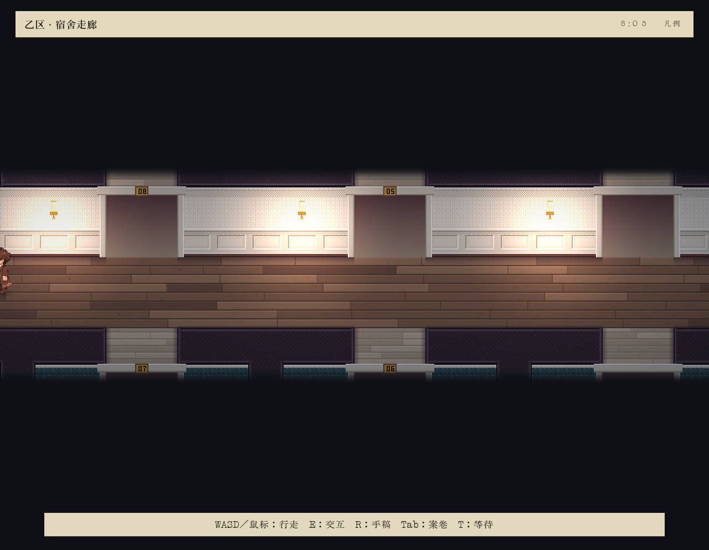

# blind-04 独立盲玩报告

本轮只依据本轮 frame 截图及自己的实际输入自主游玩；未读取源码、设计、历史记录、私有事件或状态。主代理告知本轮以1倍速运行，600002ms自然截止并关闭。我在最后可见截图约588秒后停止追加输入，未延长窗口。

体验结论：可以自由行走、进出房间、检视物件并回看案卷，已呈现侦探RPG的探索外形；本窗口未遇到可交谈人物，未实际发起推演、提交答案或达成章节交接，无法确认这些体验是否能顺畅衔接。最明显的阻碍是走廊导航：向左行走后人物裁到画面左缘，继续按A未见变化，画面没有给出可辨出口；我花了一段时间尝试方向和案卷，后来点击08号门才重新推进。这里只记录可见现象，不判断内部原因。

## 实际进展

- 08:00从自己的卧室R-05开始，床旁E触发醒来叙述。侦探只记得上船，以袖口磨损辨认自己的风衣，并提出先出去看看。这为探索提供了明确动机。
- 鼠标走到下方门道，再按S进入乙区宿舍走廊，看到08:05。房间与走廊转换成功；按键长按容易越过狭窄走廊中线，鼠标点击更便于准确接近。
- 向右探索未看到公共出口，向左后出现人物裁切及继续移动无可见变化。未能从画面判定通路。
- Tab案卷可打开，证据栏回顾了开局叙述；书页斜透视的正文较小。Tab从证据页退到目录，再点击“返回现场”才回到现场。
- 点击08号门进入苏泠卧室R-08，08:07。点击书桌纸张后人物自行接近，08:08完成首次乐谱检视：弱音问号、重读“开门”、小节两遍、旁注“门外？”及“他们关了门”。这是实际获得的观察，但门、他们和用途均未知。
- R打开推演工作台，显示没有可进行的重演、没有可显示假设、尚无个人批注，建议继续调查和访问同伴。面板未给出当前可执行推演入口，本轮没有实际推演结果。
- 返回走廊后点击07号门，最后可见08:12进入沈鼎卧室R-07，未见住客或热点。窗口随后截止。

## 截图证据

离开卧室后的真实走廊：

向左后人物裁在左缘；继续A后的截图仍相同，去向不清：

首次有效乐谱检视，其中一页可见观察：

R推演工作台的空状态：

逐次目的、依据截图、实际输入和后续可见结果保存在 [blind-notes.md](run/blind-notes.md)。原始输入由运行器另行留存；我未读取该私有记录，不能独立确认封存完整性。

本窗口没有发生正确作答被接受、章节交接或通关；不以此推断整局无法达成。截图间的中间过程未连续观看，移动细节只按实际看到的前后画面报告。