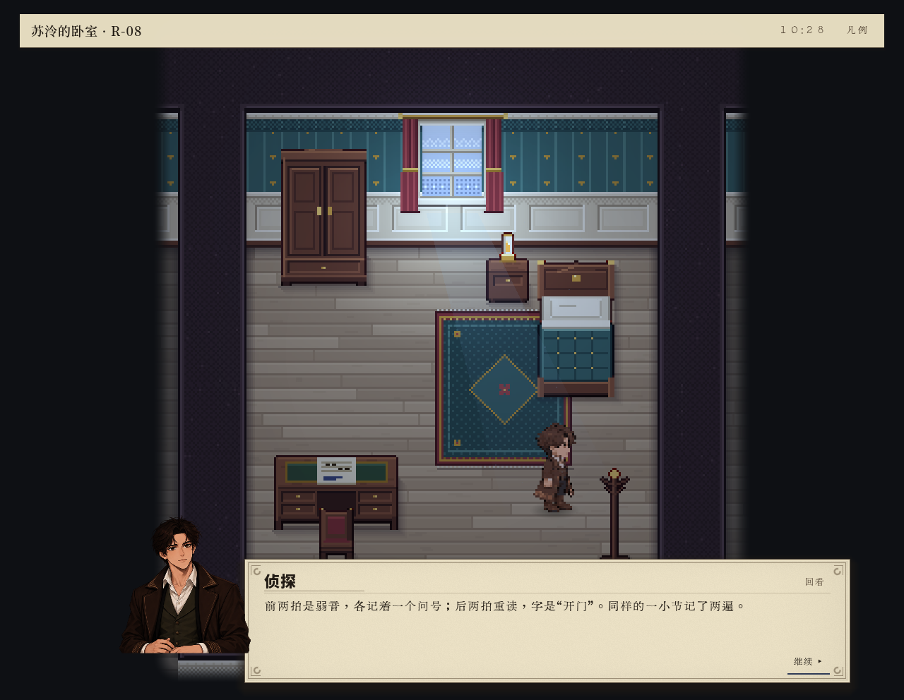
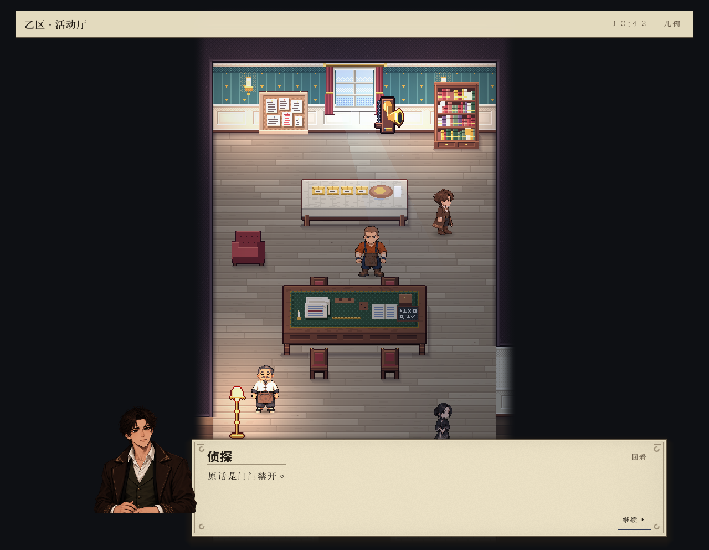
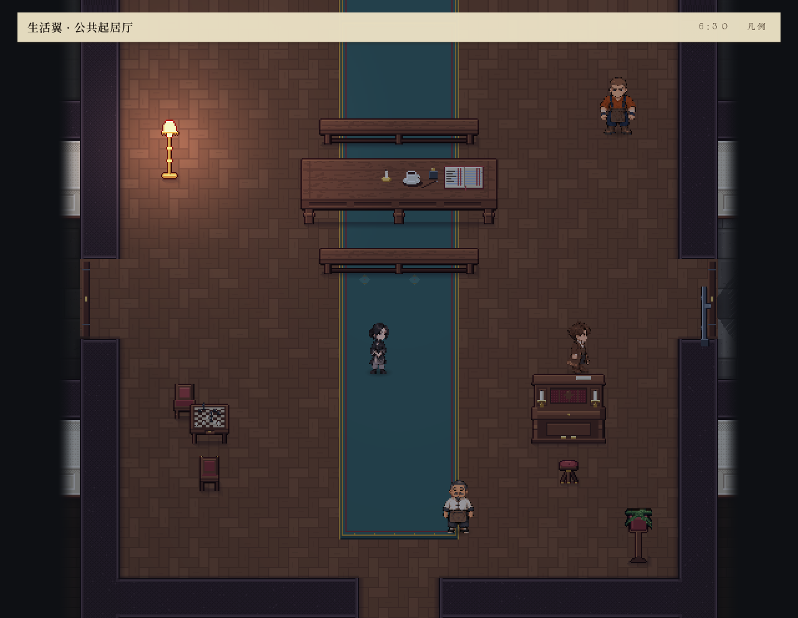

# 07：E6与四问接受已发生，300秒截止时会话仍活动

本轮侦探进入 R-08，获得 E6 正式检视结果，随后第三问“原话是什么”和第四问信任理由均获权威接受。侦探本人合计四次答辩接受；全体主体合计十四次，不混用两种数量。之后实际走出隔离门，进入公共起居厅并进行夜间活动。截止仍为第1章、active=true，原始停止原因是 `host-closed-during-active-session`，不能据此判定章节交接故障或整局无法完成。

E6 的证据边界也必须保留：真实 Godot 移动证明到达 R-08，同室检视正式 applied；检视回执却是 `executor=dv-world`、`contact=true`、`site=""`，没有热点距离或站点到达证明，不能称其近距物理接触已验收。

## 来源、工程条件与完整携带

2026-10-21，仅运行一次新引擎侦探会话。隔离根 `tmp/detective-rpg-candidate-07-20261021` 已完成构建0警告0错误与导入退出0；本轮导入未报告脚本错误。来源包含05人工取消同点 retry、06规划重复任务前置检查、07地板边界及通行 hint；没有补预算、预置答案、代选路线或注入状态。

`candidate-freeze-07.json` 的2,252个来源文件运行前及完整关闭后均逐一吻合，清单 SHA-256 为 `3d5a42d4e7c52a126c05921570e360d5315d40a7b8c8cc5e6b7ab8ad94aa7259`。结果为 `engine-investigation-preflight-07.json`、`engine-investigation-postclose-07.json`；`postflight-07.json` 是游玩结束后、关闭尚在途时的中间复核。启动器的 tracked 文件与 DLL 复核亦无差异。

上一轮全记录随本轮只读携带于 `carry-forward-07/`，主代理核验13,253文件、10,312,250,600字节，包含此前完整 carry 链、盲玩04及全部raw/report和独立审查更正。`carry-forward-07-engineering/` 另外完整携带当时98份工程文件。没有改写这些归档；04侦探两次/全主体四次接受的数量范围澄清见 `engine-investigation-report-04-corrigendum.md`。

参数为300现实秒、四倍播放、AI本人决策、offscreen真实渲染/碰撞、完整审计、5Hz PNG、290秒托管线程时间采样、native off。输出 `engine-investigation-300s-07/`，完整命令/PID见 `launch.json`。采集截止300,037ms；首个游戏钟记录在3,050ms为08:00，截止1830分钟，即次日06:30，实际推进1350分钟，不由倍率换算。正式等待行动实际推进了游戏钟，不能把它当成跳帧或测试代理注入。关闭完成314,086ms，尾部14.049秒；启动器总317.516秒。游戏/采样均退出0，无Godot游戏错误行，托管报告可读。唯一新增宿主目录为 `20261021-074949-3618`。

## 实际节点

现实时间取正式结果向宿主送达的记录，不能冒充正文首帧或计算完成时刻。数据见 `actual-milestones.dvlog` 及原始 `run/host-events.dvlog`。

| 实际节点 | 现实送达 | 游戏钟 | 原始事件 |
| --- | --- | --- | --- |
| 始业之问提出 | 02:07.745 | 09:29 | e2513 applied |
| 本人听取、首候选采纳 | 精确现实点未知 | 09:30 | listener_parse e2562；hypothesis_adopted e2579 |
| 唯一一次正式重演 | 02:24.355 | 09:59 | e2843，七条mind_simulation，完整解释未成立 |
| 身份答案接受 | 02:27.040 | 10:11 | e2913提交；e2915接受 |
| 声音来源接受 | 02:33.330 | 10:22 | e2995提交；e2997接受 |
| 第三问提出 | 02:33.623 | 10:23 | e3030；本人listener_parse e3046 |
| R-08真实到达 | 02:41.435 | 10:27 | e3093执行；此前host_completion e3092 |
| E6正式检视 | 02:41.738 | 10:28 | e3110；host_completion e3109 |
| 第三问答案接受 | 02:49.655 | 10:42 | e3170提交；e3172接受 |
| 第四问答案接受 | 03:06.428 | 11:01 | e3342提交；e3344接受 |
| 拔内闩、开门 | 03:16.954 / 03:18.594 | 11:05 / 11:06 | e3470 / e3485 applied |
| 实际走入公共起居厅 | 03:21.116 | 11:08 | e3525 cross-out applied |
| 夜间证物检视、暂缓判断 | 03:56.053 / 03:57.765 | 14:41 / 14:42 | e4578 / e4587 applied |
| 晚餐 | 04:16.925 | 19:02 | e5404 applied |
| 留意夜间时间 | 04:39.126 | 次日00:01 | e6162 applied |
| 截止 | 05:00.037 | 次日06:30 | active=true，第1章，尚未实际交章 |

四次侦探接受均有原始 `answer_accepted`，`accepted=true`、`literal_truth=true`、`epistemic_support=true`、`question_match=true`、`answer_complete=true`，分别identity、voice_source、words、trust。全主体另有十次接受，属于其他人的案件，不能替代侦探本人节点。

## E6：正式结果与几何接触分开

R-08移动回执e3092记录同一人物实例 `173107319608`，源房 `zone_yi:corridor`、目标 `zone_yi:north_2`，实际终点 `[2224,924]`，arrival_error=0、tolerance=4，status=arrived、executor=godot。这是真实房间到达证据。

随后的E6检视e3109记录action219、outcome=applied，但field只有 `contact=true`、`executor=dv-world`、`site=""` 以及同室context。没有E6站点标识、实际接近终点、距离或接触半径。164.518秒截图也显示人物位于房间右下侧、乐谱在左下桌面上。可确认正式结果与玩家正文，不能据此独立确认角色走到乐谱近旁。派生界限见 `contact-boundaries.dvlog`，原始值保留于DAG。

E6检视正文确实提供了手写乐谱信息，随后第三问“原话是闩门禁开。”获接受；这证明正式逻辑链推进，不补成缺失的几何证据。

## 重演、规划与重复任务

本轮仍只有一次replay，发生在实际听取问题之后。七条mind_simulation与此前04一样：history-case-1局部一条比较为explained，但完整七条比较结果为unknown；history-case-3完整结果inconsistent；末条history-case-5展开78后剩余0、stop_reason=budget-exhausted。正文明确“尚未形成能够完整说明现有观察的解释。推演总预算已耗尽。”后续问答接受不等于完整正确重演已经成立。E6之后没有第二次实际重演，因此也不能补说新证据已使重演正确。

对06修补的具体核查采用旧原始轨迹离线重测量，未重跑旧游戏：04的172条侦探planning事件、9,641条记录候选路径中，有419条路径把 `detective.compare.E2` 放入两次，例如e427路径末尾连续两个compare.E2；07的98条planning事件、2,386条记录候选路径中，同一路径重复compare.E2、touch_latch、compare_sole均未观察到。证据见 `repeated-task-paths.dvlog`，含两份DAG SHA及原路径实例。这支持“记录候选中重复同一比较任务的现象已消失”，不推断未记录的内部展开次数，也不是同条件速度结论。

07仍有135条记录候选路径重复一般移动行动；不能把它们与重复比较任务混为一类。实际hall→corridor11次、反向12次，合计23次，04是各72次共144次；两轮行为和知识前提已不同，只列事实。07实际compare.E2、touch_latch、compare_sole各执行一次。规划停止标记为54次complete-depth、44次current-affordance-root；这些是规划轮次停止，不是正式会话终止。

## 时间、热点与尾部

完整宿主阶段墙钟：Prepare477段合计35.831秒，其中choice23.350秒、cognition7.785秒；Complete477段10.903秒；快照投影6.416秒、JSON编码0.339秒、Godot物化0.653秒；逐帧visible_trace共39,528段52.269秒；采集GPU回读1,479次29.628秒、复制与入队5.400秒。现场执行/回执55.140秒、正文阅读205.845秒，与后台计算重叠，不能求和当总耗时或CPU。

特别是末条Complete从295.871秒到304.104秒，共8.233秒，跨越300秒采集截止。上述完整宿主总计包含该关闭尾段；`run/live-timing.dvlog` 截止前只留该段begin，`host-session/interaction-timing.dvlog`有end。不能用未刷新在线尾部宣布崩溃或把关闭尾部全部算成窗内卡顿。原始DAG实际action_execution共477，截止前已送达presentation为476，亦保留这个边界。

后台PNG编码33.573秒、写盘3.947秒、哈希/通知4.299秒，不算成主线程阻塞。实际≥50ms绘制间隔52段、最大123.388ms。托管样本等待49.04%/15.30%，Godot variant销毁10.85%、ptrcall3.52%、Memmove2.73%；这些是含等待的线程时间栈占比，不是CPU利用率。仍有完整审计、截图与采样成本，不能与普通无采集游玩同条件比较。

## 截图实际查看

164.518秒，R-08乐谱检视正文与人物/乐谱相对位置。证明正文已显示，不证明热点近距接触。

170.387秒，第三问答案已显示；正式接受由e3172另证。

186.915秒，信任理由已显示；正式接受由e3344另证。

299.072秒，公共起居厅、HUD06:30、没有对白。单张静态画面不替代末条后台Complete、次晨节点或章节交接。

另实际查看71.667、148.499、161.901、222.171秒原始PNG，全部未改动。

## 精确停止原因与封存

捕获终点 `end.dvlog`：active=true、chapter=1、chapter_summary=false、game_time=1830，仍保存当时已Prepare的mora/action476等待意图。关闭等待在途Complete结束后，`close-result.dvlog`为complete=true、errors=[]、unprocessed_commands=0、pending_action为空。二者分属截止与完整关闭，不能互相覆盖。

原始e6619 `session_stopped` reason=`host-closed-during-active-session`、time1830、actions_executed477；封存根status同值。它不是no_candidate、动作上限、时域终点或剧情结束。前一e6618是 `chapter_content_available`，chapter=2、movement=false；仅说明内容可用，不是实际移动交章。未到某个未来节点不能据此判定交章bug，需要后续独立更长新会话观察，本轮不延长。

原始DAG完整seal、无无效尾部，107,310,866字节，SHA-256 `a1021d6e75c39ddfc382bc84bbbe588092fc80f478db6dc83fcfed390b0ea57d`，实际final.events有6,620条事件。该封存格式把事件放在events字段，增量committed_events=0不等于空轨迹。截图归档错误为空。全部原始二进制、PNG、nettrace及控制台输出保留；分析仅新增派生二进制和报告。运行已结束、目录可归档携带，没有续跑。完整正确推演、近距E6接触、实际第二章交接、最终结局均不由本轮宣称完成。
