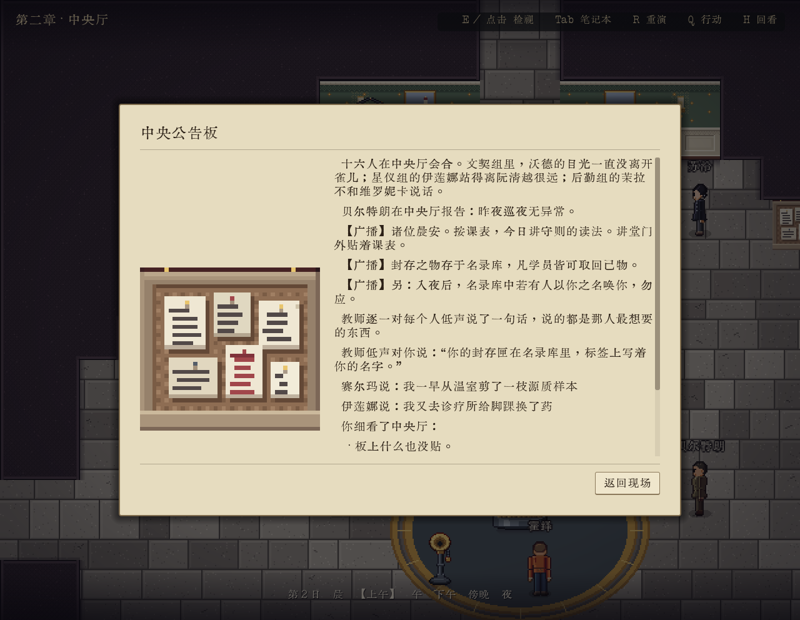
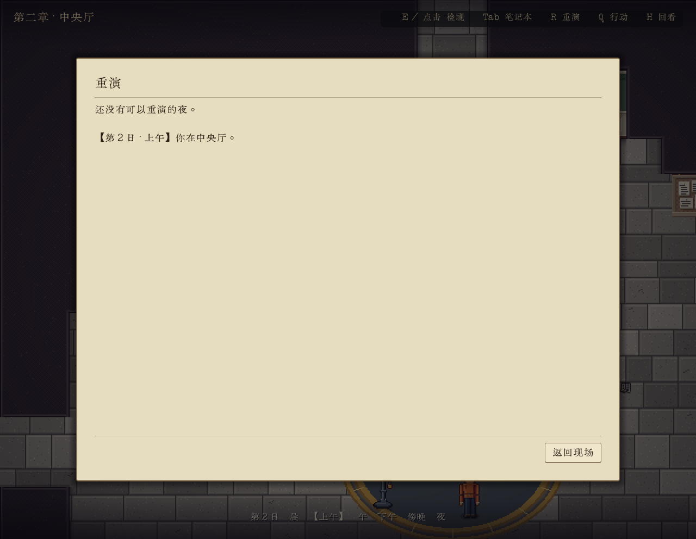

# 未解锁重演页独立局部补验

通过。2026-10-04，全新独立上下文 Agent 使用 Godot 4.6.1 .NET 渲染窗口，从默认第二章原开场开始。此为 UI 自动回归，非盲玩；未读设计/历史报告、未注入状态/跳夜、未构建 .NET、未改实现。

| 原 UI 路径 | 实际结果 | 截图 |
| --- | --- | --- |
| 7次 Space 原开场→Q→帮助 | 第2日清晨、标题帮助 | 0010 |
| ESC→R | 标题重演、原提示“还没有可以重演的夜。”、notebook、无图 | 0011 |
| ESC | 回现场正常 | 0012 |
| 现场移动→点击实体中央公告板 | 正常消耗时段至第2日上午；等8秒仍人物行动，续等18秒后原card有图 | 0016、0017 |
| 公告卡 ESC→R | 标题重演、原提示保留、notebook、card_texture=false，旧图不残留 | 0018 |
| ESC→D 250ms | 现场可操作，busy/action_playing=false | 0019 |

无输入或fixture阻塞。开始误点下方装饰公告柱，E打开此处菜单；关闭后正常走到实体中央公告板再点击。运行170.278秒，非有效盲玩时长，stderr为空。仅关闭自己启动的47100/41204，用户编辑器30124保留。

证据目录：`unified-ui-title-fix-evidence/`，包含全部截图、`client.jsonl`原输入、`timeline.jsonl`玩家可见输出、`ui-observations.jsonl`只读类型/纹理/忙状态。检查glue位于`godot_csharp/scenes/Chapter2/Game/check/ui_title_fix_session.gd`与`ui_title_fix_client.py`，继承原通用driver，不写剧情状态。

