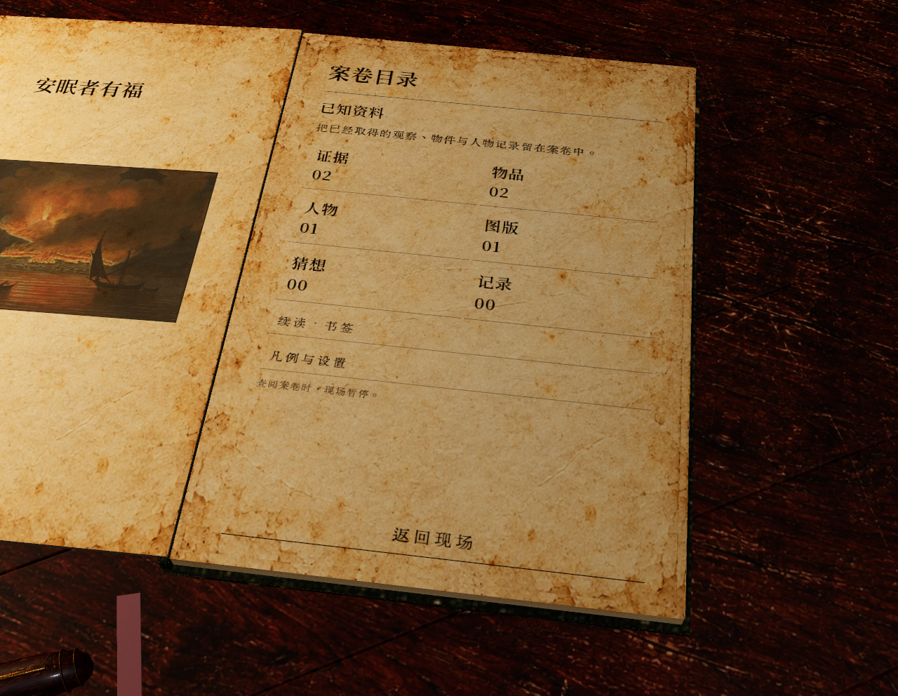
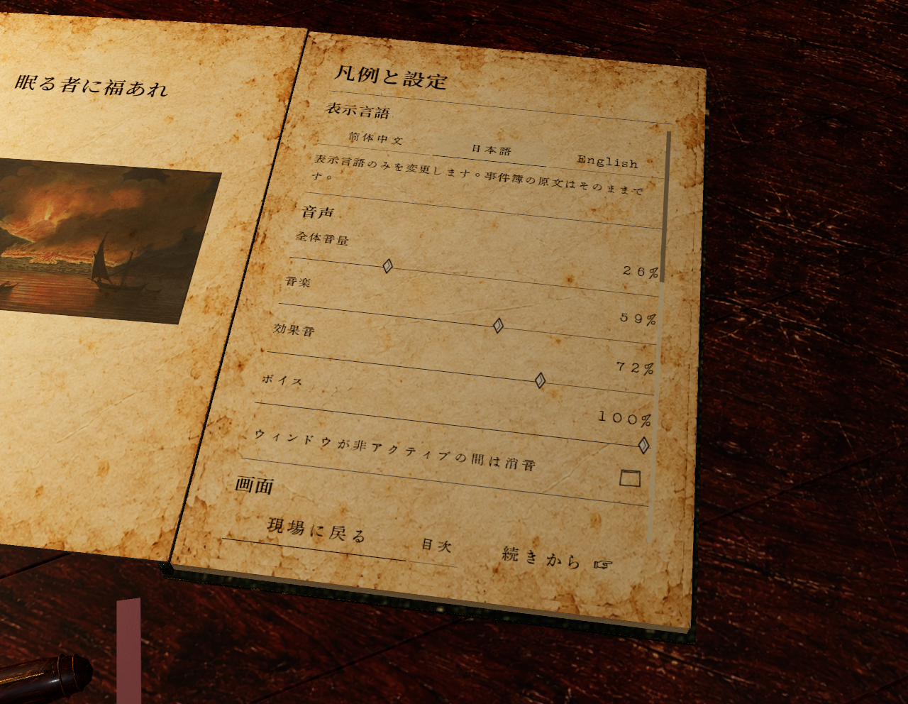
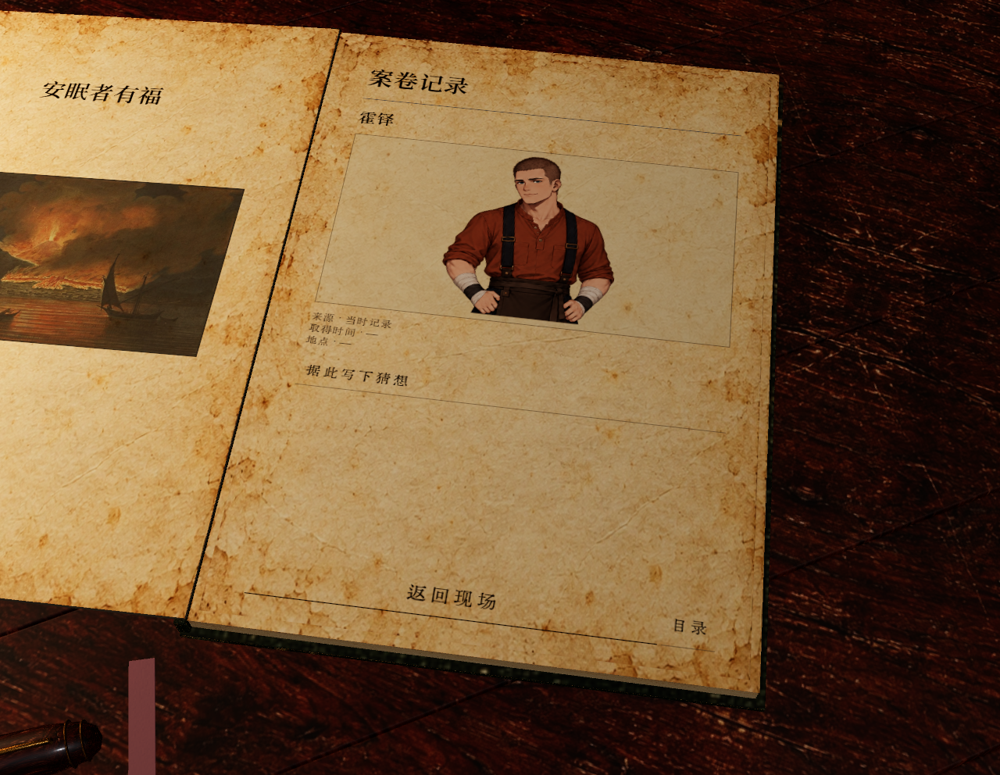
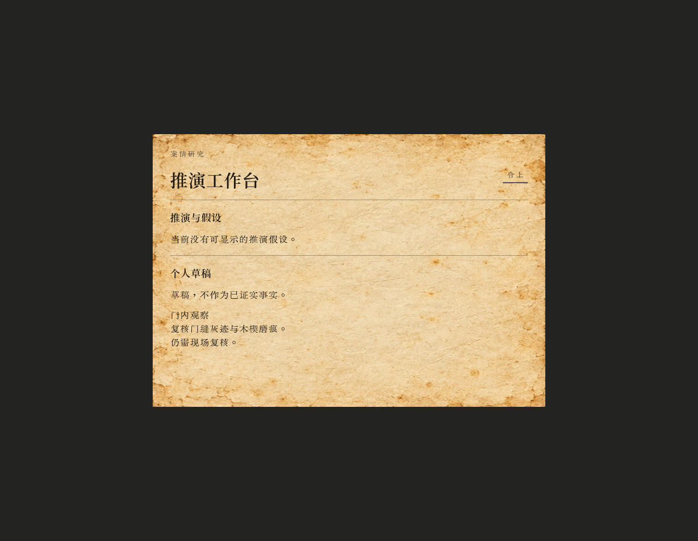
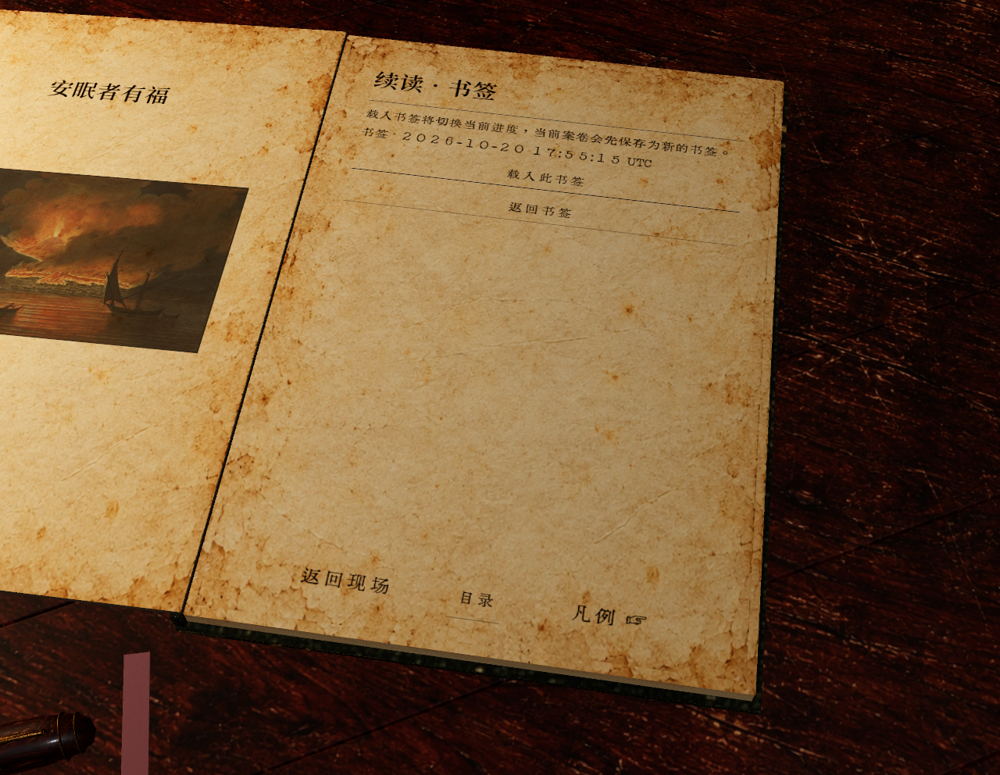

# 共享实体书、透镜与案卷 UI：实现和实机记录

本轮按用户要求修改 Windows 项目 `C:\Users\iii\Desktop\dual_ontology_world_engine`。观察日期为 2026-10-20 UTC；沿用任务目录名 `casebook-ui-20261021`。相机保持此前确定的约 60°俯角与近景，未因放大镜或其他道具体量而拉远。代码、Blender 源稿与运行资源均在原项目内更新。

## 已实现的行为

| 部分 | 现在的行为 |
| --- | --- |
| 放大镜 | 调整桌面锚点与朝向，木柄完整露在灯座和书之间；保留 80 mm 镜片规格与约 174.075 mm 整体长度。 |
| 镜片 | `magnifier_lens.gdshader` 接管 LensGlass，提供屏幕空间放大、凸面折射、深度约束、轻微色散和 Fresnel 边缘响应。默认放大系数 1.32、折射率参数 1.52；其他玻璃继续使用原材质。 |
| 封皮背面 | 正反面采用各自朝外的法线与三角形绕序，背面 UV 镜像时同步处理切线框架。法线贴图随硬封旋转及纸页弯曲，移除原先重复翻转背面法线的路径。 |
| 共同书页 | 标题与游戏内复用生产 `TitleUI.tscn`、3D 桌面、实体书、翻页网格与投影输入。凡例、续读、证据、物品记录、人物立像、图版、猜想与记录从同一目录进入。 |
| 三语与偏好 | 共同设置页提供简体中文、日本語、English；界面语言存入 `user://language.cfg`，音量、显示及辅助功能存入 `user://settings.cfg`。不把这些偏好写进 Core、世界存档或案卷侧车。 |
| 推演工作台 | 保持独立界面，与书页共用纸、墨和字体语义。书内负责资料、关联与个人批注；进入推演由现有 UI 事件连接，不自动提交世界行动。 |
| 书签 | 保存到新的唯一文件；载入前生成当前会话的新备份。书页使用日期标签，完整路径放在提示中；确认页明确聚焦“载入此书签”。 |
| 退出 | 菜单退出和窗口关闭共用 Sound/GameAudio 关闭链，先等待 Main/C# 封存会话及案卷，再排空音频并结束进程。 |

### 资料与设计边界

实现遵循当前设计文本与此前 Gemini 建议的共同部分：以案卷整理所控角色已知的信息，印刷正文和个人批注分层，保留来源和关联，实际推演独立展开。

`CasebookData` 只接收已交付的逐行对白、实际打开的可见卡片和明确取得的案卷投影。它不会扫描几何快照中的所有人物来解锁立像，也不会把未读正文、隐藏行动标签或作者资料写入案卷。条目保留原始 `lines`、来源标识及已有时间、地点；未提供的字段保持缺失。个人笔记属于独立草稿，不变成正式证词、世界事实、持有物品或推演结果。

案卷侧车 `<basename>.casebook.dvlog` 同时绑定 viewer 与对应 `.dvsave` 字节的 SHA-256。旧存档缺少侧车时恢复空案卷；不匹配或损坏的侧车返回警告。Core 的 Prepare → 现场执行/回执 → Complete 动作链没有改动。

保存和载入前，Main 检查正文阅读、未交付事件、延后输入、地图准备、现场动作，以及已提交但尚未返回的 Complete 投影。未达到稳定边界时提示用户先完成当前阅读和动作。保存期间也锁住书本，避免重入或关闭；成功、失败事件都能直接回传解锁。候选世界已经安装而现场资源装配失败时保持暂停，给出此前备份的恢复指引，不继续旧现场的动作。

## 实际验证

| 记录 | 结果与范围 |
| --- | --- |
| `prepare-01-geometry.log` | Blender 4.2 再生成功：146 个对象、50,334 个面、99,228 个三角形。保留实物标定规格，更新 .blend、.glb 与布局配置。 |
| `prepare-01-build.log` | Godot .NET 工程构建成功，0 警告、0 错误。 |
| `prepare-03-import.log` | 最终生产 GDScript/资源导入退出码 0。采集工具的最终解析与执行另由 render-03 验证。 |
| `build_ui_theme.py --check` | 三份主题与生成器输出一致，退出码 0。 |
| `render-03.log`、`render-03/` | 最终独立 UI 采集退出码 0，42 张 PNG 全部写入，采集阶段 22.550077 秒。覆盖硬封与纸页翻动、三语凡例、目录、证据正文、人物、图版、批注输入/编辑/关联和关闭重开、独立推演窗口。 |
| `main-bookmark-02.log`、`main-bookmark-02/` | 真实 Main 新会话通过 Enter 开始；F1 打开书本；经真实投影鼠标输入保存新书签、选中这次新保存路径、明确确认载入。观察到新现场实例完成装配，4 张 PNG 全部写入；进程退出码 0。未选择世界行动。 |
| `main-bookmark-02-session/` | 正式封存含 inputs、visible、interaction-timing、世界保存、案卷侧车和 close-result。close-result 为 complete=true、unprocessed_commands=0、pending_action 为空、errors 为空。 |
| `main-bookmark-02-verification.dvlog` | 正式输入记录中确有书本设置页的 6 个 Tab/Shift 按键包；计时记录包含 2 次 view_build_end、1 次 bookmark_saved、1 次 bookmark_loaded。手动保存、载入前备份与退出保存的侧车哈希绑定均正确，viewer 为 detective。 |

最后一次真实 Main 观察的安全关闭请求发生在 11.184729 秒，Main 关闭完成信号发生在 11.529927 秒；整个外部进程运行约 13.63 秒。这些时间属于本次有限 UI 观察，不是玩法或性能比较。

### 本轮发现并保留的失败证据

- `render-01` 的初次封面截图进入了菜单淡入阶段。稳定封面与实际 Main 证明菜单正常；采集器后来改为等待生产入场过渡和菜单可交互状态。
- `render-02.log` 保留采集器三个动态表达式的 GDScript 类型推断错误。补上显式 bool 后，render-03 完整执行；没有把失败轮计作成功。
- `main-native-01-session/` 保留第一次原生关窗产生的未完成计时归档。原因是 GameAudio 在仅等待音频混音后结束进程，未等待 C# 异步封存。统一关闭链后，main-bookmark-02 的正式 close-result 和世界/案卷保存均完整。

## 画面证据

以下均为 Godot 实际渲染。

### 放大镜柄、透镜与稳定封面

### 共用案卷目录

### 游戏内日文凡例

### 人物与独立推演

### 真实会话中的书签确认

## 验证边界与剩余事项

独立 UI 采集的 E2/E7 正文、石板图片和单一立像是有来源标记的有限呈现夹具，不代表该次正式玩家已经取得这些资料。个人批注输入、编辑与合卷重开经过生产控件；本轮真实存档载入观察使用初始空案卷，没有冒充一轮带完整证物和批注的长期游玩恢复。

三语截图采用临时 locale 预览，结束时恢复原语言，并核对语言/设置文件指纹不变；语言按钮的持久化代码已接回 GameLocale，本轮没有另做重启后的语言偏好验收。也没有执行完整剧情、推演作答、跨章节流程、损坏存档恢复或跨版本存档兼容性回归。

屏幕空间镜片只能采样可用的屏幕颜色与深度，不能当作光线追踪透镜；后绘透明物体不保证出现在折射图像内。灯具其他玻璃与火焰仍保留原有实现边界。

运行仍报告项目已有的 `main_theme.ogg` / `ui_click.ogg` 缺失。退出时还存在 Texture RID / ObjectDB 资源告警：独立 UI 轮为 21 个 Texture RID，最后 Main 轮为 14 个。没有把这些告警写作已解决。

本轮未覆盖或回退工作区中的角色图、房间 relief、角色发布工具等其他改动。已有 UI 排版与阅读返回栈改动在整合时保留；最终源指纹和提交范围见同目录工程清单。
