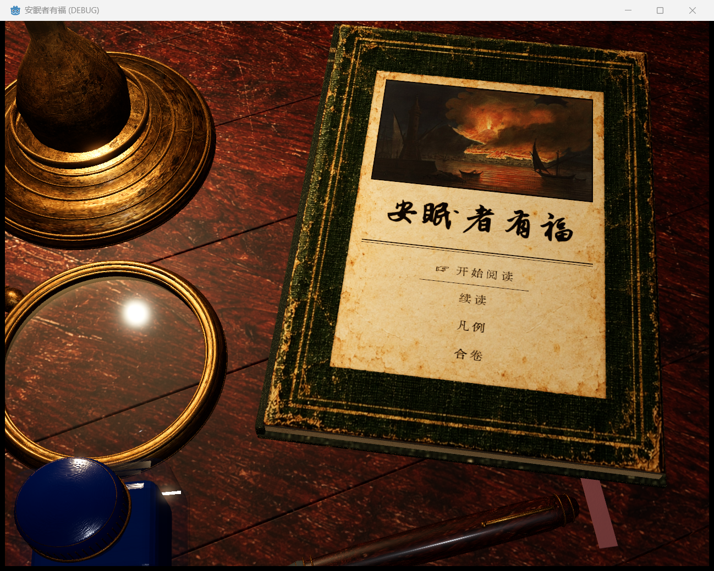

# 卷首书桌：60°俯视与近景取景

最终观察批次为 **render-camera-60-01**。用户明确“拉近不包含降低俯角”后，已将此前误解产生的 40°镜头改为 **60°俯视**，保留 **12 场景单位的近景距离**。既有实物尺寸、翻页、法线与粗糙度材质继续使用；本次没有缩小道具或把相机退回远景。

## 实际运行画面

[翻页演示](render-camera-60-01/book-turn-demonstration.mp4) · [设置页](render-camera-60-01/settings-page.png) · [纸页翻动](render-camera-60-01/paper-to-load-005.png) · [先前较远镜头](native-scale-01.png) · [已纠正的 40°镜头](native-camera-low-02.png)

## 相机与构图

| 参数 | 最初实物标定版 render-scale-01 | 当前版本 |
| --- | --- | --- |
| 俯视角 | 56° | **60°** |
| 相机距注视点 | 13.8 场景单位 | **12.0 场景单位** |
| 注视平面的垂直取景范围，1280×992 | 约 10.075 单位 | **7.2 单位** |
| 垂直 FOV | 约 40.10° | **33.40°** |
| 开书行为 | 视野随开书变化 | **只平移跟随阅读页，角度、距离与 FOV 固定** |

俯角与距离分别控制。固定 60°后，书页纵向投影增大；7.2 单位的垂直范围为文字与导航保留边界，相比原先 10.075 单位仍减少约 28.5%。封面目标点为 (0.7, 0.25, 1.5)，阅读目标为 (6.5, 0.25, 1.1)。窗口使用 KEEP_HEIGHT，宽度仅改变左右可见范围。鼠标视差保留很小的方向变化，因此逐帧实际俯角在名义 60°附近轻微波动。

灯具上部、镜柄、部分前景瓶身与笔允许自然裁切，翻动书皮也可出框；不会为了把全体物件收进画面而拉远相机。画面中的书页、按钮和内页导航需实际查看；射线点击成功不单独作为无遮挡的证明。

## 实物比例与空间关系

书封长 6.96 单位，明确设定为 220 mm，因此 **1 单位 = 31.6091954 mm**，书封宽约 156.78 mm。这是场景采用的实体尺度假设，不是从参考图测出的尺寸。

| 物件 | 当前网格实测尺寸 |
| --- | --- |
| 油灯 | 高 355.60 mm，足径 114.30 mm |
| 放大镜 | 镜片直径 80.00 mm，总长 174.08 mm |
| 墨水瓶 | 53.00 × 44.00 × 70.00 mm |
| 钢笔 | 长 141.00 mm，杆径 13.10 mm |

尺寸量级参考 [Vermont Mansfield 灯](https://www.vermontlanterns.com/content/oil-lantern-brass-table-14)、[Sailor 50 ml 墨瓶](https://sailor.co.jp/product/13-1007/)、[Eschenbach 官方目录的 80 mm 镜片](https://www.eschenbach-optik.co.jp/main/wp-content/uploads/2022/12/8ffa81b928e8080d2015bc76cb7b33a2.pdf)、[Pelikan M800 尺寸级别](https://www.pelikan-passion.com/images/international/assets/magazine/passion-magazin-01-2018_en.pdf?download=)。这些资料用于可比大小，不表示复制品牌外形、开盖状态或光学性能。

几何生成器从实际使用的网格顶点测量，按物体自身轴分别标定高度、长度和横截面，输入集中于 `desk_physical_spec.json`。灯位为 (−3.2, 0, −1.1)，墨瓶为 (−2.05, 0, 4.9)；墨瓶与笔的包围盒沿 X 轴净隔 **0.12522 单位／3.96 mm**。相机由 40°纠正到 60°时，这些位置与尺寸均未改动。几何沿用 `render-camera-low-02-geometry.log` 对应导出，共 99,228 个三角形、146 个网格对象。

## 翻页、光照与材质

硬书皮与柔性纸页使用真实网格，具有正背面、厚度、纸边及阴影；页面转动时切线法线框架同步旋转。原生 Control 显示在 580×820 的页面 SubViewport，点击经过同一 Camera3D 与书页平面逆投影。翻动中锁定页面输入，落定后恢复；减少动态效果时直接落定并暂停明显视差、闪烁和微尘运动。

颜色按参考采用深暖木色、墨绿金边、旧纸、黄铜与钴蓝。颜色素材由 imagegen 辅助生成，独立法线与线性粗糙度由 Blender CPU Cycles 微表面节点烘焙，共六张数据 PNG；不能称为人工手绘原画。灯芯位置从最终几何导出，火焰、光源能量和风偏转使用一致驱动，物体受光与阴影由共同三维场景计算。

## 本轮实际核查

可见窗口记录 **104 帧**、**7 次原生按钮激活**，约 **12.73 秒**。检查封面、设置、续读、返回和开始入口的 UI 过渡；只发出一次 start UI 事件。图像无缺失，二进制 `ui-input.dvlog` 排空封存，没有 GDScript 或 shader 编译错误。全部记录帧的 FOV 范围为 **33.398487–33.398487°**，证明翻页过程中未扩大视野。光源能量范围为 8.697–9.286；减少动态效果的通知使微尘暂停并恢复，未修改保存的偏好。

Main 原生窗口通过目标 PID 截图，图像为 1298×1039，标题“安眠者有福 (DEBUG)”；窗口留在桌面。最终画面需结合实际截图判断，API 捕获成功本身不代替目视检查。视频按记录的帧间隔编码，不能据此推断游戏帧率。历史亮度采样区域随构图改变，不能作为同一区域的跨版本光照比较。

原始截图、二进制输入、视频与日志全部保留，未覆盖前几轮记录。资源导入、捕获、视频汇总日志为 `render-camera-60-01-import.log`、`render-camera-60-01-capture.log`、`render-camera-60-01-summary.log`；源文件指纹、原始文件哈希和镜头汇总分别见 `camera60-source-fingerprints.json`、`camera60-evidence-manifest.json`、`camera60-configuration.json`。

## 仍有的差距与验证边界

这次已落实约 60°俯视与近景取景。整体仍偏三维旧物质感，金属与镜片高光较强，尚未达到参考图的全部笔触和细腻度。玻璃有透明、Fresnel 与场景反射，未实现真实光学折射或放大镜成像。

采集退出仍报告 7 个 Texture RID 未释放，现有 `main_theme.ogg`、`ui_click.ogg` 两份音频缺失仍在。此前的 CLEARCOAT_GLOSS shader 错误已改为 CLEARCOAT_ROUGHNESS，失败记录保留。本轮只核查标题 UI 呈现与导航，未验证正式 DV 会话、存档恢复、剧情流程或世界碰撞；此前 .NET 构建通过，本次没有修改 C#。
