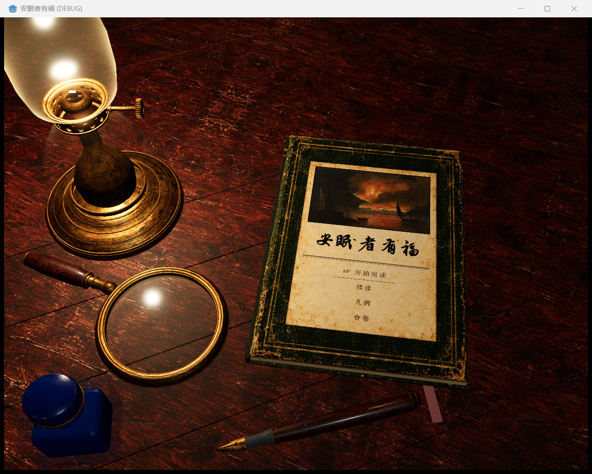

# 卷首 3D 书桌：实物尺寸校正与最终画面

本轮已修改实际 Windows Godot 工程，并在用户进一步指出道具偏小后重新按毫米标定。最终观察批次为 **render-scale-01**；此前 render-finish-04 的原始截图、视频与日志保留为调整前记录。画面采用参考辅助生成的颜色素材、Blender 几何和独立表面数据烘焙，不能称为人工手绘原画或参考图的完整复刻。

## 实际结果

[翻页演示视频](render-scale-01/book-turn-demonstration.mp4) · [设置页](render-scale-01/settings-page.png) · [纸页弯折](render-scale-01/paper-to-load-005.png) · [比例调整前](native-finish-04.png)

## 尺寸依据与实测

书封长 6.96 场景单位，明确设定为 220 mm；因此一单位为 **31.6091954 mm**，封面宽约 **156.78 mm**。这是本场景采用的实体尺度基准，不是从参考图反推的实测尺寸。模型长度 = 目标毫米数 ÷ 每单位毫米数。

| 对象 | 上一版按此尺度换算 | 本轮最终网格实测 | 处理方式 |
| --- | --- | --- | --- |
| 油灯 | 约 163.15 mm 高，106.78 mm 足径 | 355.60 mm 高，114.30 mm 足径 | 分段增高储油体与烟囱，调节轮保持圆形。 |
| 放大镜 | 约 38.11 mm 镜片 | 80.00 mm 镜片，总长 174.08 mm | 按镜片直径标定，其余形体同比。 |
| 墨水瓶 | 约 33.94 × 30.96 × 42.67 mm | 53.00 × 44.00 × 70.00 mm | 在未旋转的瓶身局部轴中分别校正宽、深、高。 |
| 钢笔 | 约 119.48 mm 长、6.01 mm 杆径 | 141.00 mm 长、13.10 mm 杆径 | 沿笔杆自身轴独立校正长度和圆形横截面。 |

实物规格来源：[Vermont Mansfield 桌灯](https://www.vermontlanterns.com/content/oil-lantern-brass-table-14)为 4.5 × 4.5 × 14 英寸；[Sailor 50 ml 瓶](https://sailor.co.jp/product/13-1007/)为 53 × 44 × 70 mm；[Eschenbach 官方目录](https://www.eschenbach-optik.co.jp/main/wp-content/uploads/2022/12/8ffa81b928e8080d2015bc76cb7b33a2.pdf)提供 80 mm 镜片；[Pelikan 官方尺寸表](https://www.pelikan-passion.com/images/international/assets/magazine/passion-magazin-01-2018_en.pdf?download=)提供 M800 约 14.2 cm 长、13.1 mm 径，同系列官网另列 14.1 cm。这里采用可比实物的尺寸量级，保留原有木柄、黄铜和钴蓝玻璃设计，不宣称复制这些品牌的外形或开盖配置。

唯一输入为 AssetsSource 中的 `desk_physical_spec.json`，生成器从实际网格顶点测量并输出 `desk-physical-layout.json`。各组最低点落在 y=0.005 单位；本轮尺寸误差均小于 0.03 mm。灯芯顶点直接从最终网格取得，Godot 读取同一配置计算火焰和光源位置；火焰高 28 mm、半径 3.5 mm，生长和风偏转保持脚点附着。反射体积覆盖增高后的油灯。

## 相机、书页与材质

封面镜头为实物尺寸留出空间，进入设置/续读后靠近阅读页。相机俯角为 56°，封面和阅读页使用同一透视相机；不会为了收进书皮而强行抬高镜头，书皮可沿实体轨迹离开画面。放大镜、墨瓶和钢笔重新布置，给封皮与纸页的完整翻动路径留出空间。实际查看的封面、设置页和弯折帧中，文字未被道具覆盖。

硬书皮与柔性纸页使用不同形变，含正背面、厚度、纸边和阴影。显示和点击由同一相机射线映射到原生 Control，翻动中锁定输入、落定后恢复。原生按钮事件不被用作“没有遮挡”的唯一证据。

色调按参考采用深暖胡桃木、磨损墨绿金边、象牙旧纸、旧黄铜与钴蓝玻璃。当前颜色素材由 imagegen 辅助生成；独立法线和线性粗糙度由 Blender CPU Cycles 的微表面节点烘焙，共六张 PNG，供桌面、静态书体及翻动页使用。书页的切线框架随形变旋转，文字不参与高度生成。火焰轮廓的法线也随风弯曲重新计算，避免亮核与透明边使用旧球面法线。

## 验证范围与证据

最终可见窗口采集 **106 帧**、**7 次原生按钮激活**，约 **12.72 秒**。完成封面→设置→续读→设置→封面、封面→续读→封面与开始入口的 UI 过渡，发出一次 start UI 事件。PNG 无缺失，二进制 `ui-input.dvlog` 排空并封存；没有 GDScript 或 shader 编译错误。减少动态效果的通知使微尘暂停并恢复，没有修改保存的偏好。光源能量观察范围为 8.697–9.289。汇总中的历史亮度测区随构图发生变化，不作为跨版本同一区域亮度比较。

视频按记录的实际帧间隔编码，不能用它推断游戏帧率。原生 Main 窗口截图为 1298 × 1039，标题“安眠者有福 (DEBUG)”；通过目标 PID 的 PrintWindow 捕获，最终图像另行目视核对。该窗口留在桌面。此前 .NET 构建通过，本轮仅调整几何、GDScript、shader 和文档，没有修改 C#。

几何为 99,228 个三角形、146 个网格对象。尺寸与灯芯证据见生成的布局 JSON；几何导出、资源导入、捕获和视频汇总日志分别为 `render-scale-01-geometry.log`、`render-scale-01-import.log`、`render-scale-01-capture.log`、`render-scale-01-summary.log`。完整原始 PNG、DVLOG、MP4 保留在本机本目录；Git 收录原生截图、代表帧、视频、二进制输入与汇总，完整原始文件 SHA256 见 `physical-scale-evidence-manifest.json`，未删除其余原始帧。

## 已知差距与未覆盖范围

画面仍偏三维旧物质感，灯玻璃的高光较强，尚未达到参考图的全部笔触与细腻度。玻璃支持透明、Fresnel 及场景反射，未实现真实光学折射或放大镜成像。退出 UI 采集时仍报告 7 个 Texture RID 未释放；现有 `main_theme.ogg` 与 `ui_click.ogg` 两份音频缺失未在本轮修复。

此前 render-finish-01 曾出现 `CLEARCOAT_GLOSS` shader 错误，已改为引擎支持的 `CLEARCOAT_ROUGHNESS`；失败证据保留，未用失败画面冒充最终结果。

本轮验证标题 UI 的呈现与导航。保留工作区已有设置与 load/path 接线，未执行正式 DV 会话、存档恢复、剧情、世界碰撞或流程回归，不能据此宣称完整游戏或存档功能已验收。
