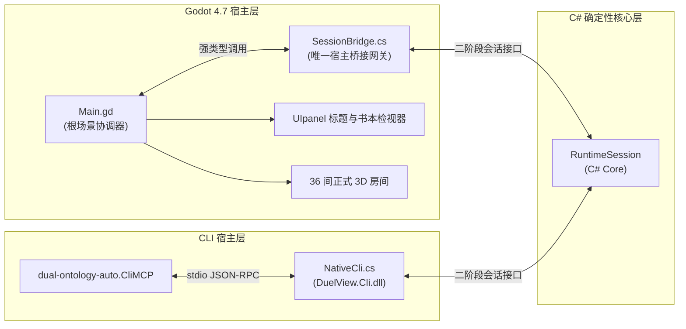

# 31 系统架构与核心机制

本文档定义《双本体世界引擎》（Dual-Ontology World Engine）的当前正式系统架构、模块职责、依赖边界与通信契约。

---

## 一、 双本体世界哲学与架构基本法

引擎核心建立在**“客观物理事实（Physical Ontology）”与“主观人物心智（Cognitive Ontology）”绝对解耦与双向隔离**的基础之上：

1. **客观世界事实**：
   - 保存在纯确定性状态树中，仅包含客观时空物理：绝对时间流逝、物品空间坐标、门锁物理开闭、气压与水银管道压差、生命体生物状态（饥饿/口渴/体能/源质侵蚀度）。
   - 客观世界不受人物“如何看待它”的影响，也不包含人物的心理独白。
2. **主观人物心智**：
   - 每个人物独立持有局部的**信念/知识状态图（Belief & Knowledge Graph）**与**证据溯源链（Evidence Provenance）**。
   - 人物所知只能通过**物理感知（Perception）**、**通信交接（Communication）**或**逻辑推演（Inference）**注入心智；严禁任何超感知的状态注入或瞬时全知。
3. **因果与时间演进**：
   - 游戏推进完全由双轨因果时钟驱动，单步仿真模拟时间推进、行动状态机转换与驱动力（Drive）效用重估。

---

## 二、 C# 确定性核心层（8 大内聚模块 DAG 依赖图）

核心逻辑层位于 `core/` 目录，完全由纯 C#（.NET 8 SDK）编写。**严禁任何核心模块引用 `GodotSharp.dll` 或 Godot 命名空间**。

### 1. 四级编译依赖有向无环图（DAG）

```text
Level 0:  DuelView.DvLang (core/dv_lang/)
              │
              ▼
Level 1:  DuelView.Ontology (core/ontology/)
              │
              ├────────────────────────┬────────────────────────┐
              ▼                        ▼                        ▼
Level 2:  DuelView.Cognition    DuelView.Reasoning        DuelView.Spatial
          (core/cognition/)      (core/reasoning/)         (core/spatial/)
              │                        │                        │
              └────────────┬───────────┴────────────┬───────────┘
                           ▼                        ▼
Level 3:             DuelView.Autonomy        DuelView.Simulation
                     (core/autonomy/)         (core/simulation/)
                           │                        │
                           └───────────┬────────────┘
                                       ▼
Level 4:                         DuelView.Cli
                              (core/session_cli/)
```

### 2. 模块职责与契约划分

| 层级 | 模块名称 | 程序集工程文件 | 核心职责与导出机制 |
| :--- | :--- | :--- | :--- |
| **L0** | `dv_lang` | `DuelView.DvLang.csproj` | DV 脚本词法、语法解析器、AST 构建与 AOT 静态编译器。不依赖任何其他业务库。 |
| **L1** | `ontology` | `DuelView.Ontology.csproj` | 双本体状态树、不可变字段快照（FieldKey）、事实值（FactValue）及实体生命周期。 |
| **L2** | `cognition` | `DuelView.Cognition.csproj` | 局部视锥/听觉感知投影、证据生成（Evidence）、贝叶斯可信度聚合与源质侵蚀遗忘机制。 |
| **L2** | `reasoning` | `DuelView.Reasoning.csproj` | 带符号霍恩逻辑（Signed Horn Logic）、自然演绎证明器、推演假设检定与做局分支生成。 |
| **L2** | `spatial` | `DuelView.Spatial.csproj` | 房间拓扑距离图、门洞视锥遮挡算法、座椅人机工程学（`SeatingFit`）与空间生命周期。 |
| **L3** | `autonomy` | `DuelView.Autonomy.csproj` | 凹性动机驱动力求解器（Drive Calculator）、Sim4 多步手段-目的规划（Means-End Planning）。 |
| **L3** | `simulation` | `DuelView.Simulation.csproj` | 双轨因果时钟流水线、单步行动状态机、战役装配器（Campaign Assembly）与内容兼容性校验。 |
| **L4** | `session_cli` | `DuelView.Cli.csproj` | 二阶段会话统一门面（`NativeCli`）、差量事件投影、标准 CLI 宿主与自动化行动回执生成。 |

### 3. `@mechanism` 契约规范
所有 53 个核心 C# 源码文件顶部强制声明 `@mechanism`、`@layer` 与 `@contracts` 结构化注释注解，保持与根目录 [`MECHANISM_MAP.yaml`](file:///c:/Users/iii/Desktop/dual_ontology_world_reconstruct/MECHANISM_MAP.yaml) 瞬时映射索引 100% 同步。

---

## 三、 宿主网关通信与单点会话架构

无论是 Godot 渲染宿主还是 CLI 自动化测试宿主，均面向相同的确定性 Core 引擎接口交互：



1. **唯一 C# 宿主网关**：[`scenes/main/SessionBridge.cs`](file:///c:/Users/iii/Desktop/dual_ontology_world_reconstruct/scenes/main/SessionBridge.cs)
   - 合并了原 `CharacterSessionBridge` 与 `GameEngine` 的全部职责；
   - 负责将 Godot 的单帧 `_process` 脉冲转换为 Core 引擎的确定性 `Step()` 调用；
   - 借助 [`GodotHostValues.cs`](file:///c:/Users/iii/Desktop/dual_ontology_world_reconstruct/scenes/main/GodotHostValues.cs) 实现 Variant 与 .NET 对象零 GC 内存互转。
2. **会话门面与生命周期协议**：
   - 遵循统一的 `open` $\to$ `advance` / `step` $\to$ `observe` $\to$ `close` 二阶段协议；
   - 观察结果输出标准只读字典，包含当前合法操作项、视锥内物证/角色、人物心理需求与已知案情线索。

---

## 四、 Godot 4.7 原生 3D 呈现与两级建造体系

全仓彻底废弃离线 Python 整房烘焙与外部裸模型拼接，全面实行 **Godot 原生参数化建筑建造 + 预配置智能预制件（Smart Prefabs）**：

1. **底层网格（assets/meshes/）**：
   - 261 个真实在用的原子级底层模型全部采用小写 snake_case 命名（如 `bookshelf_01.glb`、`vintage_writing_desk.glb`），严禁携带哈希字符或包含未烘焙的临时变体。
2. **智能预制件层（scenes/prefabs/）**：
   - 包含 286 个标准 PascalCase 智能预制件，划分为 5 大类：
     - `doors_windows/`：带开启/闭合碰撞层与音效动画的门窗（挂载 `HingedDoor3D.gd`）；
     - `furniture/`：带 `SeatPoseModifier3D` 坐姿锚点与交互站位的桌椅床铺（挂载 `PropEntity3D.gd`）；
     - `interactive_props/`：带调查交互线索、证据槽位的机关与证物；
     - `lighting_decor/`：带手绘着色器、光照参数与软阴影的灯具/地毯/装饰；
     - `exterior_landscape/`：建筑外部栏杆、围栏与自然植物。
3. **结构组件库（scenes/components/architecture/）**：
   - 提供 `@tool` 原生参数化建筑组件：`SmartWall3D.gd`（吸附墙体）、`SmartRailing3D.gd`（栏杆）、`SmartStair3D.gd`（楼梯）与 `SmartFloorZone3D.gd`（地面区域）。
4. **房间场景（scenes/rooms/）**：
   - 36 个人类可直接在 Godot 中点击拖拽编辑的正式房间（`R01.tscn` ~ `R16.tscn` 等），统挂 `RoomContainer3D.gd`。房间场景严禁直接引用裸 `.glb`，必须 100% 通过智能预制件或结构组件搭建；保存场景时自动触发同步 `campaign_rooms.dv`。
5. **建造工具链（tools/godot_architect/）**：
   - 包含编辑器面板插件（`PrefabPaletteDock`）与游戏运行时 `F4` 实时 3D 建造台（`LiveBuilderOverlay.tscn`），支持在三维视口中直观选定并放置家具。

---

## 五、 Godot 界面架构与对齐接口

### 1. 目录

```text
scenes/UIpanel/
├── TitleUI/TitleUI.tscn & .gd      # 标题：书名与菜单，只发出意图信号
├── BookUI/BookUI.tscn & .gd        # 书本检视器：SubViewport 书页、书签、翻页编排、输入映射；内含空白“图录”页
├── SaveUI/SaveUI.tscn & .gd        # 书内存档对开页
├── SettingUI/SettingUI.tscn & .gd  # 书内设置对开页
└── GUI/                            # 现场主控 GUI：无底悬浮界面
    ├── FieldGUI.tscn & .gd         # 现场 GUI 主控（组合以下三层子面板）
    ├── ClockRoomGUI.tscn & .gd     # 左上角时间、所在房间与停摆标记
    ├── TaskProgressGUI.tscn & .gd  # 底部正中当前执行任务刻度与剩余时长
    └── ActionChoiceGUI.tscn & .gd  # 物件/角色编号动作浮出列表与 3D 头顶跟随
scenes/components/world/
├── StudyDeskStage3D.tscn & .gd     # 书房舞台：模型、灯光、镜头、动态效果、书本开合与书叶
└── BookLeafTurn3D.tscn & .gd       # 可翻动的双面书叶
assets/materials/                   # book_spread_page / book_leaf_mesh_3d / night_volcano_sky / night_sea / study_curtain / lighthouse_beam 等着色器
```

书内页面顺序由 `BookUI.PAGES` 决定，当前为 图录 → 存档 → 设置。新增书内页面：在 `scenes/UIpanel/` 建一对场景与脚本，作为 `BookUI.tscn` 中 `Pages` 的子节点，并在 `PAGES` 中登记位置。

### 2. 分工

| 方 | 只负责 | 改动范围 |
| :--- | :--- | :--- |
| 界面 | 布局、文字、交互、翻页编排、输入映射 | `scenes/UIpanel/`，`Main.gd` 的界面编排 |
| 模型 | 书房几何、材质、灯光、镜头、动态效果 | `scenes/components/world/`，`assets/materials/` 与模型资源 |
| 游戏 | 规则、剧情、认知、现场与存档内容 | `core/`、`.dv`、`scenes/components/characters/` |

各方按本节接口开发，完成时对齐一次。接口变化时同步更新本节。

### 3. 接口

**Main → 界面**

| 对象 | 接口 |
| :--- | :--- |
| TitleUI | `show_title(can_continue, first)`、`hide_title()`、`interactive`；信号 `new_game_requested`、`continue_requested`、`book_requested(page_id)`、`quit_requested` |
| BookUI | `configure(stage, host)`、`open(page_id, from_field)`、`close()`、`close_immediately()`、`goto_page(page_id)`、`route_input(event) -> bool`、`page_id()`、`busy()`；信号 `closed`、`page_changed(page_id)` |
| FieldGUI | `configure(field_host)`、`release()`、`set_suppressed(suppressed)`、`refresh()`；信号 `action_requested(action_id)`、`cancel_requested`、`room_pressed(room_id)`、`suppressed_changed(suppressed)` |
| 书内页面 | 可选 `bind(host)`、`on_page_shown()` |

**界面 → Main（会话接口）**

| 接口 | 说明 |
| :--- | :--- |
| `save_slots() -> Array` | 自动记录 + 6 页手记；每项 `id`、`label`、`kind`（auto/manual）、`exists`、`saved_at`（Unix 秒）、`place`、`game_time` |
| `can_save() -> bool` | 仅从现场打开书本时为真 |
| `save_to_slot(id)`、`load_slot(id)`、`delete_slot(id)` | 返回错误文字，成功为空串；读取会关闭书本并进入现场 |
| `open_book(page_id)`、`close_book()` | 打开或翻到指定页 / 合上 |

**界面 → 舞台**

| 接口 | 说明 |
| :--- | :--- |
| `set_spread_texture(texture)` | 对开页纹理（1500×1000，左半为左页） |
| `freeze_spread(snapshot, left, right)` | 翻页期间半页显示旧页快照；`null` 恢复 |
| `open_sequence()`、`close_sequence()`、`snap_closed()` | 推镜开书 / 合书拉镜 / 直接复位 |
| `prepare_leaf(forward, front, front_rect, back, back_rect)`、`play_leaf()` | 准备并播放一次翻页；矩形为 UV 区域 |
| `screen_to_page_uv(point)`、`page_uv_to_screen(uv)` | 屏幕与书页 UV 互换；未落在页上返回 `(-1, -1)` |
| `pick_book(point)`、`set_hover(on)`、`set_pointer(v)`、`set_active(on)` | 标题点书判定、悬停、视差、显示与暂停 |

**Main → 现场**：`CampaignRoomHost.configure(path, restored)`、`host_checkpoint()`、`room_label(id)`、`shutdown()`、`camera`、`ready_for_play`、`state`、`room_id`。书本打开时 Main 停止现场处理，合上后恢复。

**FieldGUI 现场无底界面契约**：
- **挂载与生命周期**：Main 在 `_initialize_presentation()` 中将 `FieldGUI` 实例挂载至 `ui_layer` 并初始隐藏；进入现场 `_open_field()` 时调用 `field_gui.configure(field)` 激活并刷新；打开书本 `open_book()` 时调用 `field_gui.set_suppressed(true)` 隐蔽；返回现场 `_on_book_closed()` 时调用 `field_gui.set_suppressed(false)` 恢复；离开现场或关闭时调用 `field_gui.release()` 释放引用并清理子面板。
- **数据读取兼容契约**：FieldGUI 的 `refresh()`、`_refresh_clock()`、`_refresh_task()`、`_refresh_actions()` 均以 `obs.get("interface", obs)` 兼容读取 `CampaignRoomHost.observation()` 返回的 UI 结构化字典（含 `choices`、`selected_focus`、`player_progress`、`pending_approach`、`paused`、`speed`、`feedback`、`player_action` 等）。
- **现场交互驱动**：直接驱动模式下通过 `field.request_action(action_id)` 提交动作，通过 `field.interface_command({"command": "cancel"})` 取消进行中的移动或任务；Main 亦可通过监听 `action_requested` 与 `cancel_requested` 信号接管。
- **3D 目标跟随与安全容错**：`_follow_target()` 针对当前选中目标，先通过 `field.get("selected_focus")`（若空则回退至观察快照选区），通过 `field.target_node()` 或 `field._target_node()` 查询 `Node3D` 实例；当目标节点或相机无效、不在场景树或位于视锥背面时，自动安全退回 `ActionChoiceGUI.clear_anchor()`，防止空引用报错；有效时调用 `action_choices.set_screen_anchor(camera.unproject_position(world))` 实时锚定。

**测试接口**：`BookUI` 的 SubViewport 带元数据 `physical_book_view`，`GameMcp` 用 `BookUI.is_active()` 与 `screen_rect_for_control()` 报告书页内控件的屏幕位置。

### 4. 输入

| 操作 | 结果 |
| :--- | :--- |
| 标题点击桌上的案卷 | 打开书本到“图录” |
| 标题“调查记录” / “设置”，或 `F1` | 打开书本到存档 / 设置页 |
| 现场 `Tab` | 打开书本到存档页 |
| 书签、`‹ 前页` / `后页 ›`、`PageUp` / `PageDown`（滚轮设为翻页时也可用滚轮） | 翻页 |
| “合上案卷”、`Esc`、右键 | 合上书本，回到打开前的标题或现场 |

---

## 六、 数据声明与生命周期管理

- **战役唯一剧情声明入口**：[`res://assets/data/scenarios/campaign.dv`](file:///c:/Users/iii/Desktop/dual_ontology_world_reconstruct/assets/data/scenarios/campaign.dv)
  - 声明全五日剧情、16 名角色初始认知初值、身体需求参数、行为规则与因果时钟边界。
- **房间物理与呈现声明入口**：[`res://assets/data/presentation/campaign_rooms.dv`](file:///c:/Users/iii/Desktop/dual_ontology_world_reconstruct/assets/data/presentation/campaign_rooms.dv)
  - 由 Godot 房间场景保存时通过反射自动生成与同步，保持物理碰撞、物品摆放与 C# 拓扑模型一致。
- **状态重载机制**：
  - 内容热重载保留正在运行的人物心智与认知证据；修改初始状态、规则定义或人物作息必须明确要求新局（Requires New Game）。

---

## 七、 仓库卫生与架构防腐门禁（CI）

通过 [`tools/ci/verify_repo_hygiene.py`](file:///c:/Users/iii/Desktop/dual_ontology_world_reconstruct/tools/ci/verify_repo_hygiene.py) 强制执行 6 大硬性安全防腐规则：
1. **黑名单目录防护**：严禁出现 `dv_core`、`godot_csharp`、`scenes_temp`、`artifacts` 等过时目录；
2. **assets/ 资产纯度**：`assets/` 严禁出现任何 `.gd`、`.cs` 或 `.tscn`；
3. **房间预制件包装**：`scenes/rooms/*.tscn` 严禁直接引用底层裸 `.glb`；
4. **UIpanel 1:1 配对**：`scenes/UIpanel/` 场景与脚本严格 1:1 同名配对，总数不超过 12 对；
5. **C# 核心层 Godot 隔离**：`core/` 下所有 `.cs` 严禁包含 `using Godot;`；
6. **res:// 资源死链拦截**：扫描全工程资源引用，严禁存在失效的死链。
