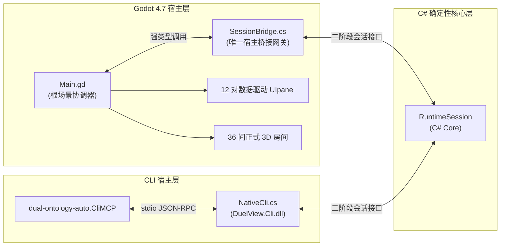

# 31 系统架构与核心机制

本文档定义《双本体世界引擎》（Dual-Ontology World Engine）的当前正式系统架构、模块职责、依赖边界与通信契约。

---

## 一、 双本体世界哲学与架构基本法

引擎核心建立在**“客观物理事实（Physical Ontology）”与“主观人物心智（Cognitive Ontology）”绝对解耦与双向隔离**的基础之上：

1. **客观世界事实**：
   - 保存在纯确定性状态树中，仅包含客观时空物理：绝对时间流逝、物品空间坐标、门锁物理开闭、气压与水银管道压差、生命体生物状态（饥饿/口渴/体能/源质侵蚀度）。
   - 客观世界不受人物“如何看待它”的影响，也不包含人物的心理独白。
2. **主观人物心智**：
   - 每个人物独立持有局部的**信念/知识状态图（Belief & Knowledge Graph）**与**证据溯源链（Evidence Provenance）**。
   - 人物所知只能通过**物理感知（Perception）**、**通信交接（Communication）**或**逻辑推演（Inference）**注入心智；严禁任何超感知的状态注入或瞬时全知。
3. **因果与时间演进**：
   - 游戏推进完全由双轨因果时钟驱动，单步仿真模拟时间推进、行动状态机转换与驱动力（Drive）效用重估。

---

## 二、 C# 确定性核心层（8 大内聚模块 DAG 依赖图）

核心逻辑层位于 `core/` 目录，完全由纯 C#（.NET 8 SDK）编写。**严禁任何核心模块引用 `GodotSharp.dll` 或 Godot 命名空间**。

### 1. 四级编译依赖有向无环图（DAG）

```text
Level 0:  DuelView.DvLang (core/dv_lang/)
              │
              ▼
Level 1:  DuelView.Ontology (core/ontology/)
              │
              ├────────────────────────┬────────────────────────┐
              ▼                        ▼                        ▼
Level 2:  DuelView.Cognition    DuelView.Reasoning        DuelView.Spatial
          (core/cognition/)      (core/reasoning/)         (core/spatial/)
              │                        │                        │
              └────────────┬───────────┴────────────┬───────────┘
                           ▼                        ▼
Level 3:             DuelView.Autonomy        DuelView.Simulation
                     (core/autonomy/)         (core/simulation/)
                           │                        │
                           └───────────┬────────────┘
                                       ▼
Level 4:                         DuelView.Cli
                              (core/session_cli/)
```

### 2. 模块职责与契约划分

| 层级 | 模块名称 | 程序集工程文件 | 核心职责与导出机制 |
| :--- | :--- | :--- | :--- |
| **L0** | `dv_lang` | `DuelView.DvLang.csproj` | DV 脚本词法、语法解析器、AST 构建与 AOT 静态编译器。不依赖任何其他业务库。 |
| **L1** | `ontology` | `DuelView.Ontology.csproj` | 双本体状态树、不可变字段快照（FieldKey）、事实值（FactValue）及实体生命周期。 |
| **L2** | `cognition` | `DuelView.Cognition.csproj` | 局部视锥/听觉感知投影、证据生成（Evidence）、贝叶斯可信度聚合与源质侵蚀遗忘机制。 |
| **L2** | `reasoning` | `DuelView.Reasoning.csproj` | 带符号霍恩逻辑（Signed Horn Logic）、自然演绎证明器、推演假设检定与做局分支生成。 |
| **L2** | `spatial` | `DuelView.Spatial.csproj` | 房间拓扑距离图、门洞视锥遮挡算法、座椅人机工程学（`SeatingFit`）与空间生命周期。 |
| **L3** | `autonomy` | `DuelView.Autonomy.csproj` | 凹性动机驱动力求解器（Drive Calculator）、Sim4 多步手段-目的规划（Means-End Planning）。 |
| **L3** | `simulation` | `DuelView.Simulation.csproj` | 双轨因果时钟流水线、单步行动状态机、战役装配器（Campaign Assembly）与内容兼容性校验。 |
| **L4** | `session_cli` | `DuelView.Cli.csproj` | 二阶段会话统一门面（`NativeCli`）、差量事件投影、标准 CLI 宿主与自动化行动回执生成。 |

### 3. `@mechanism` 契约规范
所有 53 个核心 C# 源码文件顶部强制声明 `@mechanism`、`@layer` 与 `@contracts` 结构化注释注解，保持与根目录 [`MECHANISM_MAP.yaml`](file:///c:/Users/iii/Desktop/dual_ontology_world_reconstruct/MECHANISM_MAP.yaml) 瞬时映射索引 100% 同步。

---

## 三、 宿主网关通信与单点会话架构

无论是 Godot 渲染宿主还是 CLI 自动化测试宿主，均面向相同的确定性 Core 引擎接口交互：



1. **唯一 C# 宿主网关**：[`scenes/main/SessionBridge.cs`](file:///c:/Users/iii/Desktop/dual_ontology_world_reconstruct/scenes/main/SessionBridge.cs)
   - 合并了原 `CharacterSessionBridge` 与 `GameEngine` 的全部职责；
   - 负责将 Godot 的单帧 `_process` 脉冲转换为 Core 引擎的确定性 `Step()` 调用；
   - 借助 [`GodotHostValues.cs`](file:///c:/Users/iii/Desktop/dual_ontology_world_reconstruct/scenes/main/GodotHostValues.cs) 实现 Variant 与 .NET 对象零 GC 内存互转。
2. **会话门面与生命周期协议**：
   - 遵循统一的 `open` $\to$ `advance` / `step` $\to$ `observe` $\to$ `close` 二阶段协议；
   - 观察结果输出标准只读字典，包含当前合法操作项、视锥内物证/角色、人物心理需求与已知案情线索。

---

## 四、 Godot 4.7 原生 3D 呈现与两级建造体系

全仓彻底废弃离线 Python 整房烘焙与外部裸模型拼接，全面实行 **Godot 原生参数化建筑建造 + 预配置智能预制件（Smart Prefabs）**：

1. **底层网格（assets/meshes/）**：
   - 261 个真实在用的原子级底层模型全部采用小写 snake_case 命名（如 `bookshelf_01.glb`、`vintage_writing_desk.glb`），严禁携带哈希字符或包含未烘焙的临时变体。
2. **智能预制件层（scenes/prefabs/）**：
   - 包含 286 个标准 PascalCase 智能预制件，划分为 5 大类：
     - `doors_windows/`：带开启/闭合碰撞层与音效动画的门窗（挂载 `HingedDoor3D.gd`）；
     - `furniture/`：带 `SeatPoseModifier3D` 坐姿锚点与交互站位的桌椅床铺（挂载 `PropEntity3D.gd`）；
     - `interactive_props/`：带调查交互线索、证据槽位的机关与证物；
     - `lighting_decor/`：带手绘着色器、光照参数与软阴影的灯具/地毯/装饰；
     - `exterior_landscape/`：建筑外部栏杆、围栏与自然植物。
3. **结构组件库（scenes/components/architecture/）**：
   - 提供 `@tool` 原生参数化建筑组件：`SmartWall3D.gd`（吸附墙体）、`SmartRailing3D.gd`（栏杆）、`SmartStair3D.gd`（楼梯）与 `SmartFloorZone3D.gd`（地面区域）。
4. **房间场景（scenes/rooms/）**：
   - 36 个人类可直接在 Godot 中点击拖拽编辑的正式房间（`R01.tscn` ~ `R16.tscn` 等），统挂 `RoomContainer3D.gd`。房间场景严禁直接引用裸 `.glb`，必须 100% 通过智能预制件或结构组件搭建；保存场景时自动触发同步 `campaign_rooms.dv`。
5. **建造工具链（tools/godot_architect/）**：
   - 包含编辑器面板插件（`PrefabPaletteDock`）与游戏运行时 `F4` 实时 3D 建造台（`LiveBuilderOverlay.tscn`），支持在三维视口中直观选定并放置家具。

---

## 五、 UIpanel 12 对双通道界面架构

UI 严格收敛为 **12 对 1:1 同名配对的 `.tscn` 与 `.gd`**，由 `Main.gd` 会话统一协调：

```text
scenes/UIpanel/
├── BookShell/
│   └── BookShellUI.tscn & .gd        # 书壳：支持 3D 弯曲实体纸面反投影与 F2 2D 扁平直通双模式
├── Spreads/
│   ├── CatalogInspectSpread.tscn & .gd  # 模板1：名录检视（人员花名册/物品清单/公版文献研读）
│   ├── ChronicleMapSpread.tscn & .gd    # 模板2：编年地图（五日时空轨迹与全岛平面图）
│   ├── PinboardPlateSpread.tscn & .gd   # 模板3：线索布告盘（案情物证钉板与假设连线）
│   └── LedgerSystemSpread.tscn & .gd    # 模板4：账册系统（配额对账、游戏设置与系统存读档）
├── Field/
│   ├── FieldHUD.tscn & .gd              # 现场常驻：顶部时间/阶段/探索状态栏
│   ├── InteractionMenu.tscn & .gd       # 现场交互：环形/抽屉式多级动作轮盘
│   ├── DeductionInterface.tscn & .gd    # 脑内推演：霍恩逻辑推演盘与三阶段证据校验
│   ├── DialogueUI.tscn & .gd            # 对话演出：半身立绘、无边框文字与选项分支
│   └── TitleStageUI.tscn & .gd          # 标题舞台：书案近景、新游戏/继续/设置入口
└── Shared/
    ├── ModalAlertUI.tscn & .gd          # 全局模态警告与确认对话框
    └── UIInput.tscn & .gd               # 统一输入路由、按键重映射与手柄导航
```

- **双通道交互机制**：
  - **3D 纸面主通道**：案卷作为 3D 实体平铺在胡桃木书案上，SubViewport 将 2D 页面反投影至弯曲纸面模型；
  - **2D 直通通道**：按 `F2` 键无缝切换为正视全屏 2D 扁平案卷，兼顾视听沉浸与高效点击。

---

## 六、 数据声明与生命周期管理

- **战役唯一剧情声明入口**：[`res://assets/data/scenarios/campaign.dv`](file:///c:/Users/iii/Desktop/dual_ontology_world_reconstruct/assets/data/scenarios/campaign.dv)
  - 声明全五日剧情、16 名角色初始认知初值、身体需求参数、行为规则与因果时钟边界。
- **房间物理与呈现声明入口**：[`res://assets/data/presentation/campaign_rooms.dv`](file:///c:/Users/iii/Desktop/dual_ontology_world_reconstruct/assets/data/presentation/campaign_rooms.dv)
  - 由 Godot 房间场景保存时通过反射自动生成与同步，保持物理碰撞、物品摆放与 C# 拓扑模型一致。
- **状态重载机制**：
  - 内容热重载保留正在运行的人物心智与认知证据；修改初始状态、规则定义或人物作息必须明确要求新局（Requires New Game）。

---

## 七、 仓库卫生与架构防腐门禁（CI）

通过 [`tools/ci/verify_repo_hygiene.py`](file:///c:/Users/iii/Desktop/dual_ontology_world_reconstruct/tools/ci/verify_repo_hygiene.py) 强制执行 6 大硬性安全防腐规则：
1. **黑名单目录防护**：严禁出现 `dv_core`、`godot_csharp`、`scenes_temp`、`artifacts` 等过时目录；
2. **assets/ 资产纯度**：`assets/` 严禁出现任何 `.gd`、`.cs` 或 `.tscn`；
3. **房间预制件包装**：`scenes/rooms/*.tscn` 严禁直接引用底层裸 `.glb`；
4. **UIpanel 严格收敛**：`scenes/UIpanel/` 总场景数不得超过 12 对，且必须严格 1:1 同名配对；
5. **C# 核心层 Godot 隔离**：`core/` 下所有 `.cs` 严禁包含 `using Godot;`；
6. **res:// 资源死链拦截**：扫描全工程资源引用，严禁存在失效的死链。
