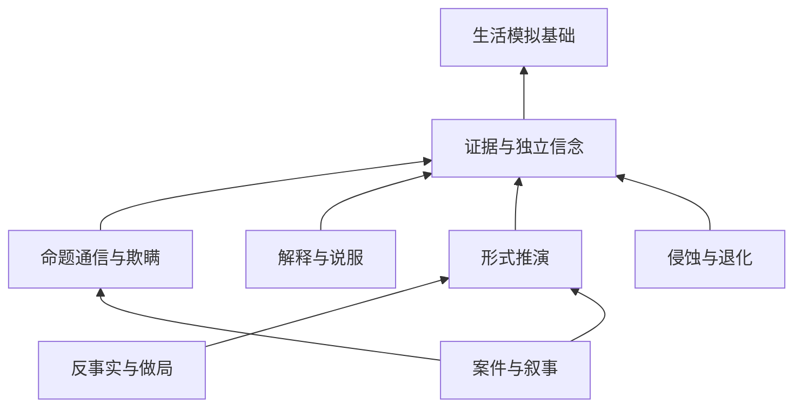

# Core 生活模拟基础与特色能力拆分

## 一、目标与边界

Core 分为生活模拟基础、特色扩展、共同基础设施。关闭全部特色扩展后，仍应形成“需求变化 → 发现物件与交互 → 自主选择或玩家命令 → 真实执行 → 生活效果结算 → 再次决策”的闭环；开启特色扩展后，在同一世界和行动状态机上增加人物信念、证据博弈、推演、做局、侵蚀与案件。

这是参照模拟人生类玩法和通用需求效用架构形成的项目设计，不是 EA 内部源码结构的复原。生活相似性指需求驱动、智能物件、日常社交和玩家干预；不要求首期复制全部家庭、经济、职业、生育和年龄内容。

客观事实与人物可用信息的隔离是所有模式的基础约束。关闭高级认知不把人物变成全知，也不把主观认知直接写成世界事实。C# 实现通用机制，人物、需求、世界规则、初始布置与模式内容由 DV 声明。

机器可读定义见 `tools/report/core_systems.json`；实施与实际验收记录见 `33 实施与验收.md`。这里的能力配置、模块端口和内容要求均为目标契约，不宣称已有同名 API 或 DV 字段。

## 二、先划生活模拟基础

| 系统 | 二级职责 | 所有权与边界 |
| :--- | :--- | :--- |
| B01 实体、客观状态与事务 | 实体字段生命周期；效果事务；快照修订 | 唯一客观状态及变化集；不保存人物猜测作为真值 |
| B02 时间、日历与世界事件 | 推进/暂停；定时条件事件；日程时间服务 | 游戏时间和事件队列；不依赖案件或侵蚀 |
| B03 需求、性格、情绪与状态效果 | 需求衰减满足；偏好权重；情绪/Buff | 当前生活状态和效用贡献；预测不结算真实收益 |
| B04 物件交互与基础感知目录 | 物件交互；基础观察/熟悉位置；候选与执行准入 | 提供角色可以考虑的动作；认得目标不代表能客观完成 |
| B05 生活自主决策与玩家队列 | 单步生活效用；手动/自主优先级；普通步骤与重选 | 选下一动作及生活任务；不要求形式证明或案件策略 |
| B06 行动执行、资源预留与结算 | 行动状态机；多人资源；真实完成/幂等结算 | 行走、对齐、工作、取消和完成；唯一效果提交链 |
| B07 逻辑空间、房间与通行 | 拓扑/门许可；逻辑位置/生命周期；交互几何契约 | Core 可达性与逻辑位置；Godot 负责真实物理移动与碰撞 |
| B08 日常社交与关系 | 交谈时序；社交结果；关系/熟悉度 | 普通聊天、友好/拒绝与社交需求；不要求生成案件命题 |
| B09 物资、持有、库存与经济 | 库存消耗；持有交接；货币账目 | 物资转移和账目事务；可先做食物/水/持有，不强制全经济 |
| B10 技能、日程、职业与生活目标 | 经验解锁；日程工作；生活目标 | 实际活动带来成长与生活进展；不把案件推演当晋升前提 |
| B11 住户、家庭与生命历程 | 住户/控制归属；健康失能；年龄阶段 | 角色生活归属和生命周期；普通健康不与侵蚀绑定 |

B01–B08 是首个生活闭环的核心职责，B09 至少提供生活必需物资；B10/B11 先保留已有任务、角色和健康子集，家庭扩展、完整经济、职业和年龄内容按游戏范围逐项接入。未启用相应生活内容时，可采用明确的无内容策略，不表示其类型职责已完成。

### 基础观察不等于高级证据推理

基础模式仍需知道自己是否饥饿、眼前有何物件、正常获知的床在哪里、门是否曾被发现，以及交互失败原因。这些可以保存在轻量观察和生活记忆中，不要求执行来源聚合、真假冲突推理或证明搜索。

B04 对外提供人物可用的只读观察；X01 开启后增强它的证据质量与可解释性。两种策略可复用底层字段类型，但基础路径不得为了读取床的位置等待高级推理任务。客观执行端始终检查真实门许可、库存、位置与资源占用。

### 生活自主策略

生活模式从物件提供的交互与需求收益出发，以需求效用、时间/距离、性格偏好和失败代价选取下一动作，执行前重校验。饥饿时“取食 → 进食”属于普通生活任务，不因关闭反事实模块而消失。

日常目标与简单手段目的规划属于基础选择；“假设他人相信某事，再制造证据诱导其行动”的模型与案件分支属于 X05。二者可以共享通用搜索工具，但不得共享不可关闭的案件评分或隐藏证据读取。

## 三、再加入本项目特色能力

| 扩展 | 二级职责 | 依赖的特色能力 | 关闭后的行为 |
| :--- | :--- | :--- | :--- |
| X01 证据溯源与独立人物信念 | 来源链；冲突/置信/时效；人物隔离/重载 | 无 | 用 B04 基础观察和有限生活记忆，不升级为全知 |
| X02 命题通信、信任与欺瞒 | 实际送达；信任/佐证；隐瞒/错误信息 | X01 | 普通聊天和关系变化继续；不产生案件证言和命题传播 |
| X03 人物解释、规范采纳与说服 | 个人规则；证据说服；采纳结果/隐私 | X01 | 保留生活偏好及普通社交接受/拒绝，移除高级证据门槛 |
| X04 形式推演与证明校验 | 命题规则；预算搜索；独立证书校验 | X01 | 无自动/手动形式推演；普通条件求值与任务完成继续 |
| X05 反事实模拟、策略与做局 | 假设分支；策略选择；逐步重校验 | X01、X04 | 单步生活效用与普通任务继续，不生成做局策略 |
| X06 源质侵蚀与认知退化 | 累积阶段；能力限制；遗忘 | X01 | 不装配侵蚀规则；普通疲劳、疾病、休息仍有效 |
| X07 案件、世界特色规则与叙事进展 | 能力要求；特色事件；章节结局 | X01、X02、X04 | 生活内容运行，不因缺证明/剧情结局卡死 |

X03 只有以消息说服时才需要 X02 提供实际通信结果；它可基于亲眼观察到的证据工作。X07 需要 X05 或 X06 的具体案件内容，必须额外声明相应能力要求；不能因为“案件”这个一级名称就强制打开全部扩展。

箭头表示依赖；基础层不反向依赖特色实现。图中只画特色主要依赖，完整基础依赖见 JSON/HTML。

### 世界规则与人物采纳必须分开

B02 执行客观定时/条件规则，例如普通物资变化和生活事件。X03 处理人物是否接受某个解释或规范；接受不直接改变客观规则。X07 可以按内容装配案件机关或其他特色客观规则，X06 装配侵蚀来源和后果。

关闭扩展时只卸下属于它的规则；不整个停掉 WorldRules、感知、时钟或行为系统。需要侵蚀的客观机关规则也必须声明 X06，不能只关闭遗忘，却留下失能/侵蚀伤害继续运行。

## 四、共同基础设施

| 基础设施 | 职责 |
| :--- | :--- |
| K01 DV 内容与能力装配 | 解析能力集合、模块依赖和内容要求；新局前构建可运行清单 |
| K02 会话门面与宿主端口 | CLI/Godot 统一观察、提交、推进和真实执行回报；能力变化不新建第二个世界 |
| K03 存取、版本与内容重载 | 保存能力集合、模块版本、内容哈希、随机状态和运行检查点；保留事实与证据 |
| K04 预算、审计与真实宿主验收 | 模块耗时/调用计数、原始回执与可归因失败；禁用模块无运行贡献 |

建议端口职责是“观察提供者、生活候选提供者、可选候选/评分贡献、动作阶段、效果事务、规则注册、状态检查点”。这是职责契约，不预先宣布已经有这些接口。生活候选必须始终有基础提供者；扩展只能显式贡献，不能以全局 Hook 偷偷替换生活行为。

## 五、能力配置和关闭语义

| 预设 | 启用扩展 | 玩法 |
| :--- | :--- | :--- |
| life 生活模拟 | 无 | 需求、物件、行动、日常交谈与生活目标 |
| cognitive 认知生活 | X01、X02、X03 | 加入证据、信任、解释与说服 |
| reasoning 推演与策略 | X01–X05 | 加入证明和反事实策略，不要求侵蚀或案件章节 |
| full 完整模式 | X01–X07 | 当前游戏特色全开 |

预设只是合法组合，不限制自定义组合。例如 X01+X04 可做无命题通信的推演玩法。非法组合如 X05 开、X04 关必须在新局前拒绝并指出依赖；不能静默开启用户关闭的模块。

关闭必须同时作用于服务/规则注册、事件与定时任务、候选和评分贡献、动作提交/结算、观察投影与 UI 可用性。UI01 推演面板在 X04 关闭时不提供推演操作；UI02 日常 HUD、UI05 书本和场景控制继续工作。隐藏面板不能替代 Core 拒绝不支持的意图。

生活模式需要可运行的生活内容包：不能继续加载必须解案才有食物、必须说服才能使用全部床铺的案件内容，再声称“扩展已关闭”。内容裁剪后须校验必需生活路线、角色、资源和目标；有禁用能力的强引用时明确报错，非必需内容可以在声明允许的条件下裁剪，并保留清单。

首期在新局固定能力，写入存档。存档继续使用原能力集合；内容热重载不偷偷改变能力。已有完整模式存档不能直接当 life 存档加载，也不自动恢复已被侵蚀删除的记忆。若未来支持中途切换，另行设计执行取消、占用释放、规则计时器卸载、缓存失效和状态迁移。

## 六、二级与整合验收

每个一级系统有三个二级验收职责，共 54 项，详见 JSON/HTML。基础模块可使用已验收依赖进行专项验收；不要求临时测试工程或合成状态。七条整合契约为：

1. life 正式新局实际完成吃喝睡、社交、资源争用；特色模块无注册和运行贡献。
2. 非法能力依赖和内容强引用在启动前明确拒绝。
3. 关闭 X05 后仍能自主生活和完成普通步骤任务。
4. 关闭 X06 后无侵蚀后果，但普通健康/疲劳继续。
5. 逐层开启认知、推演、策略，增加的行为有模块归因，基础行动链保持唯一。
6. 同模式存取保留执行与证据；能力/版本不匹配不能静默清空状态。
7. 基础不调用特色实现；构建边界、宿主调用计数、玩法结果分别报告。

全部使用真实正式新局与正常操作。自动测试用 CliMCP/GodotMCP，期限包含构建和启动并保持连接；AI/人工按 on/step/observe/close 串行操作。条件未到达、内容尚缺或观察不足记未覆盖，不注入状态、传送或用旧回放代替。

基础模式与完整模式可使用相同种子、相同共享生活内容作针对性对照，但开启认知会改变行为，不要求两条长期轨迹逐帧相同。共用动作的结算规则、暂停语义、占用释放和隐私边界应一致。

## 七、参考资料

资料检索日期：2026-11-10。

- [EA：Ways to Start Playing The Sims 4](https://www.ea.com/games/the-sims/the-sims-4/how-to-play-the-sims)：生活玩法范围参照。
- [Ian Horswill：Needs-Based AI](https://ianhorswill.github.io/DPGD/Needs-based_AI.html)：需求效用和物件交互广告的通用技术模式。
- [EA Help：Skills](https://help.ea.com/en/articles/the-sims/the-sims-4/skills/)：活动、技能成长与解锁的类型边界。
- [EA Help：Careers](https://help.ea.com/en/articles/the-sims/the-sims-4/the-sims-4-careers/)：日程、职业与晋升职责参照。
