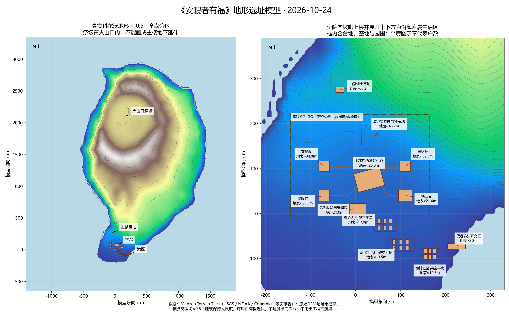
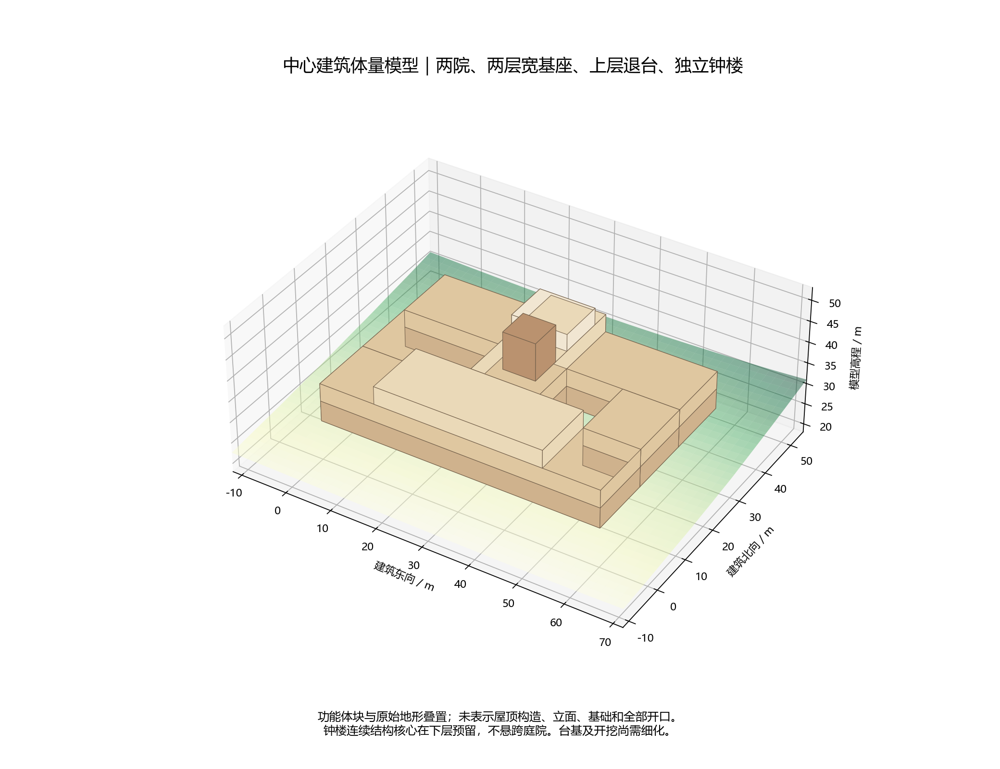
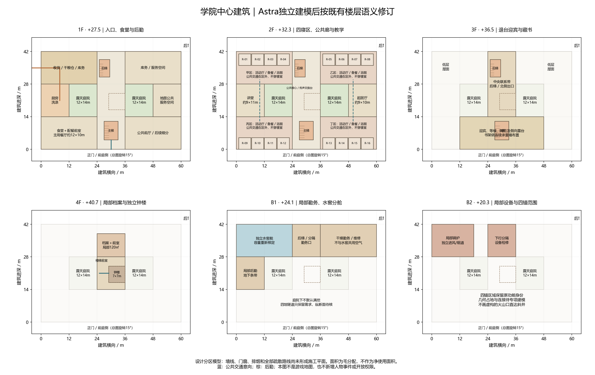
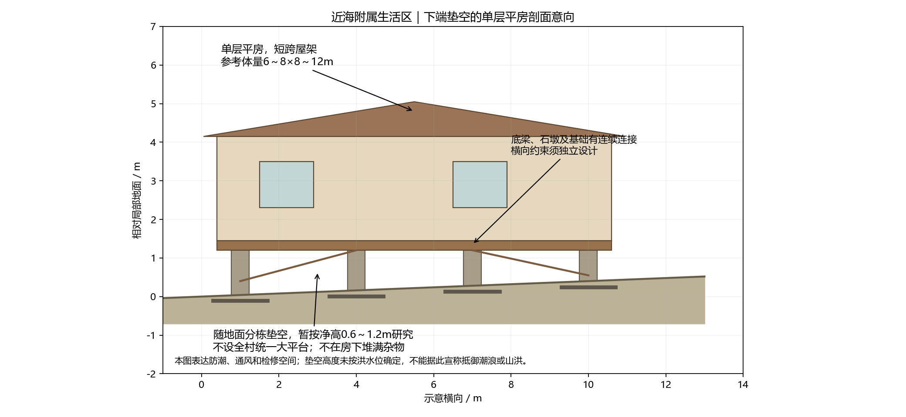
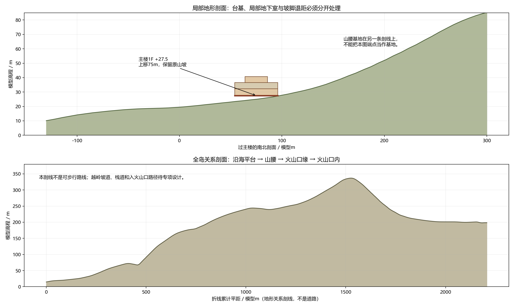

# 学院地形与中心建筑模型

本次空间设计依据：2026-10-24 用户要求，以现实地形图适当缩放；中心建筑位于离海岸有一定距离、尚未进入陡峭山坡的过渡地带；学院建筑群扩大并适度向坡脚上方移动；近海低洼地带另布置维护人员和岛民生活的下端垫空平房群；渔村、货运码头、山腰修士基地与火山口祭坛分别布置。本轮不修改游戏代码，不采用附件新增的人物关系、事件日期、手术后遗症或行为分支。

本文件是第一、二、三部设计案中**地形、高程和建筑组织的统一依据**。平面属于设计分区模型，非施工图；下列“候选”参数不等同于用户逐项批准或工程验证。人物、契约、事件时间和结局仍由各部原正文规定，空间修改不自动改变它们。

## 一、现实依据与取用方式

### 地形

采用现实科尔沃岛地形，而非按附件的建筑图反造山体。亚速尔地质公园说明，Vila do Corvo 位于南部玄武质熔岩平台，平台北侧由古海崖界定。这支持“沿海低地—平台—坡脚—山腰”的空间序列，不能把岛简化成从海岸均匀上升的圆锥。[地质公园地形说明](https://dev.azoresgeopark.com/geossitio/faja-lavica-de-vila-do-corvo/)

本轮取得的数值底图为 [Mapzen Terrain Tiles](https://registry.opendata.aws/terrain-tiles/) 的 Terrarium 高程瓦片，下载日期为2026-10-24。采用z=13的六块原始PNG，不对山体或平台做手工抬升。解码按发布者说明：`高程米 = R×256 + G + B/256 − 32768`。[发布者格式说明](https://github.com/tilezen/joerd/blob/master/docs/formats.md)

- 原始瓦片、下载地址与SHA-256：[来源清单](../../artifacts/campus-architecture-review/terrain-source/manifest.json)。
- 原始编码拼图：[corvo-terrarium.png](../../artifacts/campus-architecture-review/terrain-source/corvo-terrarium.png)，它是高程数据，不是自然色地形图。
- 本轮设计坐标与参数：[campus-model.json](campus-model.json)。这是设计数据，未被游戏读取。
- 瓦片在该纬度约14.7米/像素；这是输出采样间距，**不是实测精度**。发布者使用SRTM等多来源地形，瓦片不提供逐像素来源身份；不将其宣称为亚速尔官方10米MDT或高分辨率LiDAR。
- 仅适合地貌与候选体量判断，不能据此认定边坡稳定、地下水、岩层、可开挖性或基础安全。由近零高程估计的岸缘不是测绘海岸线，水下数值不作为港池测深。
- 现实聚落、机场和既有建筑不复制进世界观。本模型借用地形，重新放置架空建筑；图中橙色建筑均是设计覆盖，不是现实建筑测绘。

署名：Mapzen；地形贡献者包括USGS的SRTM/GMTED2010、NOAA的ETOPO1以及欧盟Copernicus EU-DEM。各来源许可及署名依发布者[归属说明](https://github.com/tilezen/joerd/blob/master/docs/attribution.md)保留；此处不将组合数据概称为同一种许可。

### 官邸与学院

Astra 按主代理提供的功能边界独立研究，未读取两份修订附件、`svg.html`或项目设计正文。初稿提出院落与前后交通分离；主代理核对原设计后撤回其“寝区放1F”的初始建议，要求保留既有楼层身份，再由Astra修订。采用的是空间原则及经过核对的分区，不照搬某一现实建筑。

- [Pembroke College 官方建筑史](https://www.pem.cam.ac.uk/college/about-pembroke)：院落可组织教学、居住、厅堂及厨房，学院无需由分散的现代校舍组成。
- [美国国家公园署 Vanderbilt Mansion 房间说明](https://home.nps.gov/vama/learn/historyculture/rooms-and-furnishings.htm)：独立服务交通、工作房间与主人空间的分工，作为官邸后勤组织参考。
- [Biltmore 官方传菜间说明](https://www.biltmore.com/blog/exploring-the-butlers-pantry/)：厨房、配餐及垂直运输相互配合；不据此把传菜设备变成可供人通行的井道。
- [NPS 历史建筑潮湿控制](https://www.nps.gov/orgs/1739/upload/preservation-brief-39-controlling-moisture.pdf)：屋面落水、地表排水、地下水分开处理，作为排水原则参考。

## 二、缩放、坐标与选址

地形水平和高程统一乘 **0.5**；地形坡度不因单独压缩某一轴而改变。建筑、人物、门宽、楼梯与设备保持正常人尺度，不能跟随岛屿缩小。缩放后重新核对建筑占地，不能借用缩放前的可用面积。

取WGS84经纬度 `(-31.115500, 39.673250)` 为固定局部水平原点；这是坐标基准，不再等同于上移后的主楼中心。高程原点保持数据的零高程，**不减去主楼地面高程**。局部米制近似：

```text
东向 x = 0.5 × (经度 − 经度原点) × 111320 × cos(原点纬度)
北向 y = 0.5 × (纬度 − 纬度原点) × 111320
模型高程 z = 0.5 × 原始DEM高程
```

这是本岛范围的局部等距近似，不宣称为正式测绘投影。“模型+27.5米”不等于现实海拔+27.5米；现实数据、缩放地形和新建筑完成面必须分别标注。



| 对象 | 模型中心(x,y)，米 | 原始DEM中心高程，约米 | 缩放地表中心，约米 | 建筑/用途候选 |
| --- | --- | ---: | ---: | --- |
| 学院中心建筑 | (30,75) | 50.0 | 25.0 | 1F完成面+27.5；60×42米外包，旋转15°顺应等高线 |
| 文契院 | (−70,105) | 69.6 | 34.8 | 24×24米分台占位；1F候选+37.0 |
| 白塔院 | (110,105) | 64.6 | 32.3 | 24×24米分台占位；1F候选+35.5 |
| 星仪院 | (−70,40) | 46.9 | 23.5 | 24×24米占位；1F候选+26.0 |
| 铁工院 | (110,40) | 42.8 | 21.4 | 30×24米占位；1F候选+25.0 |
| 维护人员平房区 | (65,−25) | 34.0 | 17.0 | 50×30米组团用地，不是单栋大房 |
| 岛民平房区 | (100,−70) | 27.1 | 13.5 | 60×28米组团用地，分栋垫空 |
| 渔村低区 | (165,−90) | 20.9 | 10.5 | 40×25米组团用地，滑道及泊艇另到低岸 |
| 学院后勤收货/维修院 | (5,10) | 42.0 | 21.0 | 36×24米占位，向学院侧后方转运 |
| 坡地实验圃与预留地 | (40,170) | 86.3 | 43.2 | 55×35米范围，不削平为整片大温室 |
| 货运码头研究区 | (223.7,−72.7) | 4.5 | 2.2 | 高位作业面暂按+4.5，占位40×12米；不表示泊位已核准 |
| 山腰修士基地 | (−35,275) | 132.6 | 66.3 | 18×12米占位；完成面暂按+68.0 |
| 火山口内祭坛 | (150,2100) | 397.0 | 198.5 | 12×12米占位；干式台面暂按+199.5 |

数值保留到0.1米只用于模型内部对应，不表示具有0.1米精度。主楼候选中心WGS84约为`(-31.114800,39.674597)`，与码头中心直线模型距离约244米，实际货路更长；主楼位于较平缓平台内缘，而非海滩、海崖缘或山腰台地。基地的+68米是山腰独立选址，不是将被否决的“主楼+68米”换名保留。

主楼上移后不再追着陡坡继续加高。原正向60×42米占地的格网起伏约5.9米；比较长边方向0°、15°、30°、45°、60°、75°和90°后，15°候选起伏约4.8米（+23.1～+27.9），比正向略小。比较仅反映此格网，不是土方工程最优解。1F+27.5意味着上坡侧局部开挖、下坡侧台基或局部露出的B1；不把整片地填到最高角，也不让同一1F在各翼任意错层。B1应在实际有覆土处局部设置，低侧不自动认定全埋。北侧预留截水及检修带，不把背墙贴进陡坡。当前分辨率尚不能确定最近小沟谷、坡脚线和最终退距。

学院总用地研究包络为模型x=−145～165、y=−10～220，约310×230米、7.13公顷；这是含自然坡、庭院、实验圃、维修通道和预留地的外包范围，不是同面积平整台地、围墙红线或全可建设面积。核心主楼不盲目放大，四馆与附属后勤展开并沿坡分台。较高分馆占地内仍有明显高差，须拆分较小结构单元或调整位置，当前矩形不表示已经批准开挖成整块平地。

四馆顺等高线错位，不再要求地上四馆严格成正方形；地下四锚仍保留原设定的功能身份，但不以四馆地基的垂直投影自动证明“四锚镜像”谜题。该几何关系必须另建可解释的测量坐标与线索，完成前不能声称既有谜题条件已经保持。

## 三、中心建筑平面与剖面

### 体量和功能

采用60×42米两院官邸式学院。建筑局部坐标轴随总图旋转15°，以建筑前左角为(0,0)，西院净空为x12～24、y14～28，东院净空为x36～48、y14～28，均为12×14米露天院；墙柱和回廊从周围建筑带占地。完整层扣院后的毛面积约2184平方米，尚未扣墙和交通；这是16人之外兼有教学、官方接待、后勤与档案用途的建筑上限分配，不是净使用面积。





| 层位 | 相对1F标高 | 模型完成面 | 功能及体量 |
| --- | ---: | ---: | --- |
| B2局部 | −7.2 | +20.3 | 局部锅炉、设备与原四锚功能；不满挖两庭院下方 |
| B1局部 | −3.4 | +24.1 | 勤务、维修、独立水窖舱；四馆联系先保留需求 |
| 1F | ±0.0 | +27.5 | 入口、食堂、厨房、配餐、干粮仓、收货与公共服务空间 |
| 2F | +4.8 | +32.3 | 甲乙丙丁四个独立四人寝区、讲堂、起居厅、公共交通与传声交换台 |
| 3F退台 | +9.0 | +36.5 | 迎宾、藏书阅览、露台与必要交通，不满铺四角寝区屋顶 |
| 4F局部 | +13.2 | +40.7 | 名录库及前室、独立钟楼联系，不形成完整第四层大平面 |

1F层间4.8米，其上主要层间4.2米；净高须再扣梁板与设备空间。局部4F屋檐暂按相对1F+17.2米、钟楼顶暂按+22米作体量研究。钟楼实际钟架、楼梯、声振分隔与屋顶形式待定，图中平顶体块不是最终立面。

2F四寝区仍使用原房号：建筑局部后左甲R-01～04、后右乙R-05～08、前左丙R-09～12、前右丁R-13～16；局部方向不冒充精确地理方位。各区占角部24×14米的最大分配范围，包含门前公共交通；不要求室内用满。图中的卧室格仅表示房号和外墙采光，不作为最终净尺寸。区内应另细分活动厅、备餐、浴厕、储藏和前室，不能仅凭分区框认定房间已全部排布完成。

公共回廊走寝区外侧，讲堂、食堂、起居厅及四馆交通不能穿过卧室或寝区活动厅。四寝区原有气闸、内外门和封锁语义保留；窗户、通风口及次出口的具体安全边界需与既有密室条件共同核对，不能因画出另一条路就自动宣布可以绕过门禁。

### 礼仪、后勤与垂直交通

前庭—正门—主梯/公共回廊组织日常和礼仪交通；侧后方收货—粮仓/厨房—配餐—食堂组织后勤。主梯连续占位约6×8米，后梯约4.5×7.5米，各自通向不同外部方向。1F至2F的4.8米高差可用约28级踏步分两跑研究，后续层约24级；图示只留洞口和体量，不能据此宣称完成疏散设计。

钟楼7×7米连续结构核心预留在中央带x29～36、y17～24，不悬跨东庭院；名录库位于北中央局部，避免处在钟架正下方。上层书架及档案荷载沿下层连续墙柱落地，不以12米庭院或大讲堂无支撑大跨度承重。

厨房—上层备餐间设置独立小型传菜井，尺寸依设备确定，不供人物通行。原故事涉及的绕行，在建筑上改用**传菜井旁独立的旧后勤检修楼梯/通道**；它与餐梯、烟道物理分开，具体门口和锁闭条件待绘，不新增任何人物的知情、权限或事件结果。不得以一条全楼贯通的隐藏通道自动消解既有封锁。

保留服务走廊、后梯及局部旧结构夹道，不采用所有1.8米厚外墙均含1.1米通廊的说法；墙体还需承担结构、保温、烟道和防火分隔。**不采用2.5F监听夹层和窥视孔**，传声交换台保持2F公共核心身份，本轮不新增监听剧情。

### 潮湿与设备

上坡截水、院落排水、屋面落水和水窖溢流分系统，院落有通向外部的可见溢流方向，雨水不直接流进B1。水窖独立水密舱，与干粮仓、档案和干燥勤务区分开。原5600立方米水窖若以约300平方米舱面积放置，将要求近19米水深，不能塞进3.4米层间；**该容量不在新建筑模型中沿用，人数、用水、降雨和有效容积另行核算**。

锅炉局部设置在B2后勤边缘，保留独立补风、排烟、运煤除灰及设备搬运路径的设计要求；当前平面未完成这些系统的布置，不声称B2设备已可运行。烟道不能借楼梯、书库、中庭或四馆隧道排放。厨房、浴厕、锅炉与实验馆排风分开。密闭连廊不是天然的防火或防毒屏障。

## 四、四馆、港村、山腰与火山口

### 四馆连接

四馆独立，现有文契、白塔、星仪和铁工功能身份不变。文契、白塔、星仪各24×24米、铁工30×24米仅为候选体量；危险实验的隔离距离和内部净空尚未核定。主楼与四馆的展开间距是布局意向，不表示已满足某项安全标准。

2F连廊从主楼公共前室出发，经过有分隔的馆端前室，不直接穿寝室或进实验间。各馆地面高程不同，不能把主楼2F+32.3一律标成馆2F。当前候选馆1F分别为+37.0、+35.5、+26.0、+25.0米，需馆端楼梯/前室或调整选址解决。图上虚线只表达联系意向，端点和坡度尚未通过设计审查。

B1地下勤务联系同样按各段地表、覆土和最低积水点设计；较低的星仪/铁工附近可能出露，不能将主楼B1+24.1米水平画过去就称地下隧道。四馆地上联系和地下联系必须分别提供纵断面后，才能作为新游戏几何依据。

### 沿海渔村与货运码头

维护人员、岛民生活区及渔村低区共同组成近海低处的附属建筑群，与上坡学院主体分开。各处采用**单层平房、分栋小跨、下部垫空**，不是把学院宿舍缩小后搬到岸边。维护人员居处靠近勤务上坡路线；岛民居处与渔用小路、公共空地联系；渔具、艇库、小艇滑道再向低岸过渡。不把所有住房压在风浪直接拍击的码头面或主汇水线上，不新增居民姓名、人数与剧情。

单栋参考6～8×8～12米，石墩/基础、底梁与屋架保留连续连接，分栋按局部地面设置台阶。下部净高暂按0.6～1.2米表达防潮、通风和检修，不据此承诺抗潮浪、洪水或冲刷；相关水位尚未确定。上部不能只是松放在石块上，基础承载、横向稳定、连接和抗冲刷分别设计。房下不堆满柴、粮或围成房间，房间之间保留过水间隙。图中平房数量仅为组团示意，不代表世界设定户数。



货运路线按码头暂存—绕生活区外围的运输路—学院侧后收货院组织；居民与维护人员使用公共小路和上坡步道，不让煤灰、垃圾和卸货运输穿过住宅正门或学院仪礼前庭。道路应顺坡迂回，穿越汇水处留桥涵或过水处理；不画成从码头直冲山坡的陡路，不以连续路堤围住住宅低洼区。

港区以现实Porto da Casa坐标定位，另设计抬高的作业平台、后方仓储和至学院收货院的货路。现实港务局资料给出80米总码头、约4米水深及最大约3米吃水的概述，明细又区分不同泊位，不能据此宣称可停大型远洋船。[港务局资料](https://portosdosacores.pt/portos/porto-do-corvo/)

本轮采用“货运与渔用分区、码头有高位作业面”的原则，**不批准具体货轮泊位能力**。暂按40×12米、+4.5米作业面画研究占位；其 footprint包含水陆交界，不能按陆上地基处理。抬高台面不增加水深，水下地形也不能随意沿用缩放后的全球海底格网。船长、吃水、潮位、护舷、系泊、防波和港池测深仍须确定；完成前不把“货轮可停靠”写成已核验事实，也不自行替用户限定船型。

### 山腰基地与火山口祭坛

修士基地在主楼以北约275模型米的山腰候选面，地表约+66.3米。保持原有石堡、丹房等功能；自流泉、羊圈、储备量和防御构造未由DEM证明，仍需分别作为设计条件核对。18×12米的基地体块不包含全部附属设施。

火山口内祭坛放在真实火山口内部候选区域，模型地表约+198.5米；不预设在湖底，也不把地形栅格解释成湖深。是否取干岸台地、避开湿地与水面，需要更细底图，+199.5米台面只是候选。



真实火山口内部仍高于沿海学院。原“-40米湖底、B3从主楼地下直达、钟楼索道直接降入火口”的空间说明失效；不能用整体平移或改楼层名掩盖山脊。通行关系改为**学院—山腰基地—火山口缘—火山口内**的分段设计需求，越岭、下降和局部防护廊须独立设计。图中的关系剖线不是道路，不表示已找到可步行坡度。原文丘里、沸石和正压等防护构想仅保留为局部通道待核方案，不再声称一条长廊已具完整可达性和防护能力。

## 五、源质空间约束与待定事项

现有五阶段、日期和人物选择不在本轮改写。旧+5.5、+16.5、+18米液面，以及附件+70～+86米液面均不能直接用于本模型；应分别按受影响地点的局部浓度、门窗、风和地势重新建立灾害分区。**沿海学院、+68米基地和+199米祭坛不共享一个低位水平雾面就能同时受淹**。本轮不虚构山腰封闭盆地、地热虹吸机制或新的涨潮数值来保证旧剧情自动成立。

因此“第18日首次淹1F”“第五章淹连廊”“高处基地维持可用”“第六章进入危险祭坛”等原有空间目标保留为需要重新满足的设计约束，尚未由此模型证明可以同时实现。进入剧情实现前，应单独审定源质来源、局部扩散与各事件空间前提；不改变人物设定来填补地理矛盾。

本轮完成的是现实地形取用、缩放与候选选址，中心建筑功能/体量模型，以及不合格附件要素的取舍。尚未完成的是施工平面、全部门窗与锁闭拓扑、四锚镜像线索、四馆连接纵断面、港池和船型、火山口通行及源质空间模型；不声称建筑施工合格、游戏几何合格或游戏验收完成。
