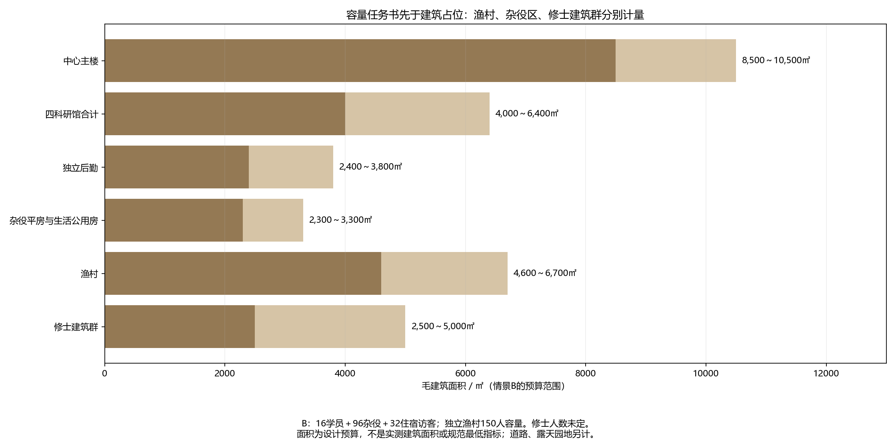
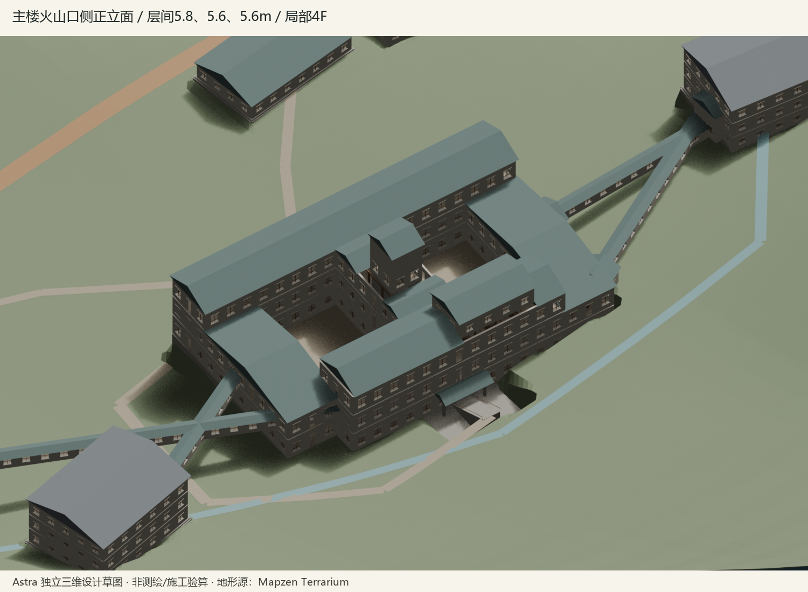
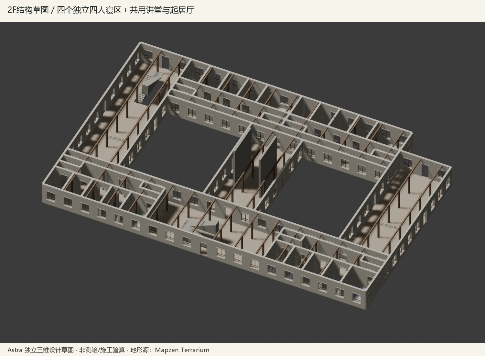
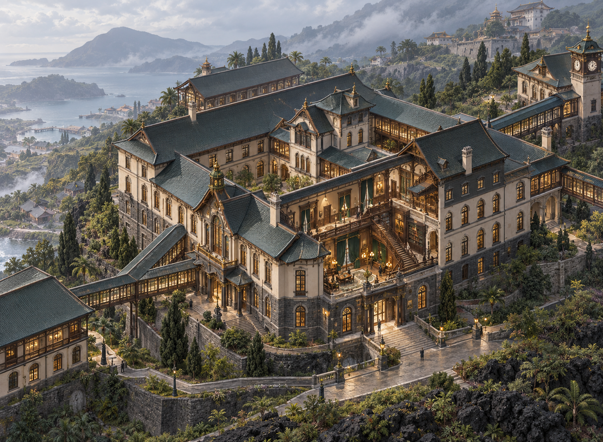
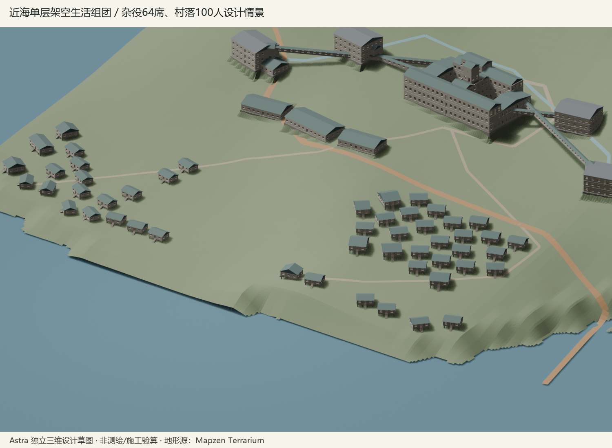

# 学院地形与中心建筑模型

本次空间设计依据：2026-10-24 用户最新要求，真实地形水平长宽各乘0.5、总面积为原来四分之一，高程不压缩；由Astra实际绘制三维草图，建筑群不排成规则方阵，并设计基本建筑结构；中心建筑位于离海岸有一定距离、尚未进入陡峭山坡的过渡地带；学院不仅服务16名学员，还承担科研、奢华生活娱乐、住宿接待及至少数倍杂役的生活；渔村需要几十至上百人规模，修士基地是约110米高程的建筑群。学院建筑群扩大并适度向坡脚上方移动；近海低洼地带另布置维护人员和岛民生活的下端垫空平房群；渔村、货运码头、山腰修士基地与火山口祭坛分别布置。本轮不修改游戏代码，不采用附件新增的人物关系、事件日期、手术后遗症或行为分支。

本文件是第一、二、三部设计案中**地形、高程和建筑组织的统一依据**。平面属于设计分区模型，非施工图；下列“候选”参数不等同于用户逐项批准或工程验证。人物、契约、事件时间和结局仍由各部原正文规定，空间修改不自动改变它们。

## 一、现实依据与取用方式

### 地形

采用现实科尔沃岛地形，而非按附件的建筑图反造山体。亚速尔地质公园说明，Vila do Corvo 位于南部玄武质熔岩平台，平台北侧由古海崖界定。这支持“沿海低地—平台—坡脚—山腰”的空间序列，不能把岛简化成从海岸均匀上升的圆锥。[地质公园地形说明](https://dev.azoresgeopark.com/geossitio/faja-lavica-de-vila-do-corvo/)

本轮取得的数值底图为 [Mapzen Terrain Tiles](https://registry.opendata.aws/terrain-tiles/) 的 Terrarium 高程瓦片，下载日期为2026-10-24。采用z=13的六块原始PNG，不对山体或平台做手工抬升。解码按发布者说明：`高程米 = R×256 + G + B/256 − 32768`。[发布者格式说明](https://github.com/tilezen/joerd/blob/master/docs/formats.md)

- 原始瓦片、下载地址与SHA-256：[来源清单](../../artifacts/campus-architecture-review/terrain-source/manifest.json)。
- 原始编码拼图：[corvo-terrarium.png](../../artifacts/campus-architecture-review/terrain-source/corvo-terrarium.png)，它是高程数据，不是自然色地形图。
- 本轮设计坐标与参数：[campus-model.json](campus-model.json)。这是设计数据，未被游戏读取。
- 瓦片在该纬度约14.7米/像素；这是输出采样间距，**不是实测精度**。发布者使用SRTM等多来源地形，瓦片不提供逐像素来源身份；不将其宣称为亚速尔官方10米MDT或高分辨率LiDAR。
- 仅适合地貌与候选体量判断，不能据此认定边坡稳定、地下水、岩层、可开挖性或基础安全。由近零高程估计的岸缘不是测绘海岸线，水下数值不作为港池测深。
- 现实聚落、机场和既有建筑不复制进世界观。本模型借用地形，重新放置架空建筑；图中橙色建筑均是设计覆盖，不是现实建筑测绘。

署名：Mapzen；地形贡献者包括USGS的SRTM/GMTED2010、NOAA的ETOPO1以及欧盟Copernicus EU-DEM。各来源许可及署名依发布者[归属说明](https://github.com/tilezen/joerd/blob/master/docs/attribution.md)保留；此处不将组合数据概称为同一种许可。

### 官邸与学院

Astra 按主代理提供的功能边界独立研究，未读取两份修订附件、`svg.html`或项目设计正文。初稿提出院落与前后交通分离；主代理核对原设计后撤回其“寝区放1F”的初始建议，要求保留既有楼层身份，再由Astra修订。采用的是空间原则及经过核对的分区，不照搬某一现实建筑。

- [Pembroke College 官方建筑史](https://www.pem.cam.ac.uk/college/about-pembroke)：院落可组织教学、居住、厅堂及厨房，学院无需由分散的现代校舍组成。
- [美国国家公园署 Vanderbilt Mansion 房间说明](https://home.nps.gov/vama/learn/historyculture/rooms-and-furnishings.htm)：独立服务交通、工作房间与主人空间的分工，作为官邸后勤组织参考。
- [Biltmore 官方传菜间说明](https://www.biltmore.com/blog/exploring-the-butlers-pantry/)：厨房、配餐及垂直运输相互配合；不据此把传菜设备变成可供人通行的井道。
- [NPS 历史建筑潮湿控制](https://www.nps.gov/orgs/1739/upload/preservation-brief-39-controlling-moisture.pdf)：屋面落水、地表排水、地下水分开处理，作为排水原则参考。

## 二、先核容量，再定地形尺度与选址

### 容量任务书

此前以“16名学员”为主要基数缩小建筑群的判断撤回。16人只约束原四寝区，不是整座学院的人口和服务规模。科研设备、准备与储存、奢华公共生活娱乐、接待客房、厨房及餐饮、供应维护、杂役正常生活空间都必须进入面积账。

用户要求杂役至少为学员数倍、渔村几十至上百人。为检查空间，使用两组**设计容量情景**；它们不新增常住人口或人物名单，修士人数不推定：

| 情景 | 学员 | 杂役住宿容量 | 同时住宿访客 | 学院服务容量合计 | 独立渔村容量 |
| --- | ---: | ---: | ---: | ---: | ---: |
| A | 16 | 64 | 16 | 96 | 100 |
| B | 16 | 96 | 32 | 144 | 150 |

杂役分别安排到学院生活区或村落时，同一人不能两次计入常住人口。访客是接待容量，不是新增注册学员。修士建筑群的现存用途与人口另定，不从占地反推人数。

Astra按补充任务书独立核算的面积预算如下。毛建筑面积含墙、交通和设备及地下楼面，露天院落不计入；用地含分区道路、院落及退距。数值是设计研究预算，不是规范最低指标或实测面积。

| 分区 | A毛建筑面积㎡ | B毛建筑面积㎡ | A用地公顷 | B用地公顷 |
| --- | ---: | ---: | ---: | ---: |
| 中心主楼，含局部地下层 | 7500～9000 | 8500～10500 | 0.9～1.5 | 1.0～1.8 |
| 四科研馆合计 | 4000～6400 | 4000～6400 | 1.4～2.4 | 1.4～2.4 |
| 独立后勤建筑 | 1800～3000 | 2400～3800 | 0.6～1.0 | 0.8～1.3 |
| 杂役平房及生活公用房 | 1600～2200 | 2300～3300 | 1.0～1.8 | 1.4～2.4 |
| 校园共用道路、园地、缓冲地 | 不另计楼面 | 不另计楼面 | 2.0～4.0 | 2.5～5.0 |
| **学院合计，村落和修士另计** | **14900～20600** | **17200～24000** | **5.9～10.7** | **7.1～12.9** |
| 独立渔村 | 3100～4500 | 4600～6700 | 2.0～3.5 | 3.0～5.0 |
| 约110米修士建筑群 | 2500～5000 | 2500～5000 | 1.5～3.5 | 1.5～3.5 |



情景B合计毛建筑面积约24300～35700平方米，其中包含独立村落与修士建筑群；不是把整座岛的所有人塞进一栋主楼。学院厨房、洗衣、清洁、燃料与库存按96/144人的学院服务容量研究，而非只算16人的餐桌。需要轮班或分时的运营方式不能被默认用来压掉面积。

住宿访客16/32人必须落实为客房及服务空间：若双人住宿约需8/16间，若独住则需16/32间；接待标准尚待选择，不能只画迎宾大厅便声称接待容量已满足。奢华生活娱乐先保留可同时使用的公共功能预算和服务交通，不自行把具体泳池、剧院等项目写成既定设施。

### 地形尺度与三维建模口径

用户现指定：**水平长宽各乘0.5，高程保持1.0，总面积为原来四分之一。**这取代此前统一三轴缩半的方案，也取代上一阶段按1:1排布的临时决定；人口、建筑功能与人尺度不能随土地面积一起缩小。

原点仍为WGS84 `(-31.115500,39.673250)`，局部坐标转换为：

```text
东向x = 0.5 × (经度−原点经度) ×111320×cos(原点纬度)
北向y = 0.5 × (纬度−原点纬度) ×111320
高程z = 原始DEM高程
```

这是一种明确的非等比地形变换，不保留原坡度：相同高差的水平距离减半，坡度正切增为约两倍。道路、基础和分台必须按变换后的地形重新设计，不能继续宣称使用“原坡度”。高程数据精度不因不缩放而提高。

本轮由Astra直接建立可编辑三维模型，群体随等高线错位、采用折转翼楼与不规则院落，不套用规则方阵；单体的合理柱网、直墙和矩形房间不因此禁止。主楼主轴、正门与主要礼仪立面必须正对火山口方向，海岸侧作为后侧；群体不必因此变成轴对称方阵。朝向须由地形与火山口位置确定，不把北向图标当作已经核对的轴线。最低结构内容包括墙体、楼板、屋顶、实际开口、楼梯和连续支承，以及近海平房的架空基础。模型仍属设计草图，不是施工验算。

上一阶段17.6公顷原尺寸外包、1:1坐标和各楼完成面已经失去现行选址依据；不能直接把包络面积除以四便声称容量仍成立。最终选址及实际几何面积以本轮Astra模型清单为准，较高容量情景未落位的功能要明确列出。

## 三、Astra三维草图的结构与审读范围

模型须按新地形重新组织，不再锁定60×42米双院矩形。群体沿等高线错位、折转翼楼与不规则院落组织，避免四馆、宿舍和住宅群被排成一张方阵；单体内部仍可采用合理正交柱网和矩形房间。

必须保留原有功能楼层身份：1F食堂、厨房与粮仓；2F四个独立四人寝区、讲堂与起居；3F迎宾、住宿接待、藏书与相应公共生活；4F局部名录库和钟楼；局部B1勤务及水窖、局部B2设备与原四锚功能。模型不增加2.5F监听层，不新增人物行为和知情权限。

三维草图最低应提供以下可见结构，而非用彩色方盒代替：

- 墙体有厚度，门窗是实际开口，入口能对应室内空间；房间、公共走廊和独立寝区边界可在切开视图中辨认。
- 楼板、承重墙/柱与基础有连续关系，书库和档案不悬跨无支承庭院；钟楼有贯穿下层的结构核心，不直接压在档案室或采光院上。
- 各层楼梯、平台与楼板洞口相应，层高与踏步需相容；主客与后勤交通分开，去公共设施不穿寝区。
- 坡屋顶应交代屋架/支承方向与落水边界，不能只给每栋方盒加一个悬空三角顶；排水、采光和厨房/设备排烟分别留有结构位置。
- 主楼下坡侧局部B1露出、上坡侧入土与挡土要和原地形分别表达。四馆分台后，连廊接入层与隧道覆土逐条核对，不能靠同一层号掩盖高差。
- 近海平房采用真实石墩/基础、底梁、楼板与必要侧向约束，保留架空层。修士建筑群由多个建筑、院落及路径组成，公共核心处于约110米高程附近。

传菜井与供人通过的后勤检修通道保持物理分开，烟道不供人通行。水窖独立水密分舱，与粮仓、档案和干燥勤务空间隔开；容量按完整服务人数核算，不能默认把旧5600立方米塞入普通层高。

切开图、几何清单和三维模型共同用于本轮设计审读；可见结构仍不代替基础、抗震、消防或设备工程验算。原有密室的完整门禁条件、四锚谜题线索与最终游戏可达性另行核对，本轮不更新游戏代码。

### 当前三维交付与主楼朝向、挑高

Astra已直接生成[Blender可编辑源场景](../../artifacts/campus-architecture-review/astra/astra_campus.blend)和[GLB三维模型](../../artifacts/campus-architecture-review/astra/astra_campus.glb)，逐栋位置、完成面、楼层与面积见[实际模型清单](../../artifacts/campus-architecture-review/astra/model_manifest.json)。这些是设计模型，不是游戏场景。

主楼采用五个错位翼部组合，局部两层与三层结合，4F档案和钟楼局部设置；四馆、后勤、杂役住宅、村落和修士群分别顺坡落位，不套规则方阵。局部翼长与柱网服务房间与交通，不能把“不规则”理解成所有房间都扭斜。

主楼主要层间采用**5.8米、5.6米、5.6米**，档案层4.8米；这是本轮建筑提案的层间尺寸，不是扣除梁板后的净高。高窗、楼梯双跑/平台与上层楼板洞口同步调整，不只拉高立面。

本轮完成面采用1F+49.0米、2F+54.8米、3F+60.4米、局部4F+66.0米，局部B1+44.8、B2+40.6米；这些是模型提案，基础与土方尚未工程验算。

主楼正门和礼仪立面朝火山口，主轴以局部代表点(230,2060)确定，相对主楼中心(30,66)约为**真北顺时针5.73°**。该点是DEM内火山口洼地的方向代表，不宣称为精测几何中心；轴线朝向不表示可以越过山脊看见湖底。海岸侧作为后侧和后勤到达方向。





二层图表达16个学员卧室、四区前室、内部廊与活动/备餐/盥洗小间，以及区外公共讲堂和起居交通。图中的S01～S16是模型索引，不自动替代原设计房号或人物位置；门锁、声学与密室条件尚须逐项匹配，不能据此宣称剧情空间验收通过。

| 几何分区 | 当前模型毛楼面约㎡ |
| --- | ---: |
| 主楼含局部地下层、局部档案与钟楼 | 8804 |
| 四科研馆 | 6240 |
| 独立后勤 | 1976 |
| 杂役生活区 | 1828 |
| 学院上述合计，不含桥头接口 | 18848 |
| 村落 | 3287 |
| 修士建筑群 | 3296 |

本轮模型按情景A（16学员、64杂役、16住宿访客、独立村落100人容量）配置；**情景B新增32杂役、16访客和50村民的空间尚未落位**。人口都是容量研究，不新增人物；毛楼面统计也不证明运营、交通、防灾或所有净房间需求已经满足。

### 图像生成参考，单独使用

用户要求后，由Astra使用内置imagegen，以自己更新后的北侧外观与二层切开图为参考生成下图，未使用旧SVG。它用于参考中西官邸气质、高挑门窗、木作黄铜与深绿内饰，不用于证明地形、朝向、房间数、楼层尺寸或结构成立；不能反向覆盖三维清单。[完整生成提示词](../../artifacts/campus-architecture-review/astra/concept_prompt.txt)。



## 四、四馆、港村、山腰与火山口

### 四馆连接

四馆独立，现有文契、白塔、星仪和铁工功能身份不变。分馆体量按每馆约1000～1600平方米毛楼面研究，具体足迹与楼层由新模型核对；危险实验的隔离距离和内部净空尚未核定。主楼与四馆的展开间距是布局意向，不表示已满足某项安全标准。

2F连廊从主楼公共前室出发，经过有分隔的馆端前室，不直接穿寝室或进实验间。各馆地面高程不同，不能把主楼2F的高程一律标成馆2F。各馆完成面及桥头高差见三维清单；桥头阶梯只是结构草图，货运、疏散与详细坡度未验算。

B1地下勤务联系同样按各段地表、覆土和最低积水点设计；较低的星仪/铁工附近可能出露，不能将主楼B1水平画过去就称地下隧道。四馆地上联系和地下联系必须分别提供纵断面后，才能作为新游戏几何依据。

### 沿海渔村与货运码头

维护人员、岛民生活区及渔村低区共同组成近海低处的附属建筑群，与上坡学院主体分开。各处采用**单层平房、分栋小跨、下部垫空**，不是把学院宿舍缩小后搬到岸边。维护人员居处靠近勤务上坡路线；岛民居处与渔用小路、公共空地联系；渔具、艇库、小艇滑道再向低岸过渡。不把所有住房压在风浪直接拍击的码头面或主汇水线上，不新增居民姓名、人数与剧情。

单栋参考6～8×8～12米，石墩/基础、底梁与屋架保留连续连接，分栋按局部地面设置台阶。架空高度随各栋地形设计，不能把早期0.6～1.2米意向套到全村。当前清单中局部低侧地面至完成面约3米，尚须核对支承及侧向约束；不据此承诺抗潮浪、洪水或冲刷，相关水位尚未确定。上部不能只是松放在石块上，基础承载、横向稳定、连接和抗冲刷分别设计。房下不堆满柴、粮或围成房间，房间之间保留过水间隙。图中平房数量仅为组团示意，不代表世界设定户数。



货运路线按码头暂存—绕生活区外围的运输路—学院侧后收货院组织；居民与维护人员使用公共小路和上坡步道，不让煤灰、垃圾和卸货运输穿过住宅正门或学院仪礼前庭。道路应顺坡迂回，穿越汇水处留桥涵或过水处理；不画成从码头直冲山坡的陡路，不以连续路堤围住住宅低洼区。

港区以现实Porto da Casa坐标定位，另设计抬高的作业平台、后方仓储和至学院收货院的货路。现实港务局资料给出80米总码头、约4米水深及最大约3米吃水的概述，明细又区分不同泊位，不能据此宣称可停大型远洋船。[港务局资料](https://portosdosacores.pt/portos/porto-do-corvo/)

本轮采用“货运与渔用分区、码头有高位作业面”的原则，**不批准具体货轮泊位能力**。现阶段港区只保留地形位置和供应方向，实际码头尺寸、作业面高程与仓储分别设计；水陆交界的占位，不能按陆上地基处理。抬高台面不增加水深，水下地形也不能随意沿用缩放后的全球海底格网。船长、吃水、潮位、护舷、系泊、防波和港池测深仍须确定；完成前不把“货轮可停靠”写成已核验事实，也不自行替用户限定船型。

### 山腰基地与火山口祭坛

修士基地以**约110米高程**为任务条件，选取原始底图中接近110米等高线的位置；位置按水平×0.5、高程×1转换后重新确定，实际上山路与建筑台地分别核对。它是**2500～5000平方米毛建筑面积、约1.5～3.5公顷分台用地预算的建筑群**，不再画成18×12米小石堡。

新三维草图沿约110米等高线组织多个建筑与公共核心，表达居住/共同活动、制作储藏及服务等功能预算；并非确定建筑栋数、修士人数或新增教团历史。丹房等既有身份保留，泉水、羊圈、储备与防御构造分别核对。多个院落、挡土和路径顺坡分台，不开挖一块同面积大平台。上山货运与日常步行路径都需成立，步行台阶不能替代供应通路。

火山口内祭坛放在真实火山口内部候选区域，地表约+397米；不预设在湖底，也不把地形栅格解释成湖深。是否取干岸台地、避开湿地与水面，需要更细底图，祭坛台面与水面避让仍是候选。

真实火山口内部仍高于沿海学院。原“-40米湖底、B3从主楼地下直达、钟楼索道直接降入火口”的空间说明失效；不能用整体平移或改楼层名掩盖山脊。通行关系改为**学院—山腰基地—火山口缘—火山口内**的分段设计需求，越岭、下降和局部防护廊须独立设计。模型中的路径不表示已找到可实际运输的坡度。原文丘里、沸石和正压等防护构想仅保留为局部通道待核方案，不再声称一条长廊已具完整可达性和防护能力。

## 五、源质空间约束与待定事项

现有五阶段、日期和人物选择不在本轮改写。旧+5.5、+16.5、+18米液面，以及附件+70～+86米液面均不能直接用于本模型；应分别按受影响地点的局部浓度、门窗、风和地势重新建立灾害分区。**沿海学院、约110米修士建筑群和约397米祭坛不共享一个低位水平雾面就能同时受淹**。本轮不虚构山腰封闭盆地、地热虹吸机制或新的涨潮数值来保证旧剧情自动成立。

因此“第18日首次淹1F”“第五章淹连廊”“高处基地维持可用”“第六章进入危险祭坛”等原有空间目标保留为需要重新满足的设计约束，尚未由此模型证明可以同时实现。进入剧情实现前，应单独审定源质来源、局部扩散与各事件空间前提；不改变人物设定来填补地理矛盾。

本轮完成的是现实地形取用、缩放与候选选址，中心建筑功能/体量模型，以及不合格附件要素的取舍。尚未完成的是施工平面、全部门窗与锁闭拓扑、四锚镜像线索、四馆连接纵断面、港池和船型、火山口通行及源质空间模型；不声称建筑施工合格、游戏几何合格或游戏验收完成。
