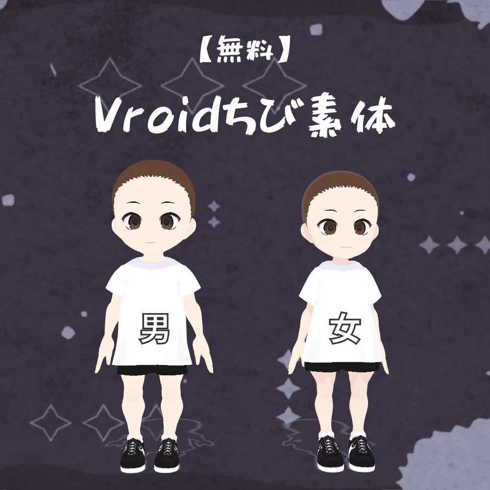
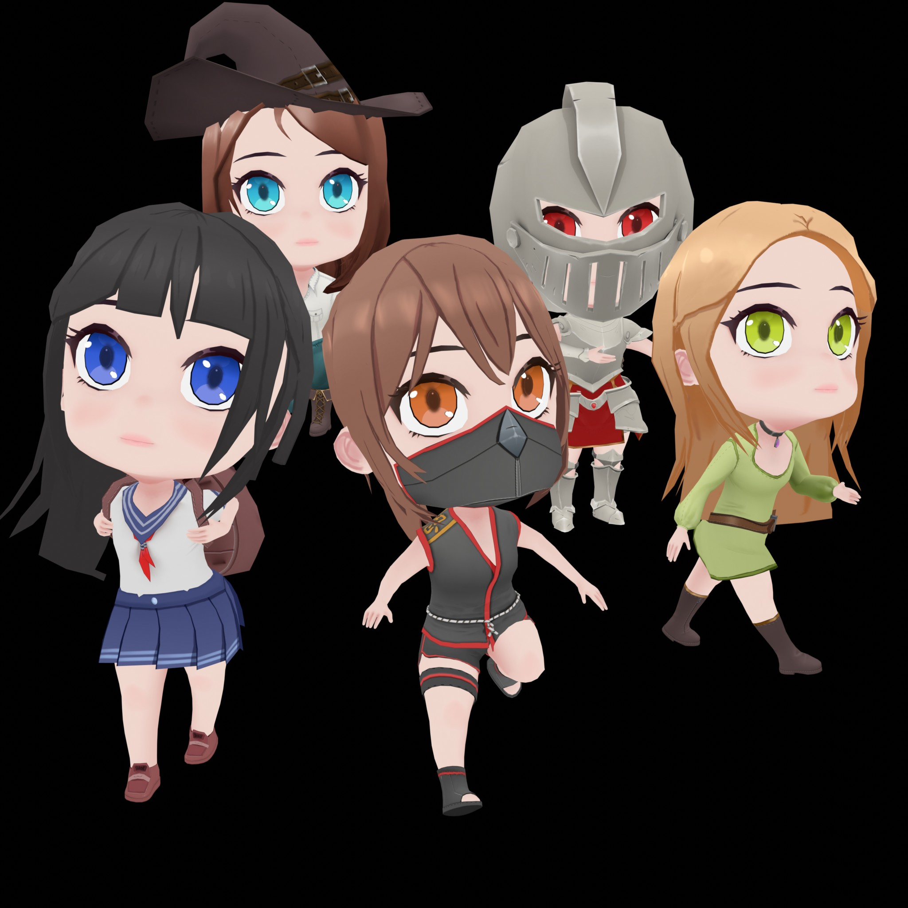

# 三头身人物选型结论

2026-10-27 的主路线确定为 VRoid Studio 制作共享人物母版，再由 Blender 整理三头身造型、时代服装、拓扑、蒙皮及游戏导出；但是这是制作路线的选择，当前正式采用的新增人物模型仍为零，原 E 外观继续保留。

用户已批准 VRoid，并确认沿用项目自己的服装与接近目标的现有比例，本轮制作据此执行；但是新底模仅替换人物基础与变形能力，不用软件默认服装覆盖已有设计。

## 选择依据与使用边界

[VRoid Studio](https://vroid.com/en/studio) 免费提供脸、体型、发型与衣服编辑，并导出 VRM，适合在同一制作体系内建立本项目十七人的身份差异；但是默认日系面貌、成人比例与现代服装继续由项目设计修订，不直接成为最终审美。[官方使用指引](https://vroid.com/en/studio/guidelines)允许通常预设用于商业作品和外部编辑；但是 pixiv 提供的基础网格并非 CC0，特殊条款和第三方衣服仍分别核验。

[创作者三头身制作记录](https://note.com/okomenko/n/ncef896909a02)展示了接近三头身的 VRoid 人物，证明该方向存在制作实例；但是作者同时记录了压缩躯干和腿部导致的变形，因此本项目把 Blender 造型与权重整理列为必要工序，不把滑条极值作为质量保障。

[免费男女 Chibi 模板](https://booth.pm/en/items/5156817)作为比例与参数参考保留，其作者说明可继续在 VRoid 内编辑；但是作者也明确记录小腿形状不整、易变形和约 110 厘米的初始尺寸，当前下载需要登录，模型文件尚未取得和采用。作者对自己的修改作 CC0 声明；但是 VRoid 基础内容的官方条款继续适用。

衣服、皮肤、头发和金属饰件以项目共用程序化 gdshader 组织材质，轮廓与衣服结构由真实网格表达；但是脸部表情、睫毛和有明确设计需要的遮罩可以保留必要图像，不把“程序化为主”解释为取消辨识度或强制零贴图。VRoid 材质向项目材质的转换列为导入工序；但是直接保留默认 MToon 并不等于已经与场景统一。

运行时交付优先采用 Blender 整理后的 GLB 与 .tscn 人物预制件，VRM 留作制作中间源；但是 VRM 导入插件、骨骼重定向、表情和动画兼容仍属于待验证能力，当前工程不增加未经验证的运行时依赖。

## 候选取舍

下表记录主代理的选择与依据；但是作者宣传、预览图片及网页许可均不能替代实际模型的结构检查。

| 候选 | 决定与原因 |
| --- | --- |
| VRoid Studio + Blender | 选为统一人物制作主路线，兼顾男女、发型、服装与面部差异；但是三头身和不同年龄的表现仍需人工整理与验收。 |
| [Grab3D Character Mixer](https://grab3d.com/tools/character-mixer/) | 保留为第二路线，官方声明免费 CC0 输出、完整蒙皮 GLB 与基础动画；但是缺少三头身保证，本机页面访问超时，尚未取得实际生成模型。 |
| [styloo Chibi Characters](https://styloo.itch.io/chibi) | 保留为现成服装与风格参考，作者提供 CC0 的五种服装、GLB/FBX 和十一段动画；但是作者说明没有男性版本，预览也不足以证明精确三头身，不作为全员统一基准。 |
| [der Mondhase Low-poly Chibi Base](https://dermondhase.itch.io/low-poly-chibi-base) | 极简完整绑定体可用于理解低面数造型；但是作者列出的 204 顶点和 213 面难以直接表现本项目服装与人物差异，附带许可尚未取得全文，不采用为正式人物。 |
| [poll 男女 Chibi 基础](https://blendswap.com/blend/12310) | 作者 CC0 底模保留为后备资料；但是登录下载、旧版 Blender 文件适配和未测量比例增加不确定性，优先级低于统一生成路线。 |
| Kenney Mini Characters | 已检查实际 GLB、绑定与站走坐预览，许可明确；但是两头身风格偏离 E，不直接采用。 |
| KayKit Adventurers Rogue | 已检查完整蒙皮和动作，可单独评估许可明确的动作来源；但是 Astra 评估其造型仍偏约两至两点五头身，不直接成为人物基准。 |
| [H3A V-Chibi Studio](https://booth.pm/ja/items/8698259) | 提供明确的 Q 版头身预设；但是付费、限女性基础及输出分享约束不适合当前免费统一路线。 |

## 制作与验收标准

资产工序使用 `mcp/asset_pipeline/characters/prepare_vroid_character.py` 读取 VRM 的人形骨骼元数据，检查网格绑定与有效骨骼权重，保留表情形状并输出可编辑 Blender 文件和候选 GLB；但是该工序仅统一整体尺寸，不自动修改头身比、不生成最终服装，也不把导入记录标为游戏验收。`--clothing-reference` 接受现有 E 人物 GLB 并置入隐藏参考集合，正式候选导出保持独立；但是参考衣物仍须贴合与权重整理后才能采用。

[Adobe Mixamo 官方 FAQ](https://helpx.adobe.com/creative-cloud/faq/mixamo-faq.html)说明免费 Adobe ID 可使用动作与人物进行商业游戏制作，其自动绑定面向双足人形；但是官方同时提示夸张比例、较大头发或衣物会影响自动绑定，并列出账号地区限制。项目优先保留 VRoid 自带骨架，在离线制作阶段重定向所需动作；但是账号可用性、实际动作文件及许可记录未落实前，Mixamo 继续作为候选动作库，不作为构建和运行的唯一依赖。

已有项目动作与来源明确的动作可作为离线重定向输入，站走、交谈、坐起及交互动作按三头身接触位置修订；但是动作库不能替代手脚接触、衣服穿插、根位移与家具碰撞的实际检查。

首批以侦探和维罗妮卡制作男女样角，依据原 E 的三头身轮廓及 character_art.dv 中的身份服装设计调整，过关后扩展到十七人；但是当前 1.32 米仅是设计提案，最终尺寸须结合座高、桌高、门窗与手脚接触共同核对。正式名单从 world.dv 核对，包含十六名已有 E 外观的人物及代管者；但是代管者实体仍待建模，其纯黑燕尾服、白手套与琥珀金竖瞳依据现有美术设定保持独特。

量产采用共享拓扑、UV、骨架层级、骨骼轴向、静止姿态与动画路径，轮廓差异优先通过发型、衣服和配件表达；但是仅同名骨骼不能直接共享动画，相关约束依据 [Godot 骨架重定向文档](https://docs.godotengine.org/en/stable/tutorials/assets_pipeline/retargeting_3d_skeletons.html)核对。男女体型变化优先保持关节和骨长兼容；但是必要的比例差异通过统一重定向工序处理，不强行套用导致滑步或手脚错位。

800～1500 三角面可作为身体最低细节试验目标，面数与贴图密度在样角实测后确定；但是该预算不覆盖全部头发、服装、配件和表情，也不作为未经测量的成品上限。关节保留适当环线并验证实际弯曲，面部表情可评估共享形态键或图集；但是共享权重不保证零穿插，Decimate 不等于重拓扑，生成三视图也不保证严格正交与前后结构一致。

材质以共用尺度的程序化着色为主，颜色图采用弱方向光以配合真实光照，必要图像使用统一像素密度与抗锯齿策略；但是同样的 512 或 1024 分辨率不自动保证相同像素密度，Nearest 采样也不自动适合全部低多边形素材。金属度表达金属属性，粗糙度控制高光宽窄，玻璃另核对透明与折射；但是高粗糙度不等于更强的金属反光，不将各种材料统一设置成高 Roughness/Metallic。

三头身测量采用站立中立姿势的头顶至下巴长度与头顶至脚底高度，发饰及帽子另计，正面与侧面共同核对；但是大头观感、透视截图和角色整体缩放均不能替代这一测量。完整身体网格由骨骼权重连续变形，服装、头发和配件按需要独立蒙皮或挂接；但是四肢不拆成刚性几何段，也不通过分段拉伸凑比例。

正式 Godot 检查覆盖站立、走停、转向、坐起、交谈和物体交互，并记录衣服穿插、脚底滑动、手部接触、家具碰撞与描边表现；但是通过 Blender 预览不等于通过游戏宿主验收。面数、材质数量与运行开销在取得样角后实测；但是当前不发布尚未测量的性能承诺。

## 图片与证据状态

以下为作者公开预览，用于本次选型与比例讨论；但是它们均非项目新人物或正式游戏验收图，图片的展示许可也不自动转化为游戏素材许可。

本地图片来源与 SHA256 保存在同目录 sources.json，模型采用时另记具体文件、许可和使用位置；但是当前预览文件只作为选型证据保留，不进入游戏导入目录。

