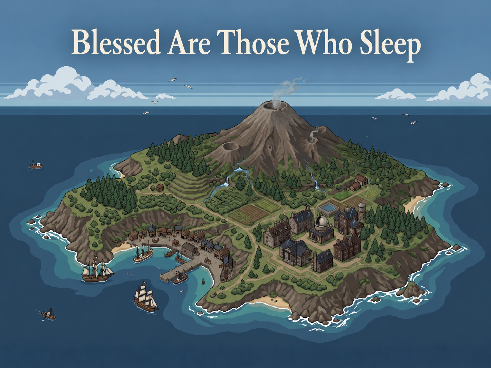

## 《安眠者有福》宣传片——25镜头最终视觉语言方案 v1

> **图片嵌入说明：** 对能确认原作画面且取得稳定图片直链的参照，直接使用 Markdown `` 嵌入；无法取得稳定直链、容易热链失效或容易误配的来源仍保留资料页链接，避免出现破图或错误参考。

> **v1 核验说明（2026-09-18）：**逐镜头重新检查了外部参照的实际游戏/影视画面与其在原作中的叙事功能。以下将“能直接借画面语法”“只能借剧情/结构功能”“必须保留原创”分开标明；网页链接优先放实际截图、官方页面或带截图的攻略页。

### 镜头1：孤岛学院远景

**最终性质：原创建立镜头。**

**v1核验：合理（原创）。** 作为建立镜头，它承担的是“学院确实位于一座可生活的孤岛上”的空间说明，而不是炫耀建筑规模。绘制时只需保证海岸、道路、学院主体与更高处地形的层级一眼可读；没有必要强行套现成 RPG 镜头。

**外部参照：**无直接参照；本镜头刻意保留原创。

远景从海面开始，学院主楼位于岛体中部偏下，靠近岸边沿着道路和平地向上延申，学院不能大到像一座城堡，也不能孤零零像恐怖片里的精神病院。这是我们的游戏实际的进入标题。

标题：

*安眠者有福 / Blessed Are Those Who Sleep*

缓慢显现。

这里不强行套任何 RPG，因为绝大多数传统 TileMap RPG 的世界地图/城堡外景尺度太小，反而无法同时表现“学院—岛—海—火山”四层关系。

**视觉关键词：**静止、遥远、可居住、轻微隔绝。

---

### 镜头2：早餐

**最终视觉参考：《Pokémon Ranger: Shadows of Almia》的 Ranger School。**

**v1核验：合理。** Ranger School 的楼层功能与课堂布局均可核实：一楼有两间教室、图书馆和教员室，二楼有用餐区和宿舍；实际游戏截图也证明它确实是可探索的学校地图。因此它很适合做“生活区与教学区连续存在”的结构母版。

**实际画面 / 资料：**[Ranger School（Bulbapedia，含各层布局图）](https://bulbapedia.bulbagarden.net/wiki/Ranger_School)；[Ranger School 2F 用餐区原图](https://archives.bulbagarden.net/media/upload/0/05/Ranger_School_2F_Ranger2.png)；[MobyGames：Exploring the school 实机截图](https://www.mobygames.com/game/38538/pokemon-ranger-shadows-of-almia/screenshots/nintendo-ds/1025703/)；[Part 1 walkthrough（实际游览课堂、图书馆、二楼）](https://bulbapedia.bulbagarden.net/wiki/Walkthrough%3APok%C3%A9mon_Ranger%3A_Shadows_of_Almia/Part_1)

Ranger School 的实际建筑就是一个完整可探索的学校：一楼有两间教室、图书馆和教员室，二楼则直接安排宿舍与用餐区，因此它非常适合作为我们学院“生活空间与教学空间连续存在”的结构母版。

镜头从公共餐厅的 TileMap 全景开始。长桌斜着进入画面，侦探从下方进入；机械工程师已经坐着或整理东西，化学家边吃边看资料，职业棋手伏在桌边明显没睡醒。不要依次给人物登场动画，让几个人**同时做自己的事情**，玩家进入时只是撞见了一个已经运转起来的早晨。

**保留 Ranger School 的：**学校作为完整生活空间、桌椅与人物直接属于 TileMap、学生在地图中自然分布。

**不照搬：**宝可梦学校的现代、明亮、儿童化布置；我们改成20世纪初学院的木桌、白瓷餐具、资料册、茶壶与暖灰照明。

---

### 镜头3：小型聚会

**最终视觉参考：《Suikoden II》的酒馆/旅店型公共空间；不再把 Hai Yo 的厨艺比赛餐厅当主要母版。**

**v1核验：修正后合理。** 实际截图支持“RPG 公共室内空间里桌子、食物、家具与多个角色共存”，但不支持把 Hai Yo 厨艺比赛本身当成自然聚会母版；该比赛的评委/厨台布局反而过于舞台化。现在改用普通酒馆/旅店型空间。

**实际画面 / 资料：**[《Suikoden II HD Remaster》室内聚集截图（note）](https://note.com/coc967/n/n3f4591c383e4)；[MobyGames：酒馆实机截图](https://www.mobygames.com/game/4854/suikoden-ii/screenshots/playstation/696628/)

重新核对实际画面后，需要把参照说得更精确：普通酒馆/旅店型场景确实适合，桌子、食物、椅子和多个 Sprite 可以同时处于一张可探索地图里；但 Hai Yo 的厨艺比赛餐厅经常呈现为评委横排、厨台/舞台明确的竞赛构图，并不适合拿来证明“不规则小群自然聚集”。因此本镜头只借《Suikoden II》普通公共空间的空间语法。

先用一张较宽 TileMap 镜头：机械工程师抱着东西横穿前景；化学家在侧桌整理；音乐家和其他人在桌边说话。随后通过一次短时间跳切，桌上已经摆好少量食物，人物位置发生改变，表示聚会已经开始。

人物不要全部面向主角。最好有人背对摄影机、有人侧向桌子、有人正在走动。

**保留《Suikoden II》的：**桌子与食物直接属于地图、多个小型 Sprite 能在室内自然聚集、公共区域有持续生活痕迹；人物分组由我们的镜头自行设计，不再声称原作餐厅固定采用“不规则围桌群像”。

**不照搬：**红毯、烹饪比赛舞台、大量菜肴和中国风装饰。

---

### 镜头4：音乐

**最终性质：原创 TileMap 演出；只保留“演奏者—听众反应”传统镜头语法。**

**v1核验：合理（原创）。** 这一镜头的功能是用连锁反应快速建立角色性格和熟悉程度；保持可游玩地图、用 Sprite 转头/停笔/被吵醒即可。若改成舞台灯光或 CG，会破坏前几镜已经建立的“学院就是可探索地图”语言。

**外部参照：**无必须绑定的直接场景。

没有找到一个视觉风格普通、又比我们自己设计更合适的 TileMap JRPG 音乐演出。因此不要为了寻找出处而硬套。

音乐家位于公共研究厅一侧，使用符合时代的乐器。主体仍然是可游玩的地图，而不是突然变成舞台CG。

顺序：

音乐家开始演奏 → 侦探停笔侧耳 → 机械工程师皱眉 → 职业棋手被吵醒 → 回音乐家，她仍非常投入。

所有反应控制在 Sprite 动作或半身表情差分范围内。

**不要使用：**聚光灯、摇滚舞台、夸张背景特效、节奏游戏UI。

---

### 镜头5：下棋

**最终视觉参考：《第七封印》，保留影视参考。**

**v1核验：合理。** 《第七封印》的核心功能并非“下棋很酷”，而是骑士借棋局与死亡谈判、拖延自己的终点；实际画面也高度依赖两人隔棋盘相对而坐的静态构图。将棋盘放在 TileMap 几何中心非常合适。

**实际画面 / 资料：**[Criterion：The Seventh Seal 官方页面](https://www.criterion.com/films/173-the-seventh-seal)；[IMDb：骑士与死亡对弈剧照](https://www.imdb.com/title/tt0050976/mediaviewer/rm1671020033/)

这一项我仍然不建议用 RPG 替换。实际《第七封印》的棋局画面具有非常清楚的三元构图：骑士与死亡隔着棋盘，两个人大部分时间都很克制，棋盘既是视觉中心，也是骑士用来延缓死亡、争取时间的叙事装置。

转换到 TileMap 后，公共研究厅里只需要一张较孤立的小桌。

Maxwell 与侦探相对坐下，棋盘处于画面几何中心。Maxwell身体几乎完全不动；镜头短切他的手——拿棋、落子、收回。

切侦探。

他低头，没有立即行动。

职业棋手处于侧后方观察，不插进二人的视觉轴。

**保留《第七封印》的：**极静、棋盘作为两人的几何边界与谈判中心、超自然存在的动作极少而稳定。

**不照搬：**黑白摄影、海岸、严格真人侧面构图。

---

### 镜头6：言灵课——失败

**最终主视觉参考：《Pokémon Ranger: Shadows of Almia》的 Ranger School 课堂；剧情结构仍与漂浮咒课堂相似。**

**v1核验：合理，但参照应分成两层。** Ranger School 负责“RPG 课堂长什么样”；《哈利·波特》只负责“基础规则执行不精确会失败”的课堂功能。官方资料明确写明 Wingardium Leviosa 同时要求正确动作与正确发音，所以本镜头的失败最好保持为“细节没有做对”，不要硬指定只有发音出错。

**实际画面 / 资料：**[Ranger School（Bulbapedia，六张学生桌＋教师桌）](https://bulbapedia.bulbagarden.net/wiki/Ranger_School)；[Ranger School 课堂 SW Room 原图直链](https://archives.bulbagarden.net/media/upload/3/31/Ranger_School_SW_Room_Ranger2.png)；[Pokémon Ranger 2 walkthrough：开场课堂](https://gamefaqs.gamespot.com/ds/944533-pokemon-ranger-shadows-of-almia/faqs/55434)；[Harry Potter 官方：The Levitation Charm](https://www.harrypotter.com/fact-file/spells/the-levitation-charm)

这里终于可以把电影式 Hogwarts 教室换掉。

Ranger School 实际课堂拥有非常清楚的 RPG 排列：两个教室都是六张学生桌线性排列，教师桌在前。 游戏实际开场也直接从教师在前、学生在各自桌位的课堂事件开始。

地图镜头固定。

导师站上方。

学生桌形成规则排列。

侦探与音乐家相邻。

导师示范一个最基础言灵。

侦探尝试。

练习物没有任何反应。

音乐家转头。

导师走近一格或改变朝向。

失败的重点就是：

**什么都没有发生。**

不要给烟、火花、爆炸。

《哈利·波特》的漂浮咒仍可作为“基础规则执行不准确→失败”的剧情依据；官方资料明确写明动作与发音都必须正确，因此这里只借“细节不精确导致无效”的课堂功能，不把失败原因限定成发音一个因素。

---

### 镜头7：言灵课——成功

**最终视觉参考：继续 Ranger School，同一张地图、同一机位。**

**v1核验：合理。** 成功镜头继续使用完全相同的地图与机位，是这组镜头最重要的做法：观众能把“环境没换、规则结果变了”直接归因于言灵，而不是归因于剪辑或特效。

**实际画面 / 资料：**[Ranger School 布局与课堂图（Bulbapedia）](https://bulbapedia.bulbagarden.net/wiki/Ranger_School)

这是非常重要的一点。

镜头6结束后不要建立一个新场景。

导师指出问题。

侦探重新尝试。

仍从刚才相同位置观察桌面。

停半拍。

练习物离开桌面、旋转或移动到指定位置。

音乐家侧头。

导师确认。

侦探立即低头记录。

这比电影式大量特写更符合我们的 RPG：**地图本身没有变化，规则结果变了。**

**不要增加：**巨大发光法阵、粒子、风压、震屏。

观众应该因为“物体突然按照语言规定运动”而意识到言灵成功。

---

### 镜头8：图书馆

**最终环境参考：Ranger School 图书馆；动作原创。**

**v1核验：合理。** Ranger School 的图书馆确实就在学校一楼、属于正常可探索流程，和课堂处于同一建筑体系；用它做“下课后直接进入研究”的空间连续性参照成立。具体的三人协作阅读动作则是原创。

**实际画面 / 资料：**[Ranger School 图书馆原图直链](https://archives.bulbagarden.net/media/upload/c/cb/Ranger_School_Library_Ranger2.png)；[《Chrono Trigger》Kajar 全地图（SNES Maps，含顶层学者研读长桌与暗室）](https://www.snesmaps.com/maps/ChronoTrigger/ChronoTrigger12000Kajar.png)；[Shadows of Almia Part 1 walkthrough：Library 段](https://bulbapedia.bulbagarden.net/wiki/Walkthrough%3APok%C3%A9mon_Ranger%3A_Shadows_of_Almia/Part_1)

Ranger School 的一楼本身就包含教室—图书馆—职员室，因此学生从上一堂课出来直接进入图书馆会非常自然。《Chrono Trigger》Kajar 顶层研讨大厅（Room B）则提供了多名学者围绕长桌、在烛光下摊开魔法古籍研读的纯正古典学术 TileMap 构图。两者结合可同时解决校园流线连续性与神秘学研读氛围。

镜头约2秒。

第一拍：三个人围桌，书和笔记已经摊开。

第二拍：翻页。

第三拍：侦探用手指沿一行字移动。

第四拍：另一人把另一份资料推过去。

不要让三个人同步翻书。

人物应处于不同阅读进度，让它看起来是真正在研究。

**保留 Ranger School 的：**图书馆也是游戏地图的一部分。

**不照搬：**宝可梦式小型明亮校园装潢。

---

### 镜头9：化学家的阵法错误

**最终机关逻辑参考：《Golden Sun》Sol Sanctum。**

**v1核验：合理，但属于“机关因果”参考，不是逐帧视觉复刻。** Sol Sanctum 确实存在“误动 Luna 雕像触发陷阱→Kraden指出问题→先处理 Sol 侧结构→陷阱解除”的连续因果。原作能证明“错误位置、修正位置和场景状态都可以直接画在地图里”；本镜头的线路反向传播是我们自己的阵法可视化。

**实际画面 / 资料：**[GameFAQs：Sol Sanctum 机关流程](https://gamefaqs.gamespot.com/gba/468548-golden-sun/faqs/14723)；[Almar's Guides：Golden Sun Chapter 1（带 Sol Sanctum 截图）](https://almarsguides.com/retro/walkthroughs/GBA/games/GoldenSun/FullPlaythrough/Chapter1/)

> **图片直链说明：** 暂未找到稳定热链且能明确确认是“Luna 区误动雕像触发陷阱”这一瞬间的原作静帧，因此继续保留攻略页，不拿别的《Golden Sun》场景冒充。

这是整个方案中非常值得替换的一项。

真实游戏里，玩家在 Luna 区移动雕像会触发陷阱，Kraden马上赶来指出它是陷阱；之后玩家必须先处理 Sol 区的结构，解除陷阱，才能继续操作。

因此这里不再拍 Harry Potter 式“坩埚事故”。

镜头固定俯视整个阵图。

化学家修改一个节点。

第一秒看似没有问题。

随后一条原本稳定的线路反向亮起。

异常沿节点传播。

化学家后退。

导师进入画面，看一眼，直接指向那个节点。

恢复。

异常沿原来的线路反向熄灭。

最后化学家盯着那里。

这就是我们真正需要的：

**错误操作的位置、错误传播的路径、正确恢复的位置，都能在 TileMap 中看懂。**

《Golden Sun》的实际设计确实会用雕像、地面符号、光线和场景状态表达机关因果；但“线路反向亮起并沿节点传播”是我们为了让阵法错误更可读而做的二次演绎，不应写成原作直接出现的画面。

---

### 镜头10：继续研究

**最终性质：原创 TileMap 研究蒙太奇。**

**v1核验：基本合理，已收紧节奏。** “失败后继续研究”是必要的过渡，但2秒内做三个完整镜头会让观众只看见闪切。现在更适合让2–3个动作共享同一组近景构图，保留工具与手的连续性。

**外部参照：**无直接参照；这是承接镜头9的原创研究蒙太奇。

这一项仍然没有找到值得硬换的游戏场景。

它仍只需要约2秒，但原稿的“三次完整切镜”在这么短的时长里可读性偏低。

直接沿用镜头9的桌面和阵图。

错误节点已经被圈起。

化学家重画这一部分。

切侦探翻资料。

切音乐家用音叉测试某个物体。

把它压成同一空间里的2–3个连续动作，不强制每个动作都成为独立镜头。统一使用：

**工具在前景，手在中景，人物只露身体局部。**

不要切人物正面表情。

它的功能只是告诉观众：

“失败以后，他们没有停，而是继续研究。”

---

### 镜头11：危险知识

**最终参考：新增《Chrono Trigger》Kajar 隐秘暗室（Room C）与禁断古籍机关，辅以《哈利·波特》禁书区的夜间光影；淘汰《FFV》古代图书馆。**

**v1核验：高度合理。** 《Chrono Trigger》Kajar 提供了极佳的 2D TileMap 空间与叙事对照：玩家在学术大厅中依序阅读水、风、火魔法古籍，触发机关开启暗门进入 Room C；暗室正中供奉黑石（Black Rock），桌上摆放涉及拉沃斯灾难本质的禁忌笔记，完全不涉及怪物战斗，纯粹展现“知识本身的禁忌性与隐秘性”。结合《哈利·波特》的夜间局部提灯光影，能够精准指导 TileMap 构图。

**实际画面 / 资料：**[《Chrono Trigger》Kajar 密室与古籍全图（SNES Maps 直链）](https://www.snesmaps.com/maps/ChronoTrigger/ChronoTrigger12000Kajar.png)；[Harry Potter 官方：The Restricted Section（含剧照）](https://www.harrypotter.com/fact-file/locations/the-restricted-section)；[Harry Potter 官方：夜间潜入禁书区剧照文章](https://www.harrypotter.com/features/which-hogwarts-rule-would-you-most-likely-end-up-breaking)；[FFV Library of the Ancients 攻略（Page 32）](https://www.ludo.guide/guide/final-fantasy-v/library-of-the-ancients)

我专门检查过《FFV》的 Library of the Ancients。它确实是标准 TileMap 图书馆，而且存在调查异常书籍的内容，但很多异常书直接转入怪物遭遇。这样会让观众理解成：

**书里有怪物。**

这和我们“理解内容本身有危险”不是一回事，因此明确淘汰这个参考。《Chrono Trigger》Kajar 的 Room C 密室设计则完全契合：古籍与符号指向不可言说的禁忌力量，而不是跳出杂兵。

镜头采用普通 TileMap 夜间图书馆。

环境大部分暗下来。

只有桌灯或手灯形成小片暖色区域。

侦探抽出一本普通课程不会使用的资料。

打开。

不要展示完整文字。

页面某个符号或图形进入画面。

切侦探。

他停止动作。

眼神变化。

马上合书。

**不要出现：**书尖叫、长嘴、怪物跳出来、突然战斗。

---

### 镜头12：学生失控、Maxwell救场

**最终结构参考：《Golden Sun》Elemental Star Chamber，替换《魔法师的学徒》作为主要危机母版。**

**v1核验：修正后合理。** Elemental Star Chamber 很适合参考“地图级失控＋高位存在介入”的层级差，但原作中的 Wise One 是暂时阻住岩浆并把 Isaac、Garet 传送出去，并没有一抬手让房间恢复原状。Maxwell 的“彻底停机”因此应明确视为我们自己的强化。

**实际画面 / 资料：**[Golden Sun Universe：Elemental Star Chamber（含场景图与完整事件说明）](https://goldensunwiki.net/wiki/Elemental_Star_Chamber)；[Almar's Guides：Chapter 1（Elemental Star Chamber 实机截图）](https://almarsguides.com/retro/walkthroughs/GBA/games/GoldenSun/FullPlaythrough/Chapter1/)

> 这张图用于确认 Star Chamber 的场景视觉与高位存在介入的空间关系，不把它当作“Wise One 恢复整个房间”的证据。

这一替换非常合适。

实际《Golden Sun》中，最后一颗 Elemental Star 被取走以后，Star Chamber 失去稳定，水消失、岩浆涌出、结构开始崩塌；Wise One 苏醒后暂时阻住喷涌的岩浆，并最终把 Isaac 和 Garet 传送出去。它并没有把房间“恢复正常”。

所以我们这样拍：

学生启动术式。

最初成功。

阵法稳定运行。

几个人松了一点气。

然后它继续运行。

侦探尝试停止。

失败。

阵线越来越亮。

地图开始轻微震动。

局部物件移动，地面或边界出现异常。

学生越来越慌。

Maxwell出现在地图高处入口。

所有学生 Sprite 转向他。

Maxwell不冲、不跑、不摆夸张姿势。

只说一句话，或者极轻地抬手。

地图震动停止。

阵线从核心向外熄灭。

一切静下来。

然后学生仍然追问。

Maxwell：

*Very well. Then know.*

切黑。

**保留《Golden Sun》的：**整张地图进入危机、高位存在以极少动作介入系统性灾害、力量等级差通过“谁能压住这场地图级失控”体现。Maxwell 让地图彻底恢复正常，是我们的原创强化，不是 Wise One 原场景的直接复刻。

**不照搬：**火山、岩浆、巨大独眼石球本身。那些是 Golden Sun 的具体世界观。

---

## 脑内研究段

这一部分原稿本来就是镜头13–17的一整套机制演示。

### 镜头13：进入脑内研究

**最终性质：核心原创；不强行用传统 JRPG 替代。**

**v1核验：合理，而且应坚持原创。** 这一镜头承担从“现实”切入“模型”的语义转换。保持同一房间的几何位置，比设计一个漂亮但完全不同的精神世界更重要；这样观众会理解为抽象化而不是传送。

**外部参照：**无直接参照；这是核心玩法的视觉身份。

我没有找到一个普通 TileMap RPG 真正存在：

现实观察 → 重建人物 → 玩家修改其认知规则 → 重新运行事件

这整套东西。

因此这一段必须成为你的视觉身份。

现实冻结。

颜色逐步退掉。

但不要切去一个完全不同的界面。

**原来的房间仍然存在。**

墙、桌、门逐渐化为米白色简化轮廓。

现实人物消失。

对应位置生成灰色模拟人物。

只有已经确认的客观证据保持一点原色。

一条细时间轴出现。

这一步必须让观众感觉：

**他没有进入另一个世界；他正在把现实抽象成一个模型。**

---

### 镜头14：编写人物规则

**最终性质：完全原创。**

**v1核验：合理（原创）。** “条件 → 行动”足够让宣传片观众理解玩家正在定义因果；不应在短镜头里展示完整程序式条件树。画面上最多让1–2条规则清楚可读，其余作为笔记纹理退后。

**外部参照：**无直接参照。

玩家选择一名灰色模拟人物。

其余对象降低明度。

侧边展开规则页。

不是程序编辑器。

不是卡牌。

不是传统状态菜单。

最好像一本被抽象化的研究笔记。

只让观众清楚看到最核心结构：

**条件 → 行动**

再修改第二条。

模拟人物旁边可以短暂出现行动方向或目标提示，但人物仍不运动。

这里必须保留原创，因为这就是你整个游戏最应该拥有独立视觉身份的部分。

---

### 镜头15：RUN

**最终性质：原创模拟器演出。**

**v1核验：合理（原创）。** 固定摄影机同时看到 A、B、C 自治行动，是证明“这是模拟而不是玩家逐个操纵”的关键。跟拍任何一个角色都会削弱机制说明。

**外部参照：**无直接参照。

玩家按下：

**RUN**

规则页收起。

时间轴开始推进。

摄影机固定。

所有模拟人物开始自己行动。

A走向门。

B拿起某物。

C因为A的动作改变路线。

玩家不直接控制任何人。

镜头的关键恰恰是：

**不要跟拍某一个角色。**

观众需要一次同时看到多人自治。

---

### 镜头16：推演失败

**v1核验：合理（原创）。** 用“模拟位置”和“已知现实证据轮廓”发生错位来表达失败，比红叉/FAILED 更符合研究语义；时间轴冻结后立即回退也能自然引向下一镜。

**外部参照：**无直接参照。
模拟运行到某节点。

现实中已经知道的某个观察结果以淡色轮廓出现。

但模拟对象停在另一位置。

时间立即冻结。

错误节点在时间轴上亮起。

两个位置之间出现非常简单的错位提示。

不要出现：

❌ WRONG
❌ FAILED
❌ 红色大叉

这不是考试。

它表示：

**你的模型无法解释现实。**

时间轴退回。

---

### 镜头17：重新推演

**v1核验：合理（原创）。** 快速越过已经验证过的部分，只在旧错误节点恢复正常速度，是最节省时间也最清楚的“重新推演”表达；终态与证据轮廓重合即可，不需要 SUCCESS。

**外部参照：**无直接参照。
修改一条规则。

再次：

**RUN**

前面已经正确的部分高速经过。

抵达之前错误节点时恢复正常速度。

这一回，模拟人物采取不同动作。

最终状态和现实证据轮廓重合。

不要出现“SUCCESS”。

真实观察的轮廓自然消失。

整个模型稳定一瞬。

米白世界退去。

重新回到现实。

这就是“理解成立”的视觉表达。

---

### 镜头18：真名

**最终性质：原创；《地海巫师》只作为概念来源。**

**v1核验：合理，但《地海巫师》只能作为概念来源。** Earthsea 的文字设定明确把“真名”视为事物/人的本质，知道真名意味着获得力量；它不能提供这个具体镜头的影视构图。因而“无特效、异常第一次转头听懂称呼”应保留为原创视觉。

**概念资料（无直接剧照）：**[NEA：A Wizard of Earthsea](https://www.arts.gov/initiatives/nea-big-read/wizard-earthsea)；[NEA Reader's Guide（True Name / essence）](https://www.arts.gov/sites/default/files/Readers-Guide-WizardofEarthsea.pdf)

原稿要求侦探第一次以正确名字称呼一个此前不能有效干涉的异常。

仍然不要寻找“魔法攻击”的参考。

异常持续某种有规律的行动。

侦探站在安全距离。

他说出名字。

最后一个音节结束。

**没有特效。**

异常突然停止。

停顿。

它第一次明确转向侦探。

最好再让环境音也在那一瞬间变得极静。

真正可怕的是：

刚才还像自然现象一样的东西，

**听懂了你在叫它。**

---

### 镜头19：规则改变通路

**最终直接机关状态参考：《Golden Sun》Venus Lighthouse，正式淘汰《Baba Is You》和《Alan Wake 2》作为主视觉参考。**

**v1核验：合理，而且是目前最直接的 TileMap 状态变化参照之一。** Venus Lighthouse 确实有电流屏障挡路，并可通过 Move 把雕像压到地面开关上关闭屏障。它直接支持“同一地图、前后状态可比较”；我们的规则编辑 UI 则仍是原创。

**实际画面 / 资料：**[Golden Sun Universe：Venus Lighthouse](https://goldensunwiki.net/wiki/Venus_Lighthouse)；[Almar's Guides：Chapter 5（带电流屏障与机关截图）](https://almarsguides.com/retro/walkthroughs/GBA/games/GoldenSun/FullPlaythrough/Chapter5/)

这次找到的实际游戏案例非常直接：在 Venus Lighthouse 中，Felix 使用 Move 把附近雕像推到开关上，原本挡路的电流屏障因此关闭。

实际《Golden Sun》确实存在“Move 雕像→压住地面开关→电流屏障关闭”的同地图状态变化，因此它可以直接支持“修改前/修改后必须在同一机位可比较”这条视觉原则；但“编辑已理解规则”仍然是我们自己的玩法。

因此我们的镜头：

固定一个机位。

前方是一条明确无法通过的边界。

侦探试图接近，被阻挡。

进入极短规则编辑。

改变一个与边界有关的已理解条件。

回到**完全相同的镜头**。

边界结构变化。

原本封闭的位置打开。

侦探走过。

最重要的是：

**前后必须是同一个机位。**

否则观众看不出世界规则真的发生了变化。

**不照搬：**推雕像、魔法电流、Golden Sun的Psynergy图标。

---

### 镜头20：规则定义过宽

**最终性质：完全原创。**

**v1核验：很合理（原创）。** 这是25镜中最贴合“现实按规则、不按意图”的可视化之一。三个对象拥有同一红色封签、并采用完全一致的移动方式，能把“系统正确匹配了错误定义的集合”直接画出来，不需要大规模反噬。

**外部参照：**无直接参照；不建议重新给它套迈达斯等高阶魔法母版。

不再引用迈达斯。

不再引用爱情魔法。

不做黄金化。

不做任何高阶炼金术。

桌面一份带红色封签的资料。

侦探真正需要的是它。

规则发动。

该资料开始朝他移动。

他刚准备伸手。

后景另一份同样有红色封签的文件开始移动。

侦探抬头。

架子上一个贴着同样红色封签的小型容器也开始震动，然后移动。

三个物体必须使用**完全相同的运动方式**。

这样不用一句解释，观众就能理解：

“规则不是误执行。”

“它正确匹配了三个目标。”

立即切镜。

这比任何“大型反噬”都更准确地表达：

**现实不会替你猜意图。**

---

### 镜头21：棋子

**最终性质：原创角色互动。**

**v1核验：合理（原创）。** 先让棋子作为场景里的真实物体完成“放下—注视—拿起”，再出现回应 UI，能把角色关系放在数值系统之前；同时复用镜头5的棋桌，会形成非常清楚的前后呼应。

**外部参照：**无直接参照。

回到镜头5那张棋桌。

这次色温稍暖。

侦探把一个“兵”放在两人之间。

手退出。

Maxwell先低头看棋子。

停一下。

再抬眼看侦探。

然后拿起。

三项回应在这之后才出现。

不要让UI一上来就占据屏幕。

也不要做JRPG常见的：

“送礼物 → 爱心 → 好感度+1”。

棋子必须首先是一个真正存在于场景里的物体。

---

### 镜头22：夜间训练

**最终仍保留《弹丸论破V3》，没有找到更好的 TileMap RPG 替换。**

**v1核验：合理，但应借“关系功能”而不是借画面规格。** V3 确实先有 Kaito 与 Shuichi 的夜训，之后 Kaito 主动把 Maki 拉进来；三人第一次一起训练时做100个俯卧撑，Maki 很快完成。原场景的作用是建立信任、把被疏远的人纳入关系圈，因此比普通体育课更接近这里需要的情感功能。

**实际画面 / 资料：**[Danganronpa Wiki：Kaito Image Gallery（Chapter 3 training together）](https://danganronpa.fandom.com/wiki/Kaito_Momota/Image_Gallery)；[Something Awful LP：100 push-ups 场景与实机截图](https://forums.somethingawful.com/showthread.php?pagenumber=37&perpage=40&threadid=3885570&userid=0)；[三人夜间训练 CG/截图页面](https://medium.com/@jverse/maki-harukawa-camino-hacia-la-autoaceptaci%C3%B3n-eb5262b5c363)

V3 的实际剧情就是 Kaito 与 Shuichi 夜间训练，之后把 Maki 加进来；三人做100个俯卧撑，Maki异常迅速地完成。

虽然它不是标准 TileMap RPG，但它提供的**人物关系场景**比 Ranger School 的正式训练课更准确。

转换成我们的地图：

夜间庭院。

低照度。

三个人横向分布。

机械工程师认真继续。

侦探速度越来越慢。

职业棋手已经做完，站起来看其他人。

不要变成训练小游戏。

不要显示次数UI。

它表达的不只是“熟了以后一起做些没必要的事情”。V3 原场景的功能还包括 Kaito 用训练把陷入低谷的 Shuichi 拉起来，并在 Maki 身份暴露、被他人疏远后主动把她拉进这个小圈子。因此我们的镜头应更明确表达：

**非任务性的共同训练已经变成关系纽带；三个人愿意在夜里把时间交给彼此。**

---

## 高潮段

原计划23–25总共只承担约6秒的“规模突然升级”，不负责解释剧情。

### 镜头23：地下冲突

**最终结构参考：《钢之炼金术师FA》第60话；呈现方式仍转换成 RPG Event Animation。**

**v1核验：合理，但这是剧情节奏参考，不是直接视觉母版。** 第60话里 Greed 的突袭确实只短暂打断 Father；Father 随即回到真正的中心并发动全国炼成阵。把它压缩成“局部攻击命中→敌人不进入普通攻防→转向核心”能在2秒内说明层级转换。

**实际画面 / 资料：**[TBS 官方：第60话简介与剧照入口](https://www.tbs.co.jp/tbs-ch/item/a0188/)；[第60话截图式回顾（Hiyono's Anime Blog）](https://hiyono.wordpress.com/2010/06/09/fma-brotherhood-ep-60-manga-notes/)；[Episode 60 事件说明](https://fma.fandom.com/wiki/Episode_60_%282009_Anime%29)

> **图片直链说明：** 目前能稳定取得的 Greed/Father 高质量静帧多来自后续战斗，容易与第60话这里的剧情节点误配，因此本镜头暂只保留第60话资料页。

这里暂时没有 TileMap RPG 能在因果上超过《钢炼》。

第60话里 Greed 的确突然切入并命中 Father，但 Father预判了他的行动，马上回到自己准备好的中心位置并发动全国级计划。因此这里适合借的是“局部突袭只占极短一拍→立刻切换到真正的大尺度目标”的节奏结构，不是逐帧照搬原作构图。

因此：

黑暗地下区域。

一个角色高速切入。

攻击命中。

只持续几帧。

观众刚刚建立“这是战斗高潮”的判断。

敌人根本不继续追打攻击者。

他转向地面/核心。

画面立即切走。

**不能拍成：**

攻击 → 防御 → 反击 → 再攻击。

两秒时间里只需要告诉观众：

**所有人还在打局部战斗，但真正的事情根本不在这一层。**

---

### 镜头24：巨大阵法启动

**剧情结构参考：《钢炼FA》第60话；TileMap表达借《Golden Sun》的大型机关语言。**

**v1核验：合理。** 《钢炼》第60话能够直接支持“地下中心发动→作用范围跃迁到全国”的剧情尺度；Golden Sun 则更适合提供 TileMap 上地面线、机关节点和障碍状态如何响应的视觉语言。把两者拆开使用比试图完整复制动画镜头更稳妥。

**实际画面 / 资料：**[TBS 官方：第60话](https://www.tbs.co.jp/tbs-ch/item/a0188/)；[Episode 60：全国炼成阵扩展过程](https://fma.fandom.com/wiki/Episode_60_%282009_Anime%29)；[Golden Sun：Sol Sanctum 机关截图攻略](https://almarsguides.com/retro/walkthroughs/GBA/games/GoldenSun/FullPlaythrough/Chapter1/)

> 这张图用于参考“从局部突然跃迁到全国尺度”的视觉规模，不作为 TileMap 地面线路画法的直接模板。

《钢炼》第60话确实从 Father 所在的地下中心发动，并把作用范围迅速扩展到全国炼成阵，最终整个 Amestris 的人都受到影响；“核心一点亮→房间线路依次亮起→多地点响应”则是为了 TileMap 可读性做的压缩表达。

但是你做的是 RPG，所以“地图上怎么表现”应该学习 Golden Sun：

核心一点亮。

连接它的地面线条依次亮起。

镜头第一次拉开。

第二层更大的线路响应。

再切另一处场景。

正在行动的人停下。

再切另一个区域。

另一个人抬头。

只需要三次尺度跳跃：

**点 → 房间 → 多地点。**

绝对不要只有：

“一个巨大圆阵闪了一下。”

那无法产生规模感。

---

### 镜头25：反制与切黑

**最终仍以《钢炼FA》第61话 Hohenheim 的反制作为剧情母版。**

**v1核验：合理，但节点逐一点亮是我们的剪辑设计。** 第61话明确说明 Hohenheim 多年间在全国多个位置预置灵魂，并利用日食影锥形成的巨大圆统一触发，把灵魂送回原身体。因此“另一套早已布置好的规则突然接管局势”与原作功能高度吻合；逐个节点给观众看的节奏则是为了让2秒左右的 RPG 画面更易懂。

**实际画面 / 资料：**[TBS 官方：第61话简介与剧照入口](https://www.tbs.co.jp/tbs-ch/item/a0188/)；[Episode 61：Hohenheim 反制机制](https://fma.fandom.com/wiki/Episode_61_%282009_Anime%29)

> **图片直链说明：** 第61话的反制机制已经由剧集资料页核实；目前没有找到比资料页本身更稳定、又能明确对应“预埋节点同时启动”的单张直链静帧，因此不强行插错图。

这一项暂时也没有 TileMap RPG 找到更准确的替代。

Hohenheim 的方案确实是多年间在全国多个地点预置自己贤者之石中的灵魂；Father 吞下“神”后，日食形成的巨大影锥作为圆使这些地点同时发动，把 Amestris 人民的灵魂送回身体。原作支持“预埋节点＋统一条件触发”，但“一个节点、第二个、第三个依次给观众看”是我们的悬念化剪辑。

我们的镜头不要先显示一整个“第二巨大法阵”。

大型异常仍在持续。

画面边缘一个此前根本不起眼的节点突然亮起。

第二处。

第三处。

随后观众才看到：

它们之间存在联系。

前一个巨大现象开始出现逆转。

切侦探。

约0.3秒。

切 Maxwell。

约0.3秒。

两个人都不是大惊失色。

他们只是同时意识到：

**另一套规则开始工作了。**

切纯黑。

*Would that I had never been called forth into this world.*

Logo。

---

## v1 核验结论摘要

25个镜头中，**2、5、6–9、11–12、19、22–25**存在可验证的外部场景/结构参照；其中 **2、5、6–8、19** 可以较直接借画面语法，**9、12、22–25**更适合借机关因果、人物关系或剧情层级，不能写成逐帧复刻。**1、4、10、13–18、20–21**保持原创是合理的，其中13–17尤其应该被当作本作核心视觉身份保护。

本轮最重要的三处修正是：**镜头3不再把《Suikoden II》的厨艺比赛餐厅误当自然聚会母版；镜头12明确 Wise One 并未把 Star Chamber 恢复正常；镜头22把 V3 夜训的功能从“熟人闲玩”修正为“共同训练建立信任并主动纳入被疏远者”。**

---

## 最终参考体系

至此，整个宣传片已经不需要再让25个镜头各自寻找完全不同的作品。最终应该形成四套统一的视觉语法。

**学院日常与学术研读——《Pokémon Ranger: Shadows of Almia》与《Chrono Trigger》。** Ranger School 提供标准的近代教室（黑板、讲台与规则排列单排课桌）、2F用餐区与图书馆空间流线；《Chrono Trigger》Kajar 研讨大厅与地下暗室（Room B/C）则提供多名学者围桌研读魔法古籍、以及按元素古籍解开禁忌暗室的纯正 TileMap 神秘学母版。

**公共空间多人生活——《Suikoden II》。** 主要借普通酒馆/旅店型室内空间，而不是 Hai Yo 厨艺比赛。它解决桌子、食物、家具和多个小型 Sprite 怎样同时存在于一张地图；具体“不规则小群”由我们自己编排。

**超自然规则作用于地图——《Golden Sun》。** 这是最重要的新参考。Sol Sanctum 实际存在“误动机关→触发陷阱→Kraden指出问题→处理另一组结构→解除陷阱”；Venus Lighthouse 存在“移动雕像→开关触发→电流屏障消失”；Elemental Star Chamber 展示“整个地图进入失控状态→高阶存在短暂压住灾害并救出主角”。前两者可直接借机关状态反馈，后者主要借危机结构；它们共同支持“世界状态在地图上可见地变化”。

**无法由普通TileMap承担的特殊剧情——保留影视/其他类型参考。** 这里只剩棋局《第七封印》、夜训《弹丸论破V3》以及高潮《钢炼FA》。它们负责的是人物关系或高潮结构，不负责决定游戏平时长什么样。

因此最终可以把25镜的制作类型压成：

**正常TileMap直接演出：1–11、18–22。
特殊事件TileMap：12、23–25。
脑内独立视觉系统：13–17。**

这和你原先提出的“三层视觉体系”也完全吻合：普通地图仍是游戏主体，超比例角色提供必要表演，真正脱离正常地图规格的 Event Animation 只留给少数关键节点。

这样定下来以后，真正需要从零发明视觉语言的镜头实际上只剩 **1、4、10、13–18、20、21**；其中13–17又属于必须原创的核心玩法，所以这并不是缺少参考，反而应该刻意保护它的独特性。其余镜头已经都有足够明确、并且与 TileMap 制作方式兼容的视觉母版。
