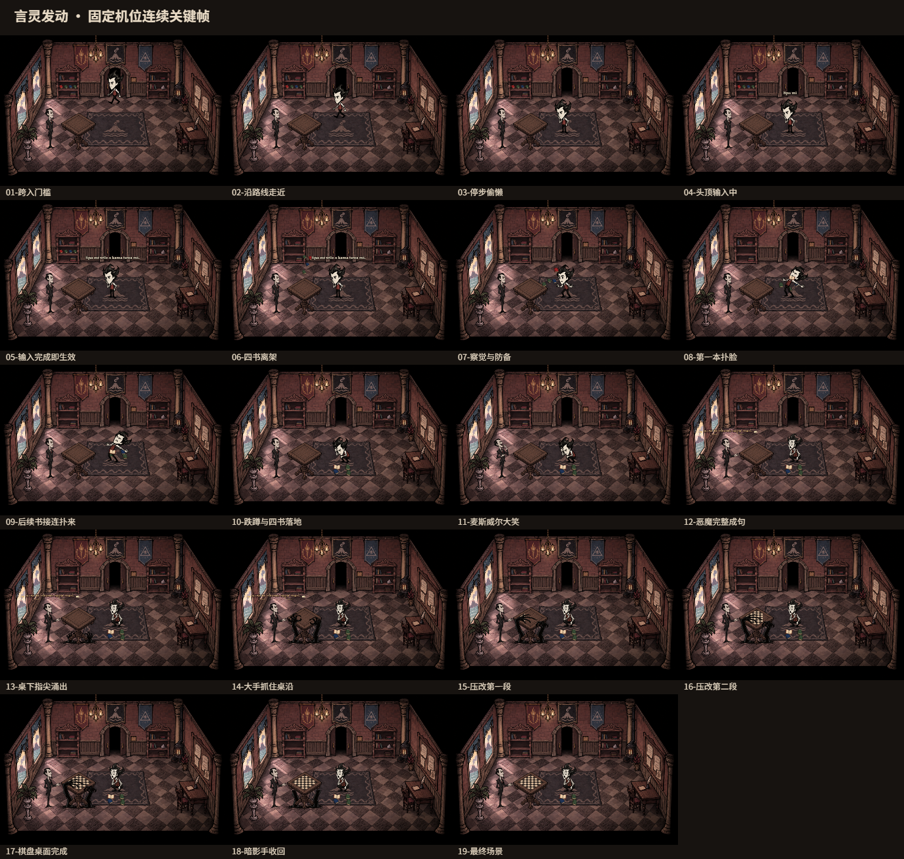
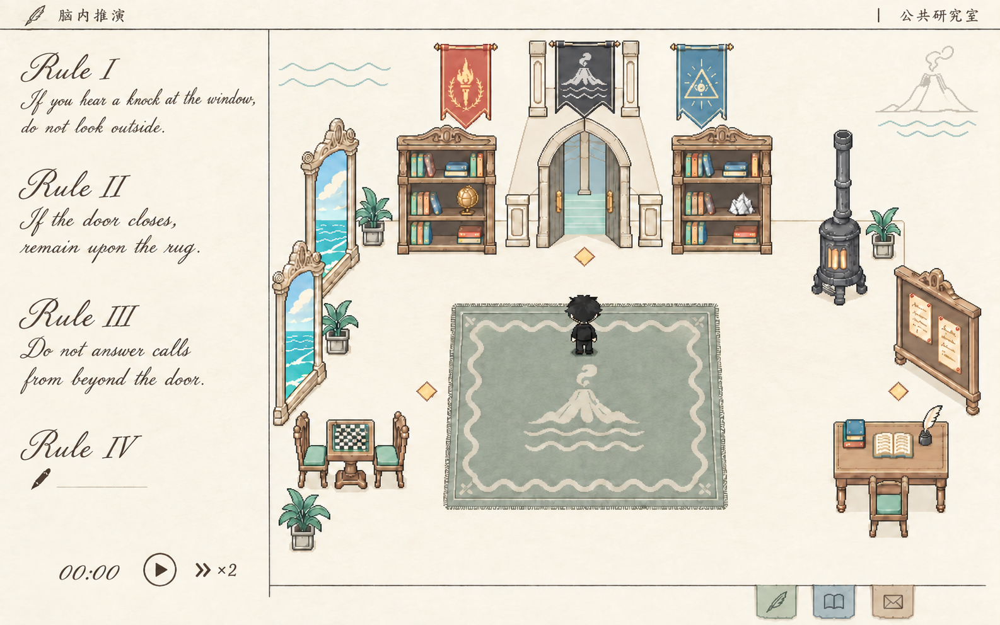
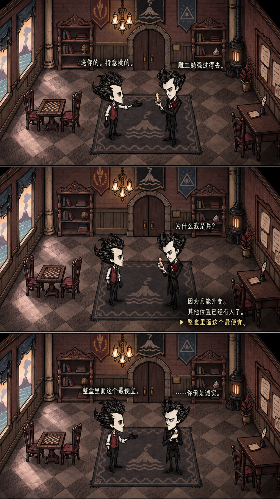

# 《安眠者有福》（Blessed Are Those Who Sleep）宣传片执行指导意见

## 目录
1. [展示定位与设计目标](#一展示定位与设计目标)
2. [世界观与剧情设定考证](#二世界观与剧情设定考证)
3. [美术与视觉系统考证规范](#三美术与视觉系统考证规范)
4. [展示片段与视听节奏规划](#四展示片段与视听节奏规划)

---

## 一、展示定位与设计目标

### 1. 展示定位
宣传内容划分为**印象片**与**机制演示**两个互补部分：
- **印象片负责建立心智预期与悬念**：展现恶魔的压迫感、威尔逊的推理，以及真名和言灵带来的极致危险感。不直接展现普通游戏UI与常规实机流程。
- **机制演示负责展示玩家核心玩法循环**：核心展示"脑内编写、推演、规则执行"，以及穿插的日常交互与轻度恶作剧。

### 2. 制作原则与范围边界
- **展示窗口外不制作**：仅对镜头明确涉及的交互、动作与场景进行专门设计与绘制，镜头之外不延展无意义系统与资产。
- **双重本体隔离**：核心引擎优先支持 C#，严格不依赖 Godot 场景树或实时物理。引擎负责离散行动值推进与主客观规则裁决；空间几何、碰撞、UI与渲染由游戏层自行解决。
- **角色制作范围**：首批严格只制作两名角色（以威尔逊为原型的主角侦探顾知微、以麦斯威尔为原型的恶魔伯爵）。其他同伴暂不提供模型或独立立绘。

---

## 二、世界观与剧情设定考证

### 1. 世界观知识与核心设定
- **双重本体（Dual Ontology）**：主客观二重世界并行维护。主观认知世界与客观物理世界相互隔离又互相影响。
- **言灵系统**：基于类似道本语（Toki Pona）的高度简化词汇、高语法复杂度语言。言灵的实现强调"真知的锚定性"，命令生效的首要依据是更高的位格，其次才是正确的语法。
- **规则怪谈与认知损害**：关注异常本身会造成心智损害。玩家利用规则，在不直接指认/不认识异常的前提下规避异常风险。
- **真名契约与反噬**：真名是高阶实体的完整指代，知晓真名即直接认知其本质。知晓或咏唱真名片段可撬动其力量并建立强制性契约，但未做好准备者会当场陷入疯狂或心智崩坏。
- **暴露风险增幅**：继承通过主动将自己暴露在危险境地提升法术权能的设定。

### 2. 核心人物设定
- **恶魔（Maxwell / 麦斯威尔）**：
  - "麦斯威尔"仅是他允许人类称呼的假名，真名无人知晓。
  - **教师属性**：人类知识的源泉（对应蛇予人智慧果的传说），立下契约后毫无保留地教授知识。
  - **绝对守约**：契约必定履行，代价公平即绝不毁约。
  - **无谎言**：所言字字属实，善于利用真实信息与诱导性提问诱使对方失衡。
  - **激发深渊**：放大人内心的渴望与执念，令人直面本心。
  - **行为特征**：优雅、从容、威压极强。平时可坐在桌前与学员下棋，极少调整坐姿，落子准确，等待时毫不焦躁。不可设计常驻獠牙或持续恶魔变形。
- **侦探（顾知微 / 威尔逊）**：
  - 玩家操控的主角，皇家研究学院的学员，同时保留侦探的观察本能。
  - **能力【浮游幻梦】**：能够在脑海中对现实场景进行还原和逆演推演，使用规则约束梦境中的人偶，以此分析真实规则或他人心智。
  - **性格特质**：克制、执拗、敏感，对"缺乏逻辑解释的事物"具有生理性的难受。
  - **弱点**：对事物之间的因果关联极其敏锐，因而极易受到认知侵蚀。
  - **行为特征**：平直发型轮廓、略长外套与冷灰色调。先观察再伸手，思考时极易忽略周围；受到认知侵蚀后出现重复检查、伸手悬空停顿、抓紧桌沿等慌乱肢体反应。

### 3. 背景背景与人员架构
- **孤岛皇家研究学院**：国家集中科研与工业资源在海外孤岛秘密建立的研究机构，专门系统性面对未知与超自然领域。
- **编制人员**：**16 名学员 + 4 名神秘学导师**。
- **主线推进**：主角与学员同伴受困于岛屿，在与恶魔的博弈中逐步发掘真相。

---

## 三、美术与视觉系统考证规范

### 1. 学院母国与孤岛地理
- **母国定位**：19世纪末至20世纪初高度工业化的君主制列强（大陆工业强国 + 远洋殖民列强）。
- **孤岛地理**：远离大陆但处于远洋补给网络内的温和火山岛。
- **核心地理象征**：**火山与海洋**。火山代表地心未知力量与研究对象；海洋代表隔绝、边界与远离母国的距离。

### 2. 建筑风格
- **整体风格**：克制的学院哥特复兴 / 历史主义公共建筑风格，混合朴素工业与科研设施。
- **主楼**：三层红砖墙体、深色板岩坡屋顶、灰白石材门框、少量尖拱窗与黑色铁件。
- **附属设施**：
  - **天文台**：高处砖石基座配金属穹顶，用于授时与异常天象观测。
  - **温室**：铸铁与玻璃结构，用于博物学与炼金植物培育。
  - **地下秘学设施**：位于地下的仪式室、封存室与密档室，避免夸张的"魔法塔"。

### 3. 画面风格体系：Stylized RPG TileMap + Oversized Hand-drawn Sprites + Cinematic Event Animation

三层视觉结构：

- **TileMap 场景层**：风格化 RPG 瓦片地图构建室内外空间。低饱和暖灰色调，保留手绘质感纹理。场景可滚动平移，支持多房间切换。
- **Oversized Sprites 角色层**：角色采用超比例手绘立绘风格，相对场景瓦片明显偏大，突出角色表情与肢体表演。角色拥有多套姿态帧与表情差分，不追求像素级动画帧数，强调关键姿态的表现力。
- **Cinematic Event Animation 事件层**：剧情关键节点触发独立演出动画（言灵发动、契约缔结、认知侵蚀等），采用逐帧手绘或骨骼动画专门制作，脱离常规场景交互的视觉规格。

演示核心场景为学院主楼一层的公共研究厅，兼具阅览、讨论与棋局功能。

### 4. 机构三旗与身份纹样体系
三面长旗按观众视角自左向右并列悬挂于正式空间上方：

- **左旗 · 皇家科学院**：红底金纹，中央为开放桂冠环抱燃烧火炬，象征现代科学与启蒙。
- **中旗 · 孤岛学院**：黑底银纹，中央为火山口切口与三道海波，为独立中央核心标识。
- **右旗 · 神秘学公会**：深蓝底银纹，中央为三角形中的全视之眼，象征感知与秘学观测。

- **王室体系**：最高合法性来源。完整徽记为盘曲团龙（仅用于正式印章和特许状），次级识别为双卷云头与回折尾。
- **创院贵族**：雄狮徽记，仅用于捐建牌与私人产业设备。
- **来源纹样载体**：
  - 王室双卷云：工坊铭牌、器物包角、装帧压纹。
  - 科学院火焰桂叶：精密仪器刻记、文书页角。
  - 学院火山海浪：门牌、餐具、织物边饰、书籍藏印。
  - 公会眼睑射线：档案扣件、秘密封印饰件。

---

## 四、展示片段与视听节奏规划

节奏编排以字幕卡点为唯一骨架，所有画面内容（印象片、机制演示、尾声）按字幕顺序嵌入。

### 1. 声音与配乐
- **开篇**：完全静音 / 环境音沉寂。
- **主体旋律**：不安小调与情绪递进。
- 开篇文本、演奏方式待定。

### 2. 字幕卡点与画面编排（约 2:00）

#### 开篇（静音）
- 前导文字打出：*安眠者有福 / Blessed Are Those Who Sleep*

#### *Sleep, my child;*
- 画面：成员间的互动——研究厅内阅读、下棋、壁炉旁谈话、送礼、恶作剧。

#### *May the blessing of ignorance be yours.*
- 画面：成员学习神秘术的经历——导师授课、言灵练习、脑内推演、实验记录。

#### *Would that I had never been called forth into this world.*
- 画面：恶魔和这些人的互动——棋局对峙、严肃教学，。

#### *Then you have chosen.*
- 画面：代价与反噬——认知崩坏、契约反噬、失控后果。

#### *All knowledge has its price.*
- 恶魔最后的低语。学员战胜恶魔、告别孤岛，悬崖旁告慰导师墓碑。

### 3. 机制演示素材

以下片段按需穿插于上述字幕段落中，每段控制在 5 秒以内：

- **言灵发动**：威尔逊偷懒召书，书砸脸；麦斯威尔一句话将木桌变为棋盘。展示位格差异。
- **脑内推演**：画面褪色过渡至米白工作台，灰色小人复演行动，左侧书写规则条目。
- **送礼互动**：威尔逊送麦斯威尔一枚小兵棋子，三项选择浮现，选"最便宜的"。
- **恶作剧规则**：玩家在公告墙贴恶搞规约，麦斯威尔因契约约束被迫执行后暴怒撕毁。
- **同伴保护**：威尔逊深陷推理，屏幕边缘蔓延侵蚀排线，同伴强行打断联想。

