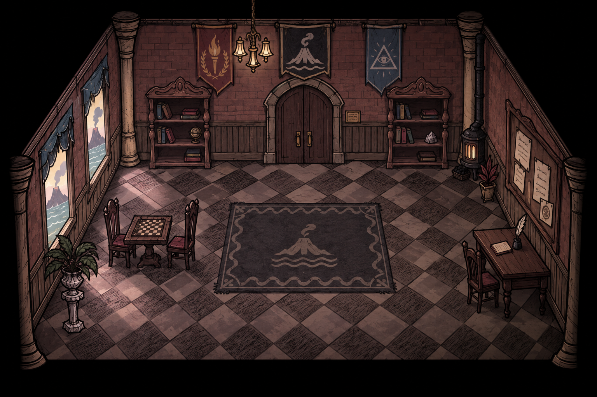

# 《安眠者有福》（Blessed Are Those Who Sleep）宣传片执行指导意见

## 目录
1. [展示定位与设计目标](#一展示定位与设计目标)
2. [世界观与剧情设定考证](#二世界观与剧情设定考证)
3. [美术与视觉系统考证规范](#三美术与视觉系统考证规范)
4. [切片场景时长计算](#四切片场景时长计算)

---

## 一、展示定位与设计目标

### 1. 展示定位
宣传内容划分为**印象片**与**机制演示**两个互补部分：
- **印象片负责建立心智预期与悬念**：展现恶魔的压迫感、威尔逊的推理，以及真名和言灵带来的极致危险感。不直接展现普通游戏UI与常规实机流程。
- **机制演示负责展示玩家核心玩法循环**：核心展示"脑内编写、推演、规则执行"，以及穿插的日常交互与轻度恶作剧。

### 2. 制作原则与范围边界
- **展示窗口外不制作**：仅对镜头明确涉及的交互、动作与场景进行专门设计与绘制，镜头之外不延展无意义系统与资产。
- **双重本体隔离**：核心引擎优先支持 C#，严格不依赖 Godot 场景树或实时物理。引擎负责离散行动值推进与主客观规则裁决；空间几何、碰撞、UI与渲染由游戏层自行解决。
- **角色制作范围**：首批严格只制作两名角色（以威尔逊为原型的主角侦探顾知微、以麦斯威尔为原型的恶魔伯爵）。其他同伴暂不提供模型或独立立绘。

---

## 二、世界观与剧情设定考证

### 1. 世界观知识与核心设定
- **双重本体（Dual Ontology）**：主客观二重世界并行维护。主观认知世界与客观物理世界相互隔离又互相影响。
- **言灵系统**：基于类似道本语（Toki Pona）的高度简化词汇、高语法复杂度语言。言灵的实现强调"真知的锚定性"，命令生效的首要依据是更高的位格，其次才是正确的语法。
- **规则怪谈与认知损害**：关注异常本身会造成心智损害。玩家利用规则，在不直接指认/不认识异常的前提下规避异常风险。
- **真名契约与反噬**：真名是高阶实体的完整指代，知晓真名即直接认知其本质。知晓或咏唱真名片段可撬动其力量并建立强制性契约，但未做好准备者会当场陷入疯狂或心智崩坏。
- **暴露风险增幅**：继承通过主动将自己暴露在危险境地提升法术权能的设定。

### 2. 核心人物设定
- **恶魔（Maxwell / 麦斯威尔）**：
  - "麦斯威尔"仅是他允许人类称呼的假名，真名无人知晓。
  - **教师属性**：人类知识的源泉（对应蛇予人智慧果的传说），立下契约后毫无保留地教授知识。
  - **绝对守约**：契约必定履行，代价公平即绝不毁约。
  - **无谎言**：所言字字属实，善于利用真实信息与诱导性提问诱使对方失衡。
  - **激发深渊**：放大人内心的渴望与执念，令人直面本心。
  - **行为特征**：优雅、从容、威压极强。平时可坐在桌前与学员下棋，极少调整坐姿，落子准确，等待时毫不焦躁。不可设计常驻獠牙或持续恶魔变形。
- **侦探（顾知微 / 威尔逊）**：
  - 玩家操控的主角，皇家研究学院的学员，同时保留侦探的观察本能。
  - **能力【浮游幻梦】**：能够在脑海中对现实场景进行还原和逆演推演，使用规则约束梦境中的人偶，以此分析真实规则或他人心智。
  - **性格特质**：克制、执拗、敏感，对"缺乏逻辑解释的事物"具有生理性的难受。
  - **弱点**：对事物之间的因果关联极其敏锐，因而极易受到认知侵蚀。
  - **行为特征**：平直发型轮廓、略长外套与冷灰色调。先观察再伸手，思考时极易忽略周围；受到认知侵蚀后出现重复检查、伸手悬空停顿、抓紧桌沿等慌乱肢体反应。

### 3. 背景背景与人员架构
- **孤岛皇家研究学院**：国家集中科研与工业资源在海外孤岛秘密建立的研究机构，专门系统性面对未知与超自然领域。
- **编制人员**：**16 名学员 + 4 名神秘学导师**。
- **主线推进**：主角与学员同伴受困于岛屿，在与恶魔的博弈中逐步发掘真相。

---

## 三、美术与视觉系统考证规范

### 1. 学院母国与孤岛地理
- **母国定位**：19世纪末至20世纪初高度工业化的君主制列强（大陆工业强国 + 远洋殖民列强）。
- **孤岛地理**：远离大陆但处于远洋补给网络内的温和火山岛。
- **核心地理象征**：**火山与海洋**。火山代表地心未知力量与研究对象；海洋代表隔绝、边界与远离母国的距离。

### 2. 建筑风格
- **整体风格**：克制的学院哥特复兴 / 历史主义公共建筑风格，混合朴素工业与科研设施。
- **主楼**：三层红砖墙体、深色板岩坡屋顶、灰白石材门框、少量尖拱窗与黑色铁件。
- **附属设施**：
  - **天文台**：高处砖石基座配金属穹顶，用于授时与异常天象观测。
  - **温室**：铸铁与玻璃结构，用于博物学与炼金植物培育。
  - **地下秘学设施**：位于地下的仪式室、封存室与密档室，避免夸张的"魔法塔"。

### 3. 画面风格体系：Stylized RPG TileMap + Oversized Hand-drawn Sprites + Cinematic Event Animation

三层视觉结构：

- **TileMap 场景层**：风格化 RPG 瓦片地图构建室内外空间。低饱和暖灰色调，保留手绘质感纹理。场景可滚动平移，支持多房间切换。
- **Oversized Sprites 角色层**：角色采用超比例手绘立绘风格，相对场景瓦片明显偏大，突出角色表情与肢体表演。角色拥有多套姿态帧与表情差分，不追求像素级动画帧数，强调关键姿态的表现力。
- **Cinematic Event Animation 事件层**：剧情关键节点触发独立演出动画（言灵发动、契约缔结、认知侵蚀等），采用逐帧手绘或骨骼动画专门制作，脱离常规场景交互的视觉规格。

演示核心场景为学院主楼一层的公共研究厅，兼具阅览、讨论与棋局功能。

### 4. 机构三旗与身份纹样体系
三面长旗按观众视角自左向右并列悬挂于正式空间上方：

- **左旗 · 皇家科学院**：红底金纹，中央为开放桂冠环抱燃烧火炬，象征现代科学与启蒙。
- **中旗 · 孤岛学院**：黑底银纹，中央为火山口切口与三道海波，为独立中央核心标识。
- **右旗 · 神秘学公会**：深蓝底银纹，中央为三角形中的全视之眼，象征感知与秘学观测。

- **王室体系**：最高合法性来源。完整徽记为盘曲团龙（仅用于正式印章和特许状），次级识别为双卷云头与回折尾。
- **创院贵族**：雄狮徽记，仅用于捐建牌与私人产业设备。
- **来源纹样载体**：
  - 王室双卷云：工坊铭牌、器物包角、装帧压纹。
  - 科学院火焰桂叶：精密仪器刻记、文书页角。
  - 学院火山海浪：门牌、餐具、织物边饰、书籍藏印。
  - 公会眼睑射线：档案扣件、秘密封印饰件。

---
## 四、切片场景时长规划

### 1. 展示片短版与音乐剪辑基准

目标总长为 **2:10.333，约 2 分 10.3 秒**，包含 5 秒无声前导及 125.333 秒音乐。时间格式为“分:秒.毫秒”，不是帧号；制作时按项目帧率就近落帧，不逐镜头累加取整误差。

配乐依据为《The Unfallen Duet v3》：4/4 拍，四分音符 = 180，每小节 4/3 秒。原曲 110 小节，理论时长 146.667 秒。展示片短版按 **94 小节**规划，完整主题曲另行保留，不整体加速。

本版暂按保留原谱 **M1–68、M85–110**、缩去 **M69–84 共16小节**进行排期，减少地下展开约21.333秒。以下所有 M 编号仍指原谱，跳号是短版剪辑造成的，不是漏拍。原谱 M85–88 为属准备，M89 才进入大调爆发。

这是剪辑工作方案，尚未修改 MSCX 或完成音频剪辑。M68→M85 的接缝须试听核对和声衔接、音域、织体与混响尾音；必要时在原有拍数内改写衔接。谱面的 stringendo、allargando 等文字没有对应数值变速，本排期按180 BPM计算，最终以短版音频实测时间为准。

### 2. 无声进入（0:00.000–0:05.000，5秒）

* 镜头 01 孤岛学院远景：0:00.000–0:05.000，5秒。建立孤岛与学院的位置关系，末尾准备切入日常。

### Part I 学院日常与学术研读（原谱M1–M12，0:05.000–0:21.000，16秒）

音乐于0:05.000启奏。每个日常镜头保留一个明确动作，镜头内可由环境建立转入人物反应。

* 镜头 02 早餐：0:05.000–0:09.000，4秒，M1–3。盛餐、接过餐盘，交代共同生活。
* 镜头 03 小型聚会：0:09.000–0:13.000，4秒，M4–6。以一次交谈与回应表现同伴关系。
* 镜头 04 音乐：0:13.000–0:17.000，4秒，M7–9。演奏动作与钢琴乐句衔接。
* 镜头 05 下棋：0:17.000–0:21.000，4秒，M10–12。展示落子及对手的短暂反应，不要求观众理解复杂棋局。

### Part II 恶魔授业与法则初显（原谱M13–M28，0:21.000–0:42.333，21.333秒）

小提琴首次进入时切到言灵课堂。失败与成功沿用同一机位和同一对象，便于观众辨认改变。

* 镜头 06 言灵课——失败：0:21.000–0:23.667，2.667秒，M13–14。命令发出，对象没有按预期响应。
* 镜头 07 言灵课——成功：0:23.667–0:26.333，2.667秒，M15–16。突出订正处与立即出现的结果。
* 镜头 08 图书馆：0:26.333–0:29.000，2.667秒，M17–18。翻页、比对或发现一处关键记载。
* 镜头 09 化学家的阵法错误：0:29.000–0:31.667，2.667秒，M19–20。错误集中在一处可见的阵线或连接。
* 镜头 10 导师纠正：0:31.667–0:35.667，4秒，M21–23。指认错误、修正、观察局部恢复。
* 镜头 12 学生失控、救场：0:35.667–0:42.333，6.667秒，M24–28。依次呈现异常扩大、导师介入及暂时稳定，保留结果辨认时间。

### Part III 脑内推演机制核心（原谱M29–M48，0:42.333–1:09.000，26.667秒）

以同一个问题串联“编写—运行—失败—修改—验证”。多人模拟中只突出一条关键因果链，避免同时要求观众阅读长文本和追踪多个角色。

* 镜头 13 进入脑内研究：0:42.333–0:46.333，4秒，M29–31。现实场景转为可操作的脑内复原。
* 镜头 14 编写人物规则：0:46.333–0:51.667，5.333秒，M32–35。展示一条简短条件与对应行动，留出阅读时间。
* 镜头 15 RUN 多人模拟：0:51.667–0:57.000，5.333秒，M36–39。启动后按离散行动顺序推进，突出关键角色的选择。
* 镜头 16 推演失败：0:57.000–1:02.333，5.333秒，M40–43。明确显示失败位置及导致失败的条件。
* 镜头 17 重新推演重返现实：1:02.333–1:09.000，6.667秒，M44–48。只修改一个关键条件，确认新结果，再以相同构图返回现实。

### Part IV 地下密室与法则探求（短版保留原谱M49–M68，1:09.000–1:35.667，26.667秒）

由原曲48秒地下段缩编为约26.7秒。画面保留五个叙事节点，音乐不再完整展开原谱M69–84的机件暗涌与风暴汇聚。

* 镜头 18 真名：1:09.000–1:17.000，8秒，M49–54。通过发现残片、比对与认知异常逐步推进，避免铭文静止展示8秒。
* 镜头 19 规则改变通路：1:17.000–1:22.333，5.333秒，M55–58。条款成立后，对应通路发生清楚变化。
* 镜头 20 规则定义过宽：1:22.333–1:26.333，4秒，M59–61。让非预期对象也响应，直接展示范围错误的后果。
* 镜头 21 棋子：1:26.333–1:31.667，5.333秒，M62–65。以落子连接路线或人物选择，为后续行动提供意图。
* 镜头 22 夜间训练：1:31.667–1:35.667，4秒，M66–68。用一个有明确起止的训练动作过渡到地下冲突。

### Part V 终极冲突与主旋律大爆发（原谱M85–M106，1:35.667–2:05.000，29.333秒）

三个镜头编号代表三个演出段，内部包含动作推进与必要的局部切片，不把三张静帧分别延长填满时长。

* 镜头 23 地下冲突（属准备）：1:35.667–1:41.000，5.333秒，M85–88。对峙、危险逼近、行动准备。M88末拍约1:40.667–1:41.000为全体休止，可短暂冻结或切黑。
* 镜头 24 巨大阵法启动（主旋律）：1:41.000–1:51.667，10.667秒，M89–96。**1:41.000、M89第一拍点亮主阵**；随后展示锚点依次响应与全阵成立，让音乐高潮对应可见的协作结果。
* 镜头 25 反制与切黑（超技对决）：1:51.667–2:05.000，13.333秒，M97–106。依次呈现恶魔反制、主角识别漏洞及反向执行；保留一次结果反应，末尾转黑，为尾声留出落点。

### Part VI 尾声定格（原谱M107–M110，2:05.000–2:10.333，5.333秒）

* 尾声 铭文与 Logo：2:05.000–2:10.333，5.333秒。前两小节让铭文与标题显现；M109回到主和弦时，即2:07.667起，标题稳定停留至结束。

### 3. 执行与对齐要求

先保证机制镜头的可理解性，再微调日常转场。普通切镜可在小节边界附近调整，关键事件对齐音乐落点；各段内部调整不改变段落总长，不把每个切镜都强行对齐重拍。上述三位小数为排期显示值，底层按精确小节长度累计。

保留原镜头编号，镜头11仍为空缺。单张分镜图只绘制对应演出段的首个状态；后续动作与切片在动画、实机录制或剪辑阶段补齐，不能用单张首帧替代完整演出。
