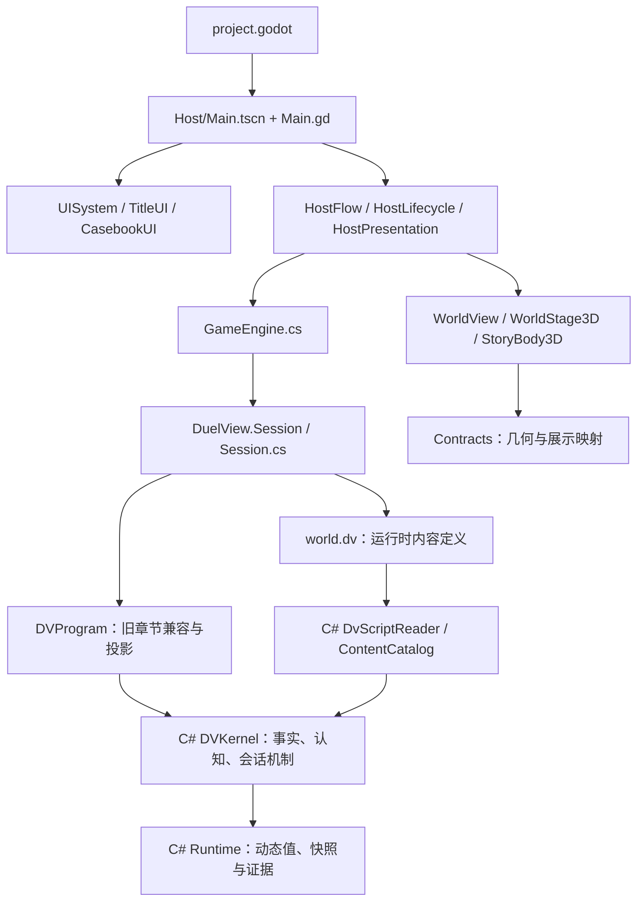

# 《安眠者有福》游戏结构

本文件以 2026-10-26 的实际项目为准，说明 CLI 与 Godot 自动、AI、人工操作及单场景检查的组件、入口与验收范围；但是设计案中的六章规划仍与已实现内容分别记录。

## 入口与依赖



Godot 项目根目录是 `godot_csharp/`，启动场景为 `scenes/Host/Main.tscn`。自动加载的 `GameLocale`、`GameAudio`、`GameSettings` 分别管理语言、音频与设置。玩家输入经宿主提交到会话，C# Core 执行机制，DV 提供外部内容，兼容章节生成观察者投影，宿主据此驱动世界、对话和案卷界面。

## 各目录的职责

| 路径 | 职责 |
| --- | --- |
| `dv_core/compiler/` | C# 实现的旧章节兼容编译器，链接 Core 的共享运行时；没有自举 |
| `dv_core/base/` | `DuelView.Core` 工程；`Kernel/` 组织机制，`Runtime/`、`Values/`、`Evidence/` 提供共享基础，`Content/` 解析与装配 DV |
| `dv_core/modules/` | 七个旧章节、公共声明及拓扑兼容模块；逐步转为运行时定义 |
| `dv_core/host_bridge/` | `DuelView.Session` 工程，承接 DV 与 C# 宿主之间的数据、证据、投影和回放 |
| `godot_csharp/Content/world.dv` | 运行时加载的物品、人物性格、规则和初始布置 |
| `godot_csharp/Contracts/` | 几何、人物与地图展示映射，以及独立演示舞台的数据 |
| `godot_csharp/scenes/Host/` | 入口、生命周期、会话桥接、操作流程、回放和诊断 |
| `godot_csharp/scenes/World/` | 全游戏共用地图、场内视图、角色与恢复的 E 三维美术库；但是美术库恢复与正式三维接线分别验收 |
| `godot_csharp/scenes/Shared/` | 输入、语言、设置、音频、场景资源与世界绘制的公共实现 |
| `godot_csharp/scenes/World/Actors/` | `StoryActor` 保留逻辑适配，`StoryBody3D` 执行三维碰撞并展示导入人物；但是静态模型尚无走路、坐起动画 |
| `godot_csharp/scenes/UI/` | 标题、书桌、翻页、HUD、对话、调查、案卷与模态交互 |
| `godot_csharp/scenes/Highlights/` | 独立节选演示及其舞台、角色和效果；不作为完整剧情验收 |
| `godot_csharp/ShareAsset/Internal/` | 已发布角色、道具、纹理、声音与资源元数据 |
| `godot_csharp/ShareAsset/External/` | 字体、图像与第三方许可证 |
| `mcp/build/` | 编译缓存、依赖图和按模块生成 C# 的 Python 工具 |
| `dv_core/cli/` | 正式 JSON 行文本宿主，供 CLI 人工、AI 和全自动操作共用 |
| `mcp/game/` | 将 CLI、真实 Godot 窗口包装为统一的 MCP 操作与观察工具 |
| `docs/` | 三份设计案与本结构文件 |

`.git` 是版本数据库；`.godot`、`bin`、`obj`、`__pycache__` 是生成物。`.scratch` 中的测试脚本、临时测试工程、测试报告及其构建产物已逐文件清理；其余原有美术参考、素材工作副本不属于本文件的游戏和测试入口。

## Core 与 DV 的边界

剧情文本、人物倾向与认知设定、接纳规则、世界法则及世界物体全部以 `.dv` 为内容源码，解释与演算机制以 C# 为源码；但是旧章节中尚存的内容装配和机制辅助会继续按此边界迁移，不能把兼容层误写成迁移已经完成。

本次将 17 个人物姓名、16 份自主行为参数与习惯、契约全文和两类侦探认知模板接入 `world.dv`，C# 按 DV 的行动—需求映射进行评分，并执行通用时间条件分析；但是其余章节叙事、认知初始化样本、法则与世界实例仍由七个 `.dv` 兼容模块提供。

`narrative` / `叙述` 声明文本，`profile` / `认知` 声明认知模板，人物的 `autonomy` 提供需求权重、行动映射和习惯，设为 `false` 表示关闭；但是已创建状态中的文本与认知初始化保持稳定，修改叙事或认知模板需要新局，人物自主参数可在安全动作边界重载。

**已采用：Core 用 C#，外部内容语言叫 DV，放弃自举。** `base/Kernel/` 是唯一维护的内核机制源码，按世界、认知、规划、通信、会话与基础记录分组；不再在构建时从 `.dv` 生成机制。初次迁移保留了原有 `object`、动态记录与函数 ABI，尚未完成类型化世界模型重构，不能据此宣称换语言已经提速。

`Content/DvScriptReader.cs` 以 C# 实现有界声明式 DV 解析，`Content/ContentCatalog.cs` 校验并装配定义，`Content/ContentPolicy.cs` 装配人物遵守的规范。C# 不存具体人物、物品或世界规则的静态表。`Runtime/` 保留通用动态值、记录、快照、缓存和每会话内容作用域，`Values/Rational.cs` 负责精确数值，`Evidence/BinaryEvidence.cs` 负责二进制存储编码。

`godot_csharp/Content/world.dv` 是实际运行入口。目前已接入 **4 个初始物品、1 条触闩法则、17 份人物性格档案和 1 组初始物品布置**。人物声明有 `obeys` 规范列表；当前生产内容的这些列表为空，既有剧情中获得的规范继续保留。其他章节定义仍在下面七个兼容模块内，不能把这一轮说成所有内容都已支持热加载。

| 兼容模块 | 当前职责 |
| --- | --- |
| `35-campaign-schema.dv` | 公共声明与内容辅助；已从运行时 DV 读取四件物品描述及人物性格 |
| `36-island-topology.dv` | 既有地点与连接拓扑 |
| `40-chapter1.dv` | 第一章行动、对话、转场；初始物品与触闩法则已从运行时 DV 读取 |
| `50-chapter2.dv` | 第二章生活、环境、角色行为与案件 |
| `55-island.dv` | 岛屿内容及世界安装 |
| `56-island-cases.dv` | 岛屿案件与行动 |
| `60-game.dv` | 入口、配置、快照、主观地图、选项与展示投影；装配外部人物规范 |

这些兼容模块由 **C# `NativeCompiler.cs`** 在构建时生成 `DVProgram`；它不编译自身。旧 `10-compiler.dv`、种子工程、`20-core.dv` 和 `30-session.dv` 已逐文件移除，不恢复 C1/C2/C3 链。生产入口仍是 `dvg_open()` / `dvg_host_open(options)`，宿主对外边界仍是 `DvSession`。

### Core 内部组织

大文件已按完整职责移动为以下目录。35 个机制文件仍组成同一个 `DVKernel` partial 类型，保留内部直接调用和 DV ABI；这属于源码职责整理，没有引入跨模块消息层，也没有声称所有依赖已单向化。

| 目录 | 职责与主要文件 |
| --- | --- |
| `Kernel/Values/` | `Records.cs`：记录操作、通用 ID 查找与序列替换 |
| `Kernel/World/` | 引用、世界状态、条件/时间、法则执行、感知投影、行动成本、环境推进与现实模拟 |
| `Kernel/Cognition/` | 推理、人物认知、可见性、价值评价、印刻求解、证明、解释与论证验证 |
| `Kernel/Planning/` | 决策、个人策略、行动资格、预测、因子证明、模型执行与导航评分 |
| `Kernel/Communication/` | 请求/建议与言语接收、解释、规范处理 |
| `Kernel/Session/` | 事件、因果来源、会话生命周期、调度、完成提交、演出与玩家控制 |
| `Runtime/` | `Context`、`Primitives`、`CausalIndex`、`Records`、`Predicates`、`Memoization`、`Snapshots`、`Exchange`、`EvidenceOutput`，共同组成 `R` partial 类型 |
| `Content/` | 外部 DV 解析、校验、装配；不包含具体剧情静态表 |
| `Values/`、`Evidence/` | 独立的精确有理数 ABI 和二进制证据编解码 |

本轮合并了两个只转发的事件包装，调用统一到 `dvs_event`；角色/房间线性查找统一到 `dv_index_by_id`，仍返回首个匹配下标或 -1，事实查找也复用它。两组规划/声明缓存统一使用私有读写机制，保留各自开关；记录形状判断共用运行时算法，缓存开关仍有效。此前整理合并了重复内核接口，保留 `dvs_listener_mapping` 的映射约定；但是接口数量会随本次新增的通用内容与条件机制变化。移除 1208 个空 `else` 分支。没有重写核心推理、数值、调度与证据算法。

独立章节编译器直接链接这些共享运行时文件，编译缓存指纹覆盖全部链接源码。兼容接口发现递归读取 Core 源文件并排除 `bin`、`obj`，避免拆分文件后遗漏脚本 API。

### DV 外部脚本语法

DV 有真正的声明、记录、数组与条件/效果表达式；不是将 JSON 文件改后缀。解析后的内部表示与 MCP 传输仍可使用 JSON。

```dv
schema "dv-script-v1";
item coat {
  name = "风衣";
  group = "chapter1";
  kind = "physical";
  map_kind = "object";
  visible_fields = ["name", "location"];
  facets = { state = { worn_by = ""; }; identity = { owner = "detective"; }; };
}
layout chapter1 {
  items = { coat = "R05"; };
}
character detective {
  personality = {
    group = "living"; domain = "investigation";
    station_roles = []; value_order = ["truth", "survival"];
  };
  obeys = [];
}
rule example {
  version = 1;
  premise = eq(ref("coat", "state", "location"), "R05");
  effects = [assign(ref("coat", "state", "worn_by"), "detective")];
}
```

以上是语法示例，生产定义以 `world.dv` 为准。声明也接受 `物品`、`人物`、`规则`、`布置`；支持 `//` / `#` 注释、字符串、有限数值、布尔值、数组和记录。允许的表达式为 `ref`、`eq`、`at_least`、`all`、`not`、`assign`、`increment`、`truth`、`rational`；不调用任意 C# 或系统函数。重复声明/字段与未知函数会报错，并给出行列位置；解析限制深度 64、节点 200000。

人物 `obeys` 中每条规范提供 `id`、`method`、`mode`（`forbid` 或 `prefer`）、`available_when` 条件和非空 `basis` 来源。它们通过既有 Core 的规范机制执行，不另建一套人物 AI。

### 动态加载、修改与存档

新局默认加载 `world.dv`；MCP 的 `on`、`CliMCP`、`GodotMCP` 可传 `content_path`。输入工具仍只有四个，重载是现有 `step` 的操作：

```json
{"session_id":"<on 返回值>","operation":{"type":"reload_content","path":"<DV 文件绝对路径>"}}
```

省略 `path` 使用该会话入口的内容路径；也可传 `content_source` 字符串直接提供 DV。CLI 观察返回内容 schema、hash、各类定义数量及最近重载摘要；Godot 返回 `content_hash`，解析失败可从 `content_error` 读取。

候选文件先完整解析校验，成功后再提交。错误输入保留旧内容与状态版本；有待完成的宿主动作时拒绝重载。已经排期的动作涉及被修改法则或人物时，也拒绝修改。已安装法则按标识更新并保留绑定；不允许移除仍在使用的定义。物品名称与可见字段可更新，但不重置位置、所有权或穿戴状态。人物价值顺序与外部规范可更新；群组、领域、岗位角色变化需要新局。初始属性、布置和新增实例在创建时应用，修改布局不传送现有物品。

重载保留已学规范、信念与证据，不给人物凭空补充全知信息。存档内嵌原始 DV 源文与 hash，读档使用存档版本；每个会话有独立内容作用域。规则热更新覆盖物理世界已采用的法则，人物旧认知继续按游戏认识机制演化。

## 场景、界面与资源

共用场景现按职责整理为 `scenes/World/Maps`（21 个地图场景）、`World/Field`（地图适配）、`World/Runtime`（现场运行）和 `World/Actors`（角色），共用地图位图位于 `ShareAsset/Internal/Props/World`；但是这些目录调整保留既有游戏行为，不能等同于已完成三维换代。

用户指定的 E 美术方案原在 `scenes/ArtStyleTrials/E/`，提交 `4c64b84a` 删除了它，本次从该提交父版本恢复 40 个源文件至 `World/Art`，并恢复原生地毯和墙纸位图；但是历史美术库尚有静姿人物、室外位图保留和正式宿主未接线等边界，不能直接称为完整 3D 游戏。

目录重构后，正式 Godot 自动 MCP 在 40 秒预算内取得 143 次观察并抵达活动厅（版本 60，游戏时间 496），没有宿主错误，报告为 `.runtime/runs/godot-dd814e27cf9c8b3579749099/report.json`；但是该次状态为 `deadline_reached` 且宿主已停止，仅证明实际运行路径未因目录迁移中断。


`UISystem` 统一组织 HUD、对话、调查和案卷，`UITransition` 管理过渡与焦点。`TitleUI` 通过 `DeskStage3D`、`BookProjection3D`、`BookLeafTurn3D` 展示书桌与翻页。`CasebookData` 组织案卷数据，`BookArchivePage` 和 `BookSettingsPage` 提供档案与设置页面。

正式世界由 `StoryActor` 适配 DV 坐标、`StoryBody3D` 执行三维运动，节选舞台使用 `HighlightActor`；但是两者仍保留独立实现，正式世界静态人物不代表坐姿动画已完成。公共资源加载、输入、音频、语言与设置集中在 `Shared` 中。

`geometry_contract.json` 描述地图几何及交互位置；`presentation_catalog.json` 映射人物、地图和世界视图；`highlight_stages.json` 明确标记舞台节选及文本状态。`ShareAsset` 下的 `publication.json`、`manifest.json` 等记录发布来源，部分指向已经不在仓库的素材生产工具，作为历史出处保留，不冒充可运行依赖。

图片、字体和音频按路径或格式化字符串动态加载，不能只凭文字搜索中缺少完整路径就判为无用。`.uid` 与 `.import` 配合 Godot 资源管理保留，许可证随外部资源保留。

## 构建与维护

```powershell
dotnet build godot_csharp/DualOntologyWorldEngine.csproj
```

Core 直接编译维护中的 C#。宿主工程的构建前任务只为七个旧章节模块调用 Python 兼容工具；可单独运行 `python mcp/build/build_session.py --out dv_core/host_bridge/obj/dv`。`--base-only`、`--partition` 与自举固定点检查已经移除。

`dv_toolchain.py` 构建 C# `DvCompiler.csproj`，按其源码指纹缓存编译器，从 Core C# 导出供旧章节使用的函数签名。模块按源码、导入接口与编译器身份缓存；生成文件只写入 `obj`。运行时 `world.dv` 随宿主发布，不需要先生成 C#。过期生成文件按明确文件名逐项移除，不递归删除目录。

## 保留内容的实际使用关系

下表核对本轮编写或修改后保留的全部生产文件；路径相对于项目根目录。保留依据是实际调用或构建依赖，不是文件名看起来相关。

| 保留文件 | 使用位置与用途 | 归属 |
| --- | --- | --- |
| `dv_core/base/Kernel/**/*.cs` | Core 工程直接编译，35 个按职责组织的唯一机制实现文件 | 游戏运行 |
| `dv_core/base/Content/DvScriptReader.cs`、`ContentCatalog.cs`、`ContentPolicy.cs` | 解析、校验外部 DV 并装配到正式内核 | 游戏运行、两类测试 |
| `dv_core/base/DvMappingAttribute.cs` | 兼容前端导出映射返回值签名 | 游戏构建 |
| `dv_core/compiler/NativeCompiler.cs`、`DvCompiler.csproj` | C# 实现的旧章节兼容前端 | 游戏构建 |
| `dv_core/host_bridge/SessionContent.cs` | 正式会话内容重载、存档与安全边界 | 游戏运行、Cli/Godot 测试 |
| `godot_csharp/Content/world.dv` | 宿主默认内容，Godot 与 CLI 共用 | 游戏运行、两类测试 |
| `dv_core/base/Runtime/*.cs`、`Values/Rational.cs`、`Evidence/BinaryEvidence.cs` | Core 编译，并由独立兼容编译器以同一份源码链接；动态值与证据依赖 | 游戏构建与运行 |
| `dv_core/host_bridge/SessionEvidence.cs` | `DvSession` 的证据生命周期与存档边界；通过既有只读 Field 路径统计计划动作 | 游戏运行、Cli/Godot 自动测试 |
| `dv_core/modules/40-chapter1.dv` | `60-game.dv` include；第一章内容 | 游戏运行 |
| `dv_core/modules/50-chapter2.dv` | `60-game.dv`、`55-island.dv` include；第二章内容 | 游戏运行 |
| `dv_core/modules/60-game.dv` | `build_session.py` 默认内容入口，生成的 `DVProgram` 供会话桥调用 | 游戏运行 |
| `mcp/build/dv_toolchain.py` | `build_session.py` 导入，构建 DV 编译器并解析依赖图 | 游戏构建 |
| `mcp/build/build_session.py` | 宿主 `.csproj` 编译前任务调用，只生成兼容章节 | 游戏构建 |
| `godot_csharp/scenes/Host/Main.gd` | `Main.tscn` 挂载，`project.godot` 主场景 | 游戏运行 |
| `godot_csharp/scenes/Host/GameEngine.cs` | `Main.gd` 实例化，提交正式会话操作 | 游戏运行 |
| `godot_csharp/scenes/Host/DevConsole.gd` | `Main.gd` 实例化，控制台查看状态、输入命令与打开真实记录 | Godot AI 测试 | 输入 MCP 的 `on(backend="godot")`、`step`、`observe`、`close` | AI 依据真实窗口的新观察选择操作；但是全自动决策仍由自动 MCP 中的引擎 AI 执行 |
| Godot 人工测试 |
| `godot_csharp/scenes/Host/ReplaySession.gd` | `DevConsole → ReplayStage → ReplaySession`；实际记录的只读展示端点 | Godot 人工测试 |
| `godot_csharp/scenes/World/Field/CampusMapView.gd` | `CampusMapView.tscn` 挂载，`Main.gd` 和展示目录引用 | 游戏运行 |
| `godot_csharp/scenes/World/Runtime/RoomArtFinish.gd` | `CampusMapView.gd` 在地图布局中调用 `attach` | 游戏运行 |
| `godot_csharp/scenes/World/Runtime/WorldView.gd` | `Main.gd` 实例化，展示场景与角色 | 游戏运行 |
| `godot_csharp/scenes/Shared/Audio/GameAudio.gd` | `project.godot` 的 `GameAudio` 自动加载项 | 游戏运行 |
| `godot_csharp/scenes/Shared/Settings/GameSettings.gd` | `project.godot` 的 `GameSettings` 自动加载项 | 游戏运行 |
| `godot_csharp/scenes/UI/TitleUI.gd` | `TitleUI.tscn` 挂载，`Main.gd` 创建标题界面 | 游戏运行 |
| `godot_csharp/scenes/UI/BookProjection3D.gd` | `TitleUI.gd` preload 并创建书页投影 | 游戏运行 |
| `godot_csharp/scenes/UI/DeskStage3D.gd` | `TitleUI.tscn` 挂载书桌舞台 | 游戏运行 |
| `godot_csharp/scenes/UI/DialogueUI.gd` | `DialogueUI.tscn` 挂载，`UISystem.gd` 创建 | 游戏运行 |
| `godot_csharp/scenes/UI/InvestigationUI.gd` | `InvestigationUI.tscn` 挂载，`UISystem.gd` 创建 | 游戏运行 |
| `godot_csharp/scenes/UI/ModalPanel.gd` | `InvestigationUI.gd` 继承，处理调查界面的输入与关闭 | 游戏运行 |
| `godot_csharp/scenes/Highlights/HighlightActor.gd` | `Highlights.gd` preload 并创建舞台角色 | 单场景测试 |
| `docs/游戏结构.md` | 使用本文件的入口表和组件清单开展人工检查；前三份设计案作为内容与美术验收依据 | Godot 人工测试、单场景测试 |
| `dv_core/cli/Program.cs`、`DuelView.Cli.csproj` | 调用 `DvSession` 的正式文本宿主；MCP 直接启动此可执行程序 | 三种 Cli 测试 |
| `mcp/game/server.py`、`requirements.txt` | 官方 MCP SDK 的三个工具面；输入仅四个接口，自动入口仅两个工具 | 两类测试的调用入口 |
| `mcp/game/runtime.py` | 两种测试调用方式共用的正式宿主、进程与截止时限实现 | 两类测试 |
| `mcp/game/automation.py` | 一次调用自行推进引擎 AI、采集观察并按截止时限停止 | Cli 全自动、Godot 自动测试 |
| `mcp/game/environment.py` | 检测、校验、复制或下载项目内 C# Godot 和 .NET SDK | 两类测试所需的环境准备 |
| `.gitignore` | 排除本地环境与测试产物 `.runtime/` | 游戏和测试环境维护 |
| `godot_csharp/scenes/Host/McpControl.gd` | `project.godot` 的 `GameMcp` 自动加载项；只在 MCP 端口参数存在时开启本机传输 | Godot 自动测试、人工测试、单场景测试 |
| `godot_csharp/project.godot` | 主场景与自动加载配置；正常游玩不监听 MCP 端口 | 游戏运行 |
| `AGENTS.md` | 规定主代理和 SubAgent 使用上述 MCP、会话隔离及禁止回放冒烟 | 两类测试的执行规范 |

`DualOntologyWorldEngine.sln` 仅移除已放弃的 Seed 项目，保留其他工程。未在本轮修改的既有素材仅列入文件索引；索引本身不构成它们在当前场景实际加载的证明。

## 路线决策与验收

最终采用 C# Core + DV 内容层。依据是现有 Godot .NET / CLI 共用宿主与调试工具链，以及机制和内容分离的实际需要。旧 DV 全 Core 方案需要继续维护通用语言编译工具；Python 等动态语言替换 Core 会增加绑定、部署、确定性和状态所有权迁移工作。本轮保留动态值 ABI 是降低迁移语义风险的过渡，之后再按正式性能数据逐个职责改为明确类型与索引。

行业参照包括 [Godot 语言分层说明](https://docs.godotengine.org/en/4.6/getting_started/step_by_step/scripting_languages.html)、[Epic 编程与 Blueprint 协作](https://dev.epicgames.com/documentation/en-us/unreal-engine/guidelines-for-programming-for-blueprints?application_version=4.27)、[Factorio 对 Lua 确定性的约束](https://lua-api.factorio.com/latest/auxiliary/libraries.html)、[ink 的 C# 运行时集成](https://github.com/inkle/ink/blob/master/Documentation/RunningYourInk.md)。这些实例支持按机制与内容分层的工程判断，不构成本项目速度提升的证据。

迁移验收从正式新局与可用操作出发，核对状态、选项、认知、时间与来源，不回放历史、不注入快照。运行时 DV 已通过输入 MCP 验证物品改名、法则版本、人物价值顺序更新，以及非法函数拒绝后 hash/版本不变，随后正常移动到走廊。完整 C# 工程构建通过，零警告、零错误。Core 合并拆分后，完整构建通过，零警告、零错误。正式输入 MCP 在记录缓存关闭/开启两种配置下，都有 8 个初始选项，并完成物品改名、恢复内容和正常移动到宿舍走廊；两者最终版本均为 8、内容 hash 相同、无故障。自动 MCP 复核：CLI 在 30 秒时限完成 109 个正式动作，Godot 在 50 秒时限采集 178 次观察并实际推进到门厅（状态版本 75、游戏时间 503），两者均返回 `deadline_reached`、宿主已停止，未报告游戏故障。报告为 `.runtime/runs/cli-a73e3d7b50d1bd5effae148c/report.json` 与 `.runtime/runs/godot-fda594b7e57a8e1faa69ab8b/report.json`。这些结果覆盖上述新局路径，到期不等于通关，也不构成速度提升或全部分支等价的证明。

### 2026-10-26 内容边界修改验证

最终 Core 修改后，CLI 自动测试在 45 秒预算内完成 91 个正式动作，Godot 自动测试在 40 秒预算内取得 141 次观察、推进至第一章活动厅（版本 60，游戏时间 496），两者均未报告宿主故障并停止进程；但是返回状态均为 `deadline_reached`，这些结果不代表通关。报告分别为 `.runtime/runs/cli-b922807aba706a221606170d/report.json` 和 `.runtime/runs/godot-8f89b2584e4d4842dff68217/report.json`。

CLI AI 输入完成自主权重修改与恢复、非法负数拒绝、认知模板修改拒绝，并在拒绝后确认版本 4 与内容 hash 保持不变，随后正常移动至走廊；但是本次未验证所有规范冲突与存档兼容分支。Godot AI 输入依据真实画面完成开局、阅读和选择移动，观察到人物抵达走廊；但是该路径仅覆盖开局场景。

保护判定已按 DV 身份的 `protected` 声明计算群体，通用时间条件分析与自主评分已归入 C#；但是正式测试尚未触发保护实体竞争、高位成员保护与六章全部结局，这些边界继续列为未覆盖范围。

## 两种宿主与两类测试入口

CLI 与 Godot 均提供自动测试和 AI 测试两类入口，人工操作与单场景检查复用正式输入接口；但是构建、启动、静态检查及回放均不能替代正式新局验收。

| 测试方式 | 正式入口 | 决策与操作归属 |
| --- | --- | --- |
| Cli 全自动测试 | 自动 MCP 的 `CliMCP` | 引擎 AI 决策，工具自己推进动作直到完成、故障或截止；没有 Agent 逐步干预 |
| Cli AI测试 | 输入 MCP 的 `on(backend="cli")`、`step`、`observe`、`close` | SubAgent 读取新观察后决定下一步 |
| Cli人工测试 | 输入 MCP 的四个接口，或独立 JSON 行 CLI | 人决定并输入操作 |
| Godot 自动测试 | 自动 MCP 的 `GodotMCP` | 引擎 AI 决策，工具启动真实窗口并通过正常输入继续对白；没有 Agent 逐步干预 |
| Godot 人工测试 | 输入 MCP 的 `on(backend="godot")` 及其余三个接口 | 操作者逐步输入；人或代为操作的 SubAgent 使用同一接口，不冒充引擎全自动测试 |
| 单场景测试 | 输入 MCP 的 `on(backend="godot", scene="res://scenes/...tscn")` | 只检查当前真实场景，不作为正式剧情通关证明 |

## MCP 分工与直接调用

分为自动测试、输入操作两种调用方式，另有环境准备服务。旧 `dual-ontology-game` 注册已移除，工具不再混在一个服务中。

| 注册服务 | 暴露的工具 | 用途 |
| --- | --- | --- |
| `dual-ontology-auto` | `GodotMCP`、`CliMCP` | 一次调用全自动运行到完成、故障或截止，返回最终观察和报告 |
| `dual-ontology-input` | **`on`、`step`、`observe`、`close`** | 由人、主代理或 SubAgent 逐步输入，操作后返回新观察 |
| `dual-ontology-environment` | `prepare` | 缺环境时在本项目内准备带 C# 的 Godot 及 .NET SDK |

服务共用 `mcp/game/server.py`，通过 `--service auto/input/environment` 启动不同的工具面。正式宿主与进程管理集中在 `runtime.py`，自动测试生命周期在 `automation.py`，环境检测和准备在 `environment.py`，避免再复制三套游戏逻辑。注册方式参考[Codex MCP 文档](https://learn.chatgpt.com/docs/extend/mcp?surface=cli)。本机已完成三个服务注册；刷新 MCP 或新建连接后使用。

### 自动测试 MCP

两个工具接受同一组参数：

- `duration_seconds`：最长运行秒数，默认 60，最大 86400；可用小数。
- `deadline`：带时区的绝对 ISO-8601 截止时间，必须在未来 24 小时内。与 `duration_seconds` 二选一。
- `seed`、`viewer`：可选，默认 `1` 与 `detective`。
- `content_path`：可选，运行时 DV 内容文件路径。

例如调用 `CliMCP` 或 `GodotMCP`：

```json
{"duration_seconds":120,"seed":1}
```

或指定绝对截止时间（以下仅为格式示例，调用时替换为未来时间）：

```json
{"deadline":"2026-10-26T23:00:00+08:00","seed":1}
```

**一次调用持有完整测试生命周期，不需要 Agent 调用 step 或 observe 来推进。** 工具会自行构建、开新局、让引擎 AI 运行并采集观察。Godot 的可见对白由正常 `dialogue_continue` 输入推进，世界动作仍由正式角色和物理执行器完成。CLI 使用 `PrepareValue → CompleteFormal` 的正式形式执行链，不宣称验证 Godot 渲染或物理运动。

截止时限按现实墙钟计算，包含构建和启动。到点停止其拥有的宿主进程；正在计算的操作也不能无限拖延。结果保存于项目的 `.runtime/runs/<run_id>/report.json`，并返回 `status`、`detail`、停止前最后成功接收的观察、时间、宿主停止状态；Godot 保存最近一次真实截图 `latest.png`。状态为 `completed`、`failed` 或 `deadline_reached`，其中到期仅表示达到覆盖时限，不表示游戏通过。中途断开 MCP 或取消调用会回收测试宿主，不能宣称它仍在后台完成。

CLI 自动服务当前每批提交 32 次正式 `advance`，批内每个动作继续执行 `PrepareValue → CompleteFormal`，动作异常立即停止，批次请求超时覆盖剩余测试时限；但是批末观察只覆盖该次成功返回的完整批次，截止可能截断最后一批。正式 CLI 在每次 `CompleteFormal` 实际返回后将宿主、控制者、内容 hash、实际动作结果、游戏时间和完成墙钟写入同一 run 目录的 `actions.jsonl` 并 flush；但是 `applied` 与 `rejected` 保留原结果，记录了动作回执不表示该动作达成目标。`completed_actions` 累加成功批末观察的完成数，`flushed_execution_receipts` 统计停止后可完整读取的回执，`in_budget_execution_receipts` 和 `last_execution_receipt` 按宿主 `completed_epoch` 限定截止前完成的实际动作；但是不完整末行及截止后完成的动作不进入截止内覆盖结论。

正式五日 campaign 在 DV 中按“实际人物数 ×（剩余游戏分钟数＋1）”声明行动安全预算，并在章节扩展时继承到会话 `limit`；但是该预算按每人每分钟一次动作留出空间，零时长中断继续受安全上限约束，预算本身不构成五日已验收的证据。CLI 自动观察中的 `runtime` 直接列出真实 `executed`、`limit`、`game_time`、`horizon` 和会话状态，`planning` 只读实际选择事件的候选评分；但是这些诊断仅用于自动控制者的正式测试观察，不向玩家主观投影授予额外认知。

本机自动服务的 `tool_timeout_sec` 为 86460 秒，覆盖最大一天时限及进程回收；输入服务为 240 秒，环境服务为 900 秒。客户端自己的工具超时也须允许所配置的运行时长。调用期间不用 Agent 参与，但须保持 MCP 调用连接。

2026-10-27 最终整合版 CLI 自动回归先以 240 秒正式新局推进到第四日 21:00（时间 5580，报告 `.runtime/runs/cli-cf85a7d0da5c4c63b3a09da1/report.json`），随后按授权将时限延长至 300 秒重新开正式新局，实际在开始后 244.402 秒取得第 1800 条回执、到达第五日 00:00；但是 240 秒不足的事实不能由后一次运行替代。300 秒轮记录 2080 个成功批次观察动作，截止内逐动作回执共 2105 条（1686 条 `applied`、419 条 `rejected`），最后真实回执到第五日 12:09（时间 6489、第 2 章），没有截止后回执，宿主已停止且未报告 `faulted`；但是结果仍为 `deadline_reached`，不能称为全支线或结局通关，也未覆盖第五日午晚两餐。多人在时间 6123 完成侵蚀后当下自察，侦探在 6129 完成本地门检视、6138 实际重读已张贴条文；但是这些覆盖以各自 `applied` 回执为依据，不能推广为所有角色、门侧或规范分支验收。真实报告和逐动作回执分别保存在 `.runtime/runs/cli-75876a7b50a3d3b06d9b49b3/report.json` 与同目录 `actions.jsonl`；但是末批未完整返回的额外进度仅由截止内逐动作回执证明，不混写为完整批末观察。

### 输入 MCP：仅四个接口

| 工具 | 输入 | 返回 |
| --- | --- | --- |
| `on` | `backend="cli"` 或 `"godot"`；可选 `seed`、`viewer`、Godot `scene` | 独立 `session_id` 和初始观察；控制者固定为玩家，不自动替操作者决策 |
| `step` | `session_id`、`operation`；Godot 可选 `wait_ms` | 操作后的新观察 |
| `observe` | `session_id`；Godot 可选 `wait_ms` | 当前最新观察，不提交游戏动作 |
| `close` | `session_id` | 关闭该会话及其宿主进程 |

两种宿主均支持 `reload_content(path/content_source)`，规则见动态加载一节。CLI 操作：`advance`（默认一次，`steps` 范围 1～100）与 `select(choice_id)`。Godot 操作：`start`、`select(choice_id)`、`input_action(action,frames)`、`click(x,y)`。选项必须来自最新观察；无效选项被拒绝。Godot 的 `select` 经过现有 `console_action → spatial` 路径，不注入物理完成回执。

CLI 输入示例（依次为 `on`、`step`、`step` 的参数）：

```json
{"backend":"cli","seed":1}
{"session_id":"<on 返回值>","operation":{"type":"advance","steps":1}}
{"session_id":"<同一会话>","operation":{"type":"select","choice_id":"<最新 options 中的 id>"}}
```

Godot 输入示例：

```json
{"backend":"godot","seed":1}
{"session_id":"<on 返回值>","operation":{"type":"start"},"wait_ms":1000}
{"session_id":"<同一会话>","operation":{"type":"input_action","action":"dialogue_continue","frames":1},"wait_ms":300}
{"session_id":"<同一会话>","operation":{"type":"click","x":640,"y":496},"wait_ms":300}
```

CLI 返回玩家可见文字、位置、时间、选项、版本及最近演出；Godot 返回实时 PNG 和界面文字、场景、选项、`busy`、`reading`、`faulted`。截图和点击坐标一致。`wait_ms` 是 0～10000 毫秒的现实等待，不表示动作已经完成；`busy=true` 时继续观察。每个 SubAgent 只操作自己的 `session_id`，结束时关闭，不并发操作同一会话。输入接口不额外暴露 session 列表或测试运行工具。

CLI MCP 从正式 `DuelView.Cli.csproj` 为每个新局以 `Release` 配置构建独立的 `.runtime/hosts/cli-*` 程序集目录，并将实际构建命令与输出保存在该目录的 `formal-build.json`，观察中的 `build` 同时记录会话程序集位置与实际 JIT 优化禁用属性；但是配置名称与构建成功只说明程序来源，仍以正式新局的真实执行回执确认覆盖。运行中的输入宿主继续使用原程序集，后续自动测试可以构建新版本；但是这些目录只保存正式宿主的生成产物，不提供另一套测试工程或内容实现。

2026-10-27 整合版 CLI AI 测试由 SubAgent 从正式新局推进到第五天 00:03（时间 5763），并在第二天实际收到沃德的暂缓回复、在第四天完成一次超过旧 45 秒上限的合法 100 步批量请求；但是第五天 06:00 的既定侵蚀恢复了首日认知，当前位置与旧 R-05 认知不符，唯一旧选项在时间 6123 被真实拒绝，玩家无法继续正常输入。其后只完成既有 NPC 调度收尾到时间 7200，正式会话已关闭；但是这不构成第五天用餐、剧情或全部支线通过。报告与原始回执保存在 `.runtime/runs/cli-ai-integrated-subagent-20261027/report.json` 及其列出的分片，卡点位于 `receipts-007-dawn-boundary.json`，关闭证据位于 `receipts-008-final.json`。

针对侵蚀后的恢复卡点，第二章新增独立的现场自察方法与各门两侧的现场通行查验，并收紧本人检视为当下可感知状态，供玩家重新取得当前位置、身体能力和真实门阀证据；但是既定侵蚀、首日记忆截断、他人姓名、历史证据、规则与承诺均不因此恢复。正式新局 SubAgent 复验在第五日时间 6123 完成自察、6129 检视讲堂本地门阀、6132 实际走到中央厅，随后在时间 6501/6504 与 6867/6870 分别真实领取并食用午晚口粮，以上动作均为 `applied` 并产生本次感知；但是本轮没有调用旧自察或本人账目来恢复旧史，也没有实走全部 32 个门侧入口或实测公开条文重读。会话自然到时间 7200、`active=false/faulted=false` 并取得 `close:true`，1163 条原始响应保存于 `.runtime/runs/cli-ai-control-final-20261027/receipts-*.json`，`report.json` 与 `evidence-index.json` 提供分析及精确指针；但是自然期限结束并不表示所有支线或结局通关，本轮程序集也不包含运行期间后来增加的 Core 显式导航与后续纯读性能优化，其实际来源见同目录清单。

CLI 两类入口到第五日后，SubAgent 已从正式 Godot 标题开新局，实际完成卧室到走廊、走廊到活动厅的运动及石板、铜口的近距离检视；但是首次提交 `detective.move.hall.foyer` 在时间 498 被真实拒绝，随后候选消失，本轮止于第一章而非完整通关。该局最终无 `faulted` 或宿主错误并取得 `close:true`，57 份结构化响应和 56 张原始实机 PNG 保存于 `.runtime/runs/godot-ai-full-subagent-20261027/`，`report.json` 列出具体指针；但是当时 MCP 未输出该次 raw field、失败分类及完整轨迹，不能依据静态猜测指定拒绝分支。该局实际画面为当时的像素式房间，随后并行任务修改了正式三维运动接线；但是关闭后采集的源码散列和当前三维文件均不能冒充旧进程加载证明，迁移后宿主仍须另开正式新局验收。待应用的诊断合同方案保存于同目录 `pending-motion-diagnosis.json`；但是方案不是已落地修复或游戏执行回执，本测试任务尚未据此修改 Godot 或 Core。

### 环境准备 MCP

调用 `prepare({})` 检测并复用有效环境；缺少时下载并校验官方发行包，安装到本项目 `.runtime/` 内。调用 `prepare({"local_copy":true})` 则在外部已有环境时，也把 Godot .NET 二进制与完整 `GodotSharp` 复制到 `.runtime/godot/<项目 SDK 版本>/`，不复制外部编辑器缓存、解决方案或个人设置。

当前安装器明确支持 Windows x64，与本项目宿主一致。Godot 版本取自 `.csproj` 的 `Godot.NET.Sdk`，当前为 **4.6.1**；下载的是官方 **mono/.NET** 构建，按官方 SHA-256 校验，不接受没有 C# 支持的标准版。缺少 .NET 8 SDK 时，从微软官方发布元数据下载相应 SDK ZIP、校验 SHA-512，解压到 `.runtime/dotnet/`。不执行外部安装脚本、不修改全局安装或系统环境变量。官方依据：[Godot 4.6.1 发行包及校验值](https://github.com/godotengine/godot-builds/releases/expanded_assets/4.6.1-stable)、[Godot C# 环境要求](https://docs.godotengine.org/en/stable/tutorials/scripting/c_sharp/c_sharp_basics.html)。

运行时优先使用项目内环境；无环境时给出调用环境 MCP 的明确错误。下载失败保留暂存目录并报错，不覆盖现有目录，也不递归删除。`.runtime/environment.json` 记录本机路径和实际准备动作，整个 `.runtime/` 属本地环境与测试产物，不纳入 Git 文件索引。

Python 3.10+ 与 MCP SDK 是启动上述服务的宿主前提：

```powershell
python -m venv mcp/game/.venv
mcp/game/.venv/Scripts/python.exe -m pip install -r mcp/game/requirements.txt
codex mcp add dual-ontology-input -- (Resolve-Path mcp/game/.venv/Scripts/python.exe).Path (Resolve-Path mcp/game/server.py).Path --service input
codex mcp add dual-ontology-auto -- (Resolve-Path mcp/game/.venv/Scripts/python.exe).Path (Resolve-Path mcp/game/server.py).Path --service auto
codex mcp add dual-ontology-environment -- (Resolve-Path mcp/game/.venv/Scripts/python.exe).Path (Resolve-Path mcp/game/server.py).Path --service environment
```

CLI 仍可直接使用：`dotnet build dv_core/cli/DuelView.Cli.csproj` 后运行 `dotnet dv_core/cli/bin/Debug/net8.0/DuelView.Cli.dll`，逐行输入 `open`、`advance`、`select`、`observe`、`close` JSON。标准输出只写 JSON，诊断写标准错误。

## 本次整理

本次整理依据调用关系精简冗余，并实施上述 Core 与内容分层：

- 删除 18 个无调用的章节/投影辅助函数；将跨章节使用的 `c1_ui_ends` 更名为 `dvg_text_ends`。
- 移除 UI 中无调用的投影接口与包装函数，合并模态关闭判断、绘制包装及重复请求判断；圆形碰撞变量改为 `circle`，实际使用的参数 `_delta` 改为 `delta`。
- 宿主的三处提示框创建集中到 `_show_notice`；音频设置集中应用；删除没有调用者的设置接口和无效装饰配方分支。
- 移除依赖缺失样本包的 `--dv-mock` 入口和样本按钮；回放端点改为独立只读 `Node`，逐文件移除 `MockSession.gd`、`ReplayClock.gd` 及各自 `.uid`。真实回放继续保留。
- 精简构建工具的无调用包装、重复指纹输入和失效调试分支；清除 Runtime 中相应的孤立分析器钩子。

上一轮临时检查产生的脚本和工程已删除，不再将其作为项目测试体系或验收依据。没有执行递归删除；`.sln` 只移除 Seed 项目。设计案引用的 `docs/architecture/campus-model.md` 和部分 `artifacts` 图稿当前缺失，保留原有出处并在此记录；不能据此补写空间设定或宣称已实现。

## 文件索引

下列索引覆盖当前版本管理下仍存在的文件及本结构文件。文本源码检查内容与调用关系；二进制素材检查路径、资源引用和归属，不对其内容作源码解析。缓存、版本数据库与本地实验目录不混入生产文件索引。

<!-- FILE_INDEX -->

当前生产、MCP 接口与文档文件共 **2536** 个。文件名相对于所属目录；索引不代表每项素材均在当前场景加载。

### `.`（4）

- `.editorconfig`
- `.gitattributes`
- `.gitignore`
- `AGENTS.md`

### `docs`（4）

- `《安眠者有福》世界卡、人物卡与博弈引擎设计案.md`
- `《安眠者有福》地理建筑箱庭、神秘学体系、六章剧情与技术路线.md`
- `《安眠者有福》美术设定、视觉语言、纹样色彩、UI与音乐声学设计案.md`
- `游戏结构.md`

### `dv_core/base`（2）

- `DuelView.Core.csproj`
- `DvMappingAttribute.cs`

### `dv_core/base/Content`（3）

- `ContentCatalog.cs`
- `ContentPolicy.cs`
- `DvScriptReader.cs`

### `dv_core/base/Evidence`（1）

- `BinaryEvidence.cs`

### `dv_core/base/Kernel/Cognition`（9）

- `ActorCognition.cs`
- `Appraisal.cs`
- `ArgumentValidation.cs`
- `Arguments.cs`
- `Awareness.cs`
- `Explanations.cs`
- `Imprints.cs`
- `Proofs.cs`
- `Reasoning.cs`

### `dv_core/base/Kernel/Communication`（2）

- `Requests.cs`
- `Speech.cs`

### `dv_core/base/Kernel/Planning`（7）

- `Decisions.cs`
- `Eligibility.cs`
- `Factors.cs`
- `Models.cs`
- `Navigation.cs`
- `PersonalPolicy.cs`
- `Prediction.cs`

### `dv_core/base/Kernel/Session`（7）

- `CausalSupport.cs`
- `Events.cs`
- `Execution.cs`
- `Lifecycle.cs`
- `PlayerControl.cs`
- `Presentation.cs`
- `Scheduler.cs`

### `dv_core/base/Kernel/Values`（1）

- `Records.cs`

### `dv_core/base/Kernel/World`（9）

- `ActionCosts.cs`
- `Conditions.cs`
- `Environment.cs`
- `Laws.cs`
- `Perception.cs`
- `References.cs`
- `Simulation.cs`
- `SimulationEnvironment.cs`
- `State.cs`

### `dv_core/base/Runtime`（9）

- `CausalIndex.cs`
- `Context.cs`
- `EvidenceOutput.cs`
- `Exchange.cs`
- `Memoization.cs`
- `Predicates.cs`
- `Primitives.cs`
- `Records.cs`
- `Snapshots.cs`

### `dv_core/base/Values`（1）

- `Rational.cs`

### `dv_core/cli`（2）

- `DuelView.Cli.csproj`
- `Program.cs`

### `dv_core/compiler`（2）

- `DvCompiler.csproj`
- `NativeCompiler.cs`

### `dv_core/host_bridge`（10）

- `.gitignore`
- `DuelView.Session.csproj`
- `HostValues.cs`
- `KernelImports.cs`
- `ObserverProjection.cs`
- `Session.cs`
- `SessionContent.cs`
- `SessionEvidence.cs`
- `SessionPerformance.cs`
- `SmartReplay.cs`

### `dv_core/modules`（7）

- `35-campaign-schema.dv`
- `36-island-topology.dv`
- `40-chapter1.dv`
- `50-chapter2.dv`
- `55-island.dv`
- `56-island-cases.dv`
- `60-game.dv`

### `godot_csharp`（5）

- `DualOntologyWorldEngine.csproj`
- `DualOntologyWorldEngine.sln`
- `NuGet.Config`
- `default_bus_layout.tres`
- `project.godot`

### `godot_csharp/Content`（1）

- `world.dv`

### `godot_csharp/Contracts`（3）

- `geometry_contract.json`
- `highlight_stages.json`
- `presentation_catalog.json`

### `godot_csharp/ShareAsset/External/CampiPhlegraei`（2）

- `campi_phlegraei_plate_vi.jpg`
- `campi_phlegraei_plate_vi.jpg.import`

### `godot_csharp/ShareAsset/External/MaterialSymbols`（4）

- `LICENSE.txt`
- `MaterialSymbolsOutlined[FILL,GRAD,opsz,wght].codepoints`
- `MaterialSymbolsOutlined[FILL,GRAD,opsz,wght].ttf`
- `MaterialSymbolsOutlined[FILL,GRAD,opsz,wght].ttf.import`

### `godot_csharp/ShareAsset/External/NotoSansSC`（3）

- `NotoSansSC[wght].ttf`
- `NotoSansSC[wght].ttf.import`
- `OFL.txt`

### `godot_csharp/ShareAsset/External/NotoSerifSC`（3）

- `NotoSerifSC[wght].ttf`
- `NotoSerifSC[wght].ttf.import`
- `OFL.txt`

### `godot_csharp/ShareAsset/External/Yozai`（3）

- `OFL.txt`
- `Yozai-Regular.ttf`
- `Yozai-Regular.ttf.import`

### `godot_csharp/ShareAsset/External/ZCOOLQingKeHuangYou`（3）

- `OFL.txt`
- `ZCOOLQingKeHuangYou-Regular.ttf`
- `ZCOOLQingKeHuangYou-Regular.ttf.import`

### `godot_csharp/ShareAsset/External/ZenKurenaido`（3）

- `OFL.txt`
- `ZenKurenaido-Regular.ttf`
- `ZenKurenaido-Regular.ttf.import`

### `godot_csharp/ShareAsset/External/ZhaohuaTypeWriter`（3）

- `LICENSE.txt`
- `ZhaohuaTypeWriter.ttf`
- `ZhaohuaTypeWriter.ttf.import`

### `godot_csharp/ShareAsset/External/newtegomin`（3）

- `NewTegomin-Regular.ttf`
- `NewTegomin-Regular.ttf.import`
- `OFL.txt`

### `godot_csharp/ShareAsset/External/yujisyuku`（3）

- `OFL.txt`
- `YujiSyuku-Regular.ttf`
- `YujiSyuku-Regular.ttf.import`

### `godot_csharp/ShareAsset/External/zhimangxing`（3）

- `OFL.txt`
- `ZhiMangXing-Regular.ttf`
- `ZhiMangXing-Regular.ttf.import`

### `godot_csharp/ShareAsset/Internal/Characters/AnimeCast`（64）

- `archaeologist.png`
- `archaeologist.png.import`
- `archaeologist.tres`
- `archaeologist_portrait.tres`
- `architect.png`
- `architect.png.import`
- `architect.tres`
- `architect_portrait.tres`
- `chef.png`
- `chef.png.import`
- `chef.tres`
- `chef_portrait.tres`
- `chemist.png`
- `chemist.png.import`
- `chemist.tres`
- `chemist_portrait.tres`
- `chessplayer.png`
- `chessplayer.png.import`
- `chessplayer.tres`
- `chessplayer_portrait.tres`
- `dancer.png`
- `dancer.png.import`
- `dancer.tres`
- `dancer_portrait.tres`
- `detective.png`
- `detective.png.import`
- `detective.tres`
- `detective_portrait.tres`
- `doctor.png`
- `doctor.png.import`
- `doctor.tres`
- `doctor_portrait.tres`
- `engineer.png`
- `engineer.png.import`
- `engineer.tres`
- `engineer_portrait.tres`
- `lawyer.png`
- `lawyer.png.import`
- `lawyer.tres`
- `lawyer_portrait.tres`
- `marksman.png`
- `marksman.png.import`
- `marksman.tres`
- `marksman_portrait.tres`
- `musician.png`
- `musician.png.import`
- `musician.tres`
- `musician_portrait.tres`
- `naturalist.png`
- `naturalist.png.import`
- `naturalist.tres`
- `naturalist_portrait.tres`
- `painter.png`
- `painter.png.import`
- `painter.tres`
- `painter_portrait.tres`
- `poet.png`
- `poet.png.import`
- `poet.tres`
- `poet_portrait.tres`
- `thief.png`
- `thief.png.import`
- `thief.tres`
- `thief_portrait.tres`

### `godot_csharp/ShareAsset/Internal/Characters/DialogueCast`（128）

- `archaeologist-sheet.png`
- `archaeologist-sheet.png.import`
- `archaeologist_angry.tres`
- `archaeologist_calm.tres`
- `archaeologist_hooked.tres`
- `archaeologist_thoughtful.tres`
- `archaeologist_warm.tres`
- `archaeologist_worried.tres`
- `architect-sheet.png`
- `architect-sheet.png.import`
- `architect_angry.tres`
- `architect_calm.tres`
- `architect_hooked.tres`
- `architect_thoughtful.tres`
- `architect_warm.tres`
- `architect_worried.tres`
- `chef-sheet.png`
- `chef-sheet.png.import`
- `chef_angry.tres`
- `chef_calm.tres`
- `chef_hooked.tres`
- `chef_thoughtful.tres`
- `chef_warm.tres`
- `chef_worried.tres`
- `chemist-sheet.png`
- `chemist-sheet.png.import`
- `chemist_angry.tres`
- `chemist_calm.tres`
- `chemist_hooked.tres`
- `chemist_thoughtful.tres`
- `chemist_warm.tres`
- `chemist_worried.tres`
- `chessplayer-sheet.png`
- `chessplayer-sheet.png.import`
- `chessplayer_angry.tres`
- `chessplayer_calm.tres`
- `chessplayer_hooked.tres`
- `chessplayer_thoughtful.tres`
- `chessplayer_warm.tres`
- `chessplayer_worried.tres`
- `dancer-sheet.png`
- `dancer-sheet.png.import`
- `dancer_angry.tres`
- `dancer_calm.tres`
- `dancer_hooked.tres`
- `dancer_thoughtful.tres`
- `dancer_warm.tres`
- `dancer_worried.tres`
- `detective-sheet.png`
- `detective-sheet.png.import`
- `detective_angry.tres`
- `detective_calm.tres`
- `detective_hooked.tres`
- `detective_thoughtful.tres`
- `detective_warm.tres`
- `detective_worried.tres`
- `doctor-sheet.png`
- `doctor-sheet.png.import`
- `doctor_angry.tres`
- `doctor_calm.tres`
- `doctor_hooked.tres`
- `doctor_thoughtful.tres`
- `doctor_warm.tres`
- `doctor_worried.tres`
- `engineer-sheet.png`
- `engineer-sheet.png.import`
- `engineer_angry.tres`
- `engineer_calm.tres`
- `engineer_hooked.tres`
- `engineer_thoughtful.tres`
- `engineer_warm.tres`
- `engineer_worried.tres`
- `lawyer-sheet.png`
- `lawyer-sheet.png.import`
- `lawyer_angry.tres`
- `lawyer_calm.tres`
- `lawyer_hooked.tres`
- `lawyer_thoughtful.tres`
- `lawyer_warm.tres`
- `lawyer_worried.tres`
- `marksman-sheet.png`
- `marksman-sheet.png.import`
- `marksman_angry.tres`
- `marksman_calm.tres`
- `marksman_hooked.tres`
- `marksman_thoughtful.tres`
- `marksman_warm.tres`
- `marksman_worried.tres`
- `musician-sheet.png`
- `musician-sheet.png.import`
- `musician_angry.tres`
- `musician_calm.tres`
- `musician_hooked.tres`
- `musician_thoughtful.tres`
- `musician_warm.tres`
- `musician_worried.tres`
- `naturalist-sheet.png`
- `naturalist-sheet.png.import`
- `naturalist_angry.tres`
- `naturalist_calm.tres`
- `naturalist_hooked.tres`
- `naturalist_thoughtful.tres`
- `naturalist_warm.tres`
- `naturalist_worried.tres`
- `painter-sheet.png`
- `painter-sheet.png.import`
- `painter_angry.tres`
- `painter_calm.tres`
- `painter_hooked.tres`
- `painter_thoughtful.tres`
- `painter_warm.tres`
- `painter_worried.tres`
- `poet-sheet.png`
- `poet-sheet.png.import`
- `poet_angry.tres`
- `poet_calm.tres`
- `poet_hooked.tres`
- `poet_thoughtful.tres`
- `poet_warm.tres`
- `poet_worried.tres`
- `thief-sheet.png`
- `thief-sheet.png.import`
- `thief_angry.tres`
- `thief_calm.tres`
- `thief_hooked.tres`
- `thief_thoughtful.tres`
- `thief_warm.tres`
- `thief_worried.tres`

### `godot_csharp/ShareAsset/Internal/Characters/Highlights`（9）

- `chess_player.png`
- `chess_player.png.import`
- `demon.png`
- `demon.png.import`
- `poet.png`
- `poet.png.import`
- `publication.json`
- `scholar.png`
- `scholar.png.import`

### `godot_csharp/ShareAsset/Internal/Characters/HighlightsRpg`（44）

- `chef_carry_a.png`
- `chef_carry_a.png.import`
- `chef_carry_b.png`
- `chef_carry_b.png.import`
- `chef_idle.png`
- `chef_idle.png.import`
- `chef_pickup.png`
- `chef_pickup.png.import`
- `chef_reach.png`
- `chef_reach.png.import`
- `chef_warn.png`
- `chef_warn.png.import`
- `detective_carry_a.png`
- `detective_carry_a.png.import`
- `detective_carry_b.png`
- `detective_carry_b.png.import`
- `detective_chase_a.png`
- `detective_chase_a.png.import`
- `detective_chase_b.png`
- `detective_chase_b.png.import`
- `detective_idle.png`
- `detective_idle.png.import`
- `detective_pickup.png`
- `detective_pickup.png.import`
- `detective_point_down.png`
- `detective_point_down.png.import`
- `detective_recoil.png`
- `detective_recoil.png.import`
- `detective_warn_back.png`
- `detective_warn_back.png.import`
- `poet_guard.png`
- `poet_guard.png.import`
- `poet_guard_unsteady.png`
- `poet_guard_unsteady.png.import`
- `poet_hesitate.png`
- `poet_hesitate.png.import`
- `poet_step.png`
- `poet_step.png.import`
- `thief_hurt.png`
- `thief_hurt.png.import`
- `thief_limp_a.png`
- `thief_limp_a.png.import`
- `thief_limp_b.png`
- `thief_limp_b.png.import`

### `godot_csharp/ShareAsset/Internal/Characters/PixelCast`（48）

- `archaeologist.png`
- `archaeologist.png.import`
- `archaeologist.tres`
- `architect.png`
- `architect.png.import`
- `architect.tres`
- `chef.png`
- `chef.png.import`
- `chef.tres`
- `chemist.png`
- `chemist.png.import`
- `chemist.tres`
- `chessplayer.png`
- `chessplayer.png.import`
- `chessplayer.tres`
- `dancer.png`
- `dancer.png.import`
- `dancer.tres`
- `detective.png`
- `detective.png.import`
- `detective.tres`
- `doctor.png`
- `doctor.png.import`
- `doctor.tres`
- `engineer.png`
- `engineer.png.import`
- `engineer.tres`
- `lawyer.png`
- `lawyer.png.import`
- `lawyer.tres`
- `marksman.png`
- `marksman.png.import`
- `marksman.tres`
- `musician.png`
- `musician.png.import`
- `musician.tres`
- `naturalist.png`
- `naturalist.png.import`
- `naturalist.tres`
- `painter.png`
- `painter.png.import`
- `painter.tres`
- `poet.png`
- `poet.png.import`
- `poet.tres`
- `thief.png`
- `thief.png.import`
- `thief.tres`

### `godot_csharp/ShareAsset/Internal/Characters/voices`（10）

- `voice_chef.wav`
- `voice_chef.wav.import`
- `voice_detective.wav`
- `voice_detective.wav.import`
- `voice_engineer.wav`
- `voice_engineer.wav.import`
- `voice_musician.wav`
- `voice_musician.wav.import`
- `voice_tube.wav`
- `voice_tube.wav.import`

### `godot_csharp/ShareAsset/Internal/Props/AstraTerrain`（4）

- `GalleryBorder.tres`
- `gallery_border.png`
- `gallery_border.png.import`
- `publication.json`

### `godot_csharp/ShareAsset/Internal/Props/Audio/Music`（18）

- `confrontation.ogg`
- `confrontation.ogg.import`
- `day.ogg`
- `day.ogg.import`
- `day_afternoon.ogg`
- `day_afternoon.ogg.import`
- `day_evening.ogg`
- `day_evening.ogg.import`
- `day_noon.ogg`
- `day_noon.ogg.import`
- `door_side.ogg`
- `door_side.ogg.import`
- `main_theme.ogg`
- `main_theme.ogg.import`
- `night.ogg`
- `night.ogg.import`
- `rite.ogg`
- `rite.ogg.import`

### `godot_csharp/ShareAsset/Internal/Props/Audio/Sfx`（24）

- `answer_ok.ogg`
- `answer_ok.ogg.import`
- `answer_wrong.ogg`
- `answer_wrong.ogg.import`
- `bell_slot.ogg`
- `bell_slot.ogg.import`
- `door_close.ogg`
- `door_close.ogg.import`
- `door_open.ogg`
- `door_open.ogg.import`
- `door_unbar.ogg`
- `door_unbar.ogg.import`
- `evidence.ogg`
- `evidence.ogg.import`
- `page.ogg`
- `page.ogg.import`
- `replay.ogg`
- `replay.ogg.import`
- `tube.ogg`
- `tube.ogg.import`
- `tuning_fork.ogg`
- `tuning_fork.ogg.import`
- `ui_click.ogg`
- `ui_click.ogg.import`

### `godot_csharp/ShareAsset/Internal/Props/AuthoredRooms`（21）

- `central_hall_floor.png`
- `central_hall_floor.png.import`
- `central_hall_medallion_field.png`
- `central_hall_medallion_field.png.import`
- `central_hall_medallion_ring.png`
- `central_hall_medallion_ring.png.import`
- `granary_floor.png`
- `granary_floor.png.import`
- `publication.json`
- `shura_gallery_border_corner.png`
- `shura_gallery_border_corner.png.import`
- `shura_gallery_border_south.png`
- `shura_gallery_border_south.png.import`
- `shura_gallery_border_turn.png`
- `shura_gallery_border_turn.png.import`
- `shura_gallery_border_west.png`
- `shura_gallery_border_west.png.import`
- `shura_gallery_center_diamond.png`
- `shura_gallery_center_diamond.png.import`
- `shura_gallery_floor.png`
- `shura_gallery_floor.png.import`

### `godot_csharp/ShareAsset/Internal/Props/AwakeningEvidence`（14）

- `ash_fan.png`
- `ash_fan.png.import`
- `isolation_door_side.png`
- `isolation_door_side.png.import`
- `jar.png`
- `jar.png.import`
- `score.png`
- `score.png.import`
- `shelf_dust_hand.png`
- `shelf_dust_hand.png.import`
- `slate.png`
- `slate.png.import`
- `wedge.png`
- `wedge.png.import`

### `godot_csharp/ShareAsset/Internal/Props/Chapter2`（1）

- `manifest.json`

### `godot_csharp/ShareAsset/Internal/Props/World/props`（1256）

- `archive_shelf.png`
- `archive_shelf.png.import`
- `basin_row.png`
- `basin_row.png.import`
- `bathtub.png`
- `bathtub.png.import`
- `blackboard_large.png`
- `blackboard_large.png.import`
- `box_pedestal.png`
- `box_pedestal.png.import`
- `bucket_pair.png`
- `bucket_pair.png.import`
- `chess_table.png`
- `chess_table.png.import`
- `copy_desk.png`
- `copy_desk.png.import`
- `counterweight_engine.png`
- `counterweight_engine.png.import`
- `dish_rack.png`
- `dish_rack.png.import`
- `doctor_desk.png`
- `doctor_desk.png.import`
- `drying_lines.png`
- `drying_lines.png.import`
- `fireplace.png`
- `fireplace.png.import`
- `folding_screen.png`
- `folding_screen.png.import`
- `garden_tools.png`
- `garden_tools.png.import`
- `gate_leaf.png`
- `gate_leaf.png.import`
- `granary_bin.png`
- `granary_bin.png.import`
- `granary_door.png`
- `granary_door.png.import`
- `hand_pump.png`
- `hand_pump.png.import`
- `hood_chimney.png`
- `hood_chimney.png.import`
- `kitchen_range.png`
- `kitchen_range.png.import`
- `lamp_post.png`
- `lamp_post.png.import`
- `laundry_tub.png`
- `laundry_tub.png.import`
- `lectern.png`
- `lectern.png.import`
- `lecture_desk_row.png`
- `lecture_desk_row.png.import`
- `ledger_stand.png`
- `ledger_stand.png.import`
- `long_bench.png`
- `long_bench.png.import`
- `long_table.png`
- `long_table.png.import`
- `medicine_cabinet.png`
- `medicine_cabinet.png.import`
- `mouthpiece_stand.png`
- `mouthpiece_stand.png.import`
- `music_stand.png`
- `music_stand.png.import`
- `notice_board.png`
- `notice_board.png.import`
- `notice_pillar.png`
- `notice_pillar.png.import`
- `outdoor_bldg_000.png`
- `outdoor_bldg_000.png.import`
- `outdoor_bldg_001.png`
- `outdoor_bldg_001.png.import`
- `outdoor_bldg_002.png`
- `outdoor_bldg_002.png.import`
- `outdoor_bldg_003.png`
- `outdoor_bldg_003.png.import`
- `outdoor_bldg_004.png`
- `outdoor_bldg_004.png.import`
- `outdoor_bldg_005.png`
- `outdoor_bldg_005.png.import`
- `outdoor_bldg_006.png`
- `outdoor_bldg_006.png.import`
- `outdoor_bldg_007.png`
- `outdoor_bldg_007.png.import`
- `outdoor_bldg_008.png`
- `outdoor_bldg_008.png.import`
- `outdoor_bldg_009.png`
- `outdoor_bldg_009.png.import`
- `outdoor_bldg_010.png`
- `outdoor_bldg_010.png.import`
- `outdoor_bldg_011.png`
- `outdoor_bldg_011.png.import`
- `outdoor_bldg_012.png`
- `outdoor_bldg_012.png.import`
- `outdoor_bldg_013.png`
- `outdoor_bldg_013.png.import`
- `outdoor_bldg_014.png`
- `outdoor_bldg_014.png.import`
- `outdoor_bldg_015.png`
- `outdoor_bldg_015.png.import`
- `outdoor_bldg_016.png`
- `outdoor_bldg_016.png.import`
- `outdoor_bldg_017.png`
- `outdoor_bldg_017.png.import`
- `outdoor_bldg_018.png`
- `outdoor_bldg_018.png.import`
- `outdoor_bldg_019.png`
- `outdoor_bldg_019.png.import`
- `outdoor_bldg_020.png`
- `outdoor_bldg_020.png.import`
- `outdoor_bldg_021.png`
- `outdoor_bldg_021.png.import`
- `outdoor_bldg_022.png`
- `outdoor_bldg_022.png.import`
- `outdoor_bldg_023.png`
- `outdoor_bldg_023.png.import`
- `outdoor_bldg_024.png`
- `outdoor_bldg_024.png.import`
- `outdoor_bldg_025.png`
- `outdoor_bldg_025.png.import`
- `outdoor_bldg_026.png`
- `outdoor_bldg_026.png.import`
- `outdoor_bldg_027.png`
- `outdoor_bldg_027.png.import`
- `outdoor_bldg_028.png`
- `outdoor_bldg_028.png.import`
- `outdoor_bollard.png`
- `outdoor_bollard.png.import`
- `outdoor_boulder_0.png`
- `outdoor_boulder_0.png.import`
- `outdoor_boulder_1.png`
- `outdoor_boulder_1.png.import`
- `outdoor_boulder_2.png`
- `outdoor_boulder_2.png.import`
- `outdoor_boulder_3.png`
- `outdoor_boulder_3.png.import`
- `outdoor_hydrangea_0.png`
- `outdoor_hydrangea_0.png.import`
- `outdoor_hydrangea_1.png`
- `outdoor_hydrangea_1.png.import`
- `outdoor_hydrangea_2.png`
- `outdoor_hydrangea_2.png.import`
- `outdoor_hydrangea_3.png`
- `outdoor_hydrangea_3.png.import`
- `outdoor_round_0.png`
- `outdoor_round_0.png.import`
- `outdoor_round_1.png`
- `outdoor_round_1.png.import`
- `outdoor_round_2.png`
- `outdoor_round_2.png.import`
- `outdoor_round_3.png`
- `outdoor_round_3.png.import`
- `outdoor_stele.png`
- `outdoor_stele.png.import`
- `outdoor_wall_000.png`
- `outdoor_wall_000.png.import`
- `outdoor_wall_001.png`
- `outdoor_wall_001.png.import`
- `outdoor_wall_002.png`
- `outdoor_wall_002.png.import`
- `outdoor_wall_003.png`
- `outdoor_wall_003.png.import`
- `outdoor_wall_004.png`
- `outdoor_wall_004.png.import`
- `outdoor_wall_005.png`
- `outdoor_wall_005.png.import`
- `outdoor_wall_006.png`
- `outdoor_wall_006.png.import`
- `outdoor_wall_007.png`
- `outdoor_wall_007.png.import`
- `outdoor_wall_008.png`
- `outdoor_wall_008.png.import`
- `outdoor_wall_009.png`
- `outdoor_wall_009.png.import`
- `outdoor_wall_010.png`
- `outdoor_wall_010.png.import`
- `outdoor_wall_011.png`
- `outdoor_wall_011.png.import`
- `outdoor_wall_012.png`
- `outdoor_wall_012.png.import`
- `outdoor_wall_013.png`
- `outdoor_wall_013.png.import`
- `outdoor_wall_014.png`
- `outdoor_wall_014.png.import`
- `outdoor_wall_015.png`
- `outdoor_wall_015.png.import`
- `outdoor_wall_016.png`
- `outdoor_wall_016.png.import`
- `outdoor_wall_017.png`
- `outdoor_wall_017.png.import`
- `outdoor_wall_018.png`
- `outdoor_wall_018.png.import`
- `outdoor_wall_019.png`
- `outdoor_wall_019.png.import`
- `outdoor_wall_020.png`
- `outdoor_wall_020.png.import`
- `outdoor_wall_021.png`
- `outdoor_wall_021.png.import`
- `outdoor_wall_022.png`
- `outdoor_wall_022.png.import`
- `outdoor_wall_023.png`
- `outdoor_wall_023.png.import`
- `outdoor_wall_024.png`
- `outdoor_wall_024.png.import`
- `outdoor_wall_025.png`
- `outdoor_wall_025.png.import`
- `outdoor_wall_026.png`
- `outdoor_wall_026.png.import`
- `outdoor_wall_027.png`
- `outdoor_wall_027.png.import`
- `outdoor_wall_028.png`
- `outdoor_wall_028.png.import`
- `outdoor_wall_029.png`
- `outdoor_wall_029.png.import`
- `outdoor_wall_030.png`
- `outdoor_wall_030.png.import`
- `outdoor_wall_031.png`
- `outdoor_wall_031.png.import`
- `outdoor_wall_032.png`
- `outdoor_wall_032.png.import`
- `outdoor_wall_033.png`
- `outdoor_wall_033.png.import`
- `outdoor_wall_034.png`
- `outdoor_wall_034.png.import`
- `outdoor_wall_035.png`
- `outdoor_wall_035.png.import`
- `outdoor_wall_036.png`
- `outdoor_wall_036.png.import`
- `outdoor_wall_037.png`
- `outdoor_wall_037.png.import`
- `outdoor_wall_038.png`
- `outdoor_wall_038.png.import`
- `outdoor_wall_039.png`
- `outdoor_wall_039.png.import`
- `outdoor_wall_040.png`
- `outdoor_wall_040.png.import`
- `outdoor_wall_041.png`
- `outdoor_wall_041.png.import`
- `outdoor_wall_042.png`
- `outdoor_wall_042.png.import`
- `outdoor_wall_043.png`
- `outdoor_wall_043.png.import`
- `outdoor_wall_044.png`
- `outdoor_wall_044.png.import`
- `outdoor_wall_045.png`
- `outdoor_wall_045.png.import`
- `outdoor_wall_046.png`
- `outdoor_wall_046.png.import`
- `outdoor_wall_047.png`
- `outdoor_wall_047.png.import`
- `outdoor_wall_048.png`
- `outdoor_wall_048.png.import`
- `outdoor_wall_049.png`
- `outdoor_wall_049.png.import`
- `outdoor_wall_050.png`
- `outdoor_wall_050.png.import`
- `outdoor_wall_051.png`
- `outdoor_wall_051.png.import`
- `outdoor_wall_052.png`
- `outdoor_wall_052.png.import`
- `outdoor_wall_053.png`
- `outdoor_wall_053.png.import`
- `outdoor_wall_054.png`
- `outdoor_wall_054.png.import`
- `outdoor_wall_055.png`
- `outdoor_wall_055.png.import`
- `outdoor_wall_056.png`
- `outdoor_wall_056.png.import`
- `outdoor_wall_057.png`
- `outdoor_wall_057.png.import`
- `outdoor_wall_058.png`
- `outdoor_wall_058.png.import`
- `outdoor_wall_059.png`
- `outdoor_wall_059.png.import`
- `outdoor_wall_060.png`
- `outdoor_wall_060.png.import`
- `outdoor_wall_061.png`
- `outdoor_wall_061.png.import`
- `outdoor_wall_062.png`
- `outdoor_wall_062.png.import`
- `outdoor_wall_063.png`
- `outdoor_wall_063.png.import`
- `outdoor_wall_064.png`
- `outdoor_wall_064.png.import`
- `outdoor_wall_065.png`
- `outdoor_wall_065.png.import`
- `outdoor_wall_066.png`
- `outdoor_wall_066.png.import`
- `outdoor_wall_067.png`
- `outdoor_wall_067.png.import`
- `outdoor_wall_068.png`
- `outdoor_wall_068.png.import`
- `outdoor_wall_069.png`
- `outdoor_wall_069.png.import`
- `outdoor_wall_070.png`
- `outdoor_wall_070.png.import`
- `outdoor_wall_071.png`
- `outdoor_wall_071.png.import`
- `outdoor_wall_072.png`
- `outdoor_wall_072.png.import`
- `outdoor_wall_073.png`
- `outdoor_wall_073.png.import`
- `outdoor_wall_074.png`
- `outdoor_wall_074.png.import`
- `outdoor_wall_075.png`
- `outdoor_wall_075.png.import`
- `outdoor_wall_076.png`
- `outdoor_wall_076.png.import`
- `outdoor_wall_077.png`
- `outdoor_wall_077.png.import`
- `outdoor_wall_078.png`
- `outdoor_wall_078.png.import`
- `outdoor_wall_079.png`
- `outdoor_wall_079.png.import`
- `outdoor_wall_080.png`
- `outdoor_wall_080.png.import`
- `outdoor_wall_081.png`
- `outdoor_wall_081.png.import`
- `outdoor_wall_082.png`
- `outdoor_wall_082.png.import`
- `outdoor_wall_083.png`
- `outdoor_wall_083.png.import`
- `outdoor_wall_084.png`
- `outdoor_wall_084.png.import`
- `outdoor_wall_085.png`
- `outdoor_wall_085.png.import`
- `outdoor_wall_086.png`
- `outdoor_wall_086.png.import`
- `outdoor_wall_087.png`
- `outdoor_wall_087.png.import`
- `outdoor_wall_088.png`
- `outdoor_wall_088.png.import`
- `outdoor_wall_089.png`
- `outdoor_wall_089.png.import`
- `outdoor_wall_090.png`
- `outdoor_wall_090.png.import`
- `outdoor_wall_091.png`
- `outdoor_wall_091.png.import`
- `outdoor_wall_092.png`
- `outdoor_wall_092.png.import`
- `outdoor_wall_093.png`
- `outdoor_wall_093.png.import`
- `outdoor_wall_094.png`
- `outdoor_wall_094.png.import`
- `outdoor_wall_095.png`
- `outdoor_wall_095.png.import`
- `outdoor_wall_096.png`
- `outdoor_wall_096.png.import`
- `outdoor_wall_097.png`
- `outdoor_wall_097.png.import`
- `outdoor_wall_098.png`
- `outdoor_wall_098.png.import`
- `outdoor_wall_099.png`
- `outdoor_wall_099.png.import`
- `outdoor_wall_100.png`
- `outdoor_wall_100.png.import`
- `outdoor_wall_101.png`
- `outdoor_wall_101.png.import`
- `outdoor_wall_102.png`
- `outdoor_wall_102.png.import`
- `outdoor_wall_103.png`
- `outdoor_wall_103.png.import`
- `outdoor_wall_104.png`
- `outdoor_wall_104.png.import`
- `outdoor_wall_105.png`
- `outdoor_wall_105.png.import`
- `outdoor_wall_106.png`
- `outdoor_wall_106.png.import`
- `outdoor_wall_107.png`
- `outdoor_wall_107.png.import`
- `outdoor_wall_108.png`
- `outdoor_wall_108.png.import`
- `outdoor_wall_109.png`
- `outdoor_wall_109.png.import`
- `outdoor_wall_110.png`
- `outdoor_wall_110.png.import`
- `outdoor_wall_111.png`
- `outdoor_wall_111.png.import`
- `outdoor_wall_112.png`
- `outdoor_wall_112.png.import`
- `outdoor_wall_113.png`
- `outdoor_wall_113.png.import`
- `outdoor_wall_114.png`
- `outdoor_wall_114.png.import`
- `outdoor_wall_115.png`
- `outdoor_wall_115.png.import`
- `outdoor_wall_116.png`
- `outdoor_wall_116.png.import`
- `outdoor_wall_117.png`
- `outdoor_wall_117.png.import`
- `outdoor_wall_118.png`
- `outdoor_wall_118.png.import`
- `outdoor_wall_119.png`
- `outdoor_wall_119.png.import`
- `outdoor_wall_120.png`
- `outdoor_wall_120.png.import`
- `outdoor_wall_121.png`
- `outdoor_wall_121.png.import`
- `outdoor_wall_122.png`
- `outdoor_wall_122.png.import`
- `outdoor_wall_123.png`
- `outdoor_wall_123.png.import`
- `outdoor_wall_124.png`
- `outdoor_wall_124.png.import`
- `outdoor_wall_125.png`
- `outdoor_wall_125.png.import`
- `outdoor_wall_126.png`
- `outdoor_wall_126.png.import`
- `outdoor_wall_127.png`
- `outdoor_wall_127.png.import`
- `outdoor_wall_128.png`
- `outdoor_wall_128.png.import`
- `outdoor_wall_129.png`
- `outdoor_wall_129.png.import`
- `outdoor_wall_130.png`
- `outdoor_wall_130.png.import`
- `outdoor_wall_131.png`
- `outdoor_wall_131.png.import`
- `outdoor_wall_132.png`
- `outdoor_wall_132.png.import`
- `outdoor_wall_133.png`
- `outdoor_wall_133.png.import`
- `outdoor_wall_134.png`
- `outdoor_wall_134.png.import`
- `outdoor_wall_135.png`
- `outdoor_wall_135.png.import`
- `outdoor_wall_136.png`
- `outdoor_wall_136.png.import`
- `outdoor_wall_137.png`
- `outdoor_wall_137.png.import`
- `outdoor_wall_138.png`
- `outdoor_wall_138.png.import`
- `outdoor_wall_139.png`
- `outdoor_wall_139.png.import`
- `outdoor_wall_140.png`
- `outdoor_wall_140.png.import`
- `outdoor_wall_141.png`
- `outdoor_wall_141.png.import`
- `outdoor_wall_142.png`
- `outdoor_wall_142.png.import`
- `outdoor_wall_143.png`
- `outdoor_wall_143.png.import`
- `outdoor_wall_144.png`
- `outdoor_wall_144.png.import`
- `outdoor_wall_145.png`
- `outdoor_wall_145.png.import`
- `outdoor_wall_146.png`
- `outdoor_wall_146.png.import`
- `outdoor_wall_147.png`
- `outdoor_wall_147.png.import`
- `outdoor_wall_148.png`
- `outdoor_wall_148.png.import`
- `outdoor_wall_149.png`
- `outdoor_wall_149.png.import`
- `outdoor_wall_150.png`
- `outdoor_wall_150.png.import`
- `outdoor_wall_151.png`
- `outdoor_wall_151.png.import`
- `outdoor_wall_152.png`
- `outdoor_wall_152.png.import`
- `outdoor_wall_153.png`
- `outdoor_wall_153.png.import`
- `outdoor_wall_154.png`
- `outdoor_wall_154.png.import`
- `outdoor_wall_155.png`
- `outdoor_wall_155.png.import`
- `outdoor_wall_156.png`
- `outdoor_wall_156.png.import`
- `outdoor_wall_157.png`
- `outdoor_wall_157.png.import`
- `outdoor_wall_158.png`
- `outdoor_wall_158.png.import`
- `outdoor_wall_159.png`
- `outdoor_wall_159.png.import`
- `outdoor_wall_160.png`
- `outdoor_wall_160.png.import`
- `outdoor_wall_161.png`
- `outdoor_wall_161.png.import`
- `outdoor_wall_162.png`
- `outdoor_wall_162.png.import`
- `outdoor_wall_163.png`
- `outdoor_wall_163.png.import`
- `outdoor_wall_164.png`
- `outdoor_wall_164.png.import`
- `outdoor_wall_165.png`
- `outdoor_wall_165.png.import`
- `outdoor_wall_166.png`
- `outdoor_wall_166.png.import`
- `outdoor_wall_167.png`
- `outdoor_wall_167.png.import`
- `outdoor_wall_168.png`
- `outdoor_wall_168.png.import`
- `outdoor_wall_169.png`
- `outdoor_wall_169.png.import`
- `outdoor_wall_170.png`
- `outdoor_wall_170.png.import`
- `outdoor_wall_171.png`
- `outdoor_wall_171.png.import`
- `outdoor_wall_172.png`
- `outdoor_wall_172.png.import`
- `outdoor_wall_173.png`
- `outdoor_wall_173.png.import`
- `outdoor_wall_174.png`
- `outdoor_wall_174.png.import`
- `outdoor_wall_175.png`
- `outdoor_wall_175.png.import`
- `outdoor_wall_176.png`
- `outdoor_wall_176.png.import`
- `outdoor_wall_177.png`
- `outdoor_wall_177.png.import`
- `outdoor_wall_178.png`
- `outdoor_wall_178.png.import`
- `outdoor_wall_179.png`
- `outdoor_wall_179.png.import`
- `outdoor_wall_180.png`
- `outdoor_wall_180.png.import`
- `outdoor_wall_181.png`
- `outdoor_wall_181.png.import`
- `outdoor_wall_182.png`
- `outdoor_wall_182.png.import`
- `outdoor_wall_183.png`
- `outdoor_wall_183.png.import`
- `outdoor_wall_184.png`
- `outdoor_wall_184.png.import`
- `outdoor_wall_185.png`
- `outdoor_wall_185.png.import`
- `outdoor_wall_186.png`
- `outdoor_wall_186.png.import`
- `outdoor_wall_187.png`
- `outdoor_wall_187.png.import`
- `outdoor_wall_188.png`
- `outdoor_wall_188.png.import`
- `outdoor_wall_189.png`
- `outdoor_wall_189.png.import`
- `outdoor_wall_190.png`
- `outdoor_wall_190.png.import`
- `outdoor_wall_191.png`
- `outdoor_wall_191.png.import`
- `outdoor_wall_192.png`
- `outdoor_wall_192.png.import`
- `outdoor_wall_193.png`
- `outdoor_wall_193.png.import`
- `outdoor_wall_194.png`
- `outdoor_wall_194.png.import`
- `outdoor_wall_195.png`
- `outdoor_wall_195.png.import`
- `outdoor_wall_196.png`
- `outdoor_wall_196.png.import`
- `outdoor_wall_197.png`
- `outdoor_wall_197.png.import`
- `outdoor_wall_198.png`
- `outdoor_wall_198.png.import`
- `outdoor_wall_199.png`
- `outdoor_wall_199.png.import`
- `outdoor_wall_200.png`
- `outdoor_wall_200.png.import`
- `outdoor_wall_201.png`
- `outdoor_wall_201.png.import`
- `outdoor_wall_202.png`
- `outdoor_wall_202.png.import`
- `outdoor_wall_203.png`
- `outdoor_wall_203.png.import`
- `outdoor_wall_204.png`
- `outdoor_wall_204.png.import`
- `outdoor_wall_205.png`
- `outdoor_wall_205.png.import`
- `outdoor_wall_206.png`
- `outdoor_wall_206.png.import`
- `outdoor_wall_207.png`
- `outdoor_wall_207.png.import`
- `outdoor_wall_208.png`
- `outdoor_wall_208.png.import`
- `outdoor_wall_209.png`
- `outdoor_wall_209.png.import`
- `outdoor_wall_210.png`
- `outdoor_wall_210.png.import`
- `outdoor_wall_211.png`
- `outdoor_wall_211.png.import`
- `outdoor_wall_212.png`
- `outdoor_wall_212.png.import`
- `outdoor_wall_213.png`
- `outdoor_wall_213.png.import`
- `outdoor_wall_214.png`
- `outdoor_wall_214.png.import`
- `outdoor_wall_215.png`
- `outdoor_wall_215.png.import`
- `outdoor_wall_216.png`
- `outdoor_wall_216.png.import`
- `outdoor_wall_217.png`
- `outdoor_wall_217.png.import`
- `outdoor_wall_218.png`
- `outdoor_wall_218.png.import`
- `outdoor_wall_219.png`
- `outdoor_wall_219.png.import`
- `outdoor_wall_220.png`
- `outdoor_wall_220.png.import`
- `outdoor_wall_221.png`
- `outdoor_wall_221.png.import`
- `outdoor_wall_222.png`
- `outdoor_wall_222.png.import`
- `outdoor_wall_223.png`
- `outdoor_wall_223.png.import`
- `outdoor_wall_224.png`
- `outdoor_wall_224.png.import`
- `outdoor_wall_225.png`
- `outdoor_wall_225.png.import`
- `outdoor_wall_226.png`
- `outdoor_wall_226.png.import`
- `outdoor_wall_227.png`
- `outdoor_wall_227.png.import`
- `outdoor_wall_228.png`
- `outdoor_wall_228.png.import`
- `outdoor_wall_229.png`
- `outdoor_wall_229.png.import`
- `outdoor_wall_230.png`
- `outdoor_wall_230.png.import`
- `outdoor_wall_231.png`
- `outdoor_wall_231.png.import`
- `outdoor_wall_232.png`
- `outdoor_wall_232.png.import`
- `outdoor_wall_233.png`
- `outdoor_wall_233.png.import`
- `outdoor_wall_234.png`
- `outdoor_wall_234.png.import`
- `outdoor_wall_235.png`
- `outdoor_wall_235.png.import`
- `outdoor_wall_236.png`
- `outdoor_wall_236.png.import`
- `outdoor_wall_237.png`
- `outdoor_wall_237.png.import`
- `outdoor_wall_238.png`
- `outdoor_wall_238.png.import`
- `outdoor_wall_239.png`
- `outdoor_wall_239.png.import`
- `outdoor_wall_240.png`
- `outdoor_wall_240.png.import`
- `outdoor_wall_241.png`
- `outdoor_wall_241.png.import`
- `outdoor_wall_242.png`
- `outdoor_wall_242.png.import`
- `outdoor_wall_243.png`
- `outdoor_wall_243.png.import`
- `outdoor_wall_244.png`
- `outdoor_wall_244.png.import`
- `outdoor_wall_245.png`
- `outdoor_wall_245.png.import`
- `outdoor_wall_246.png`
- `outdoor_wall_246.png.import`
- `outdoor_wall_247.png`
- `outdoor_wall_247.png.import`
- `outdoor_wall_248.png`
- `outdoor_wall_248.png.import`
- `outdoor_wall_249.png`
- `outdoor_wall_249.png.import`
- `outdoor_wall_250.png`
- `outdoor_wall_250.png.import`
- `outdoor_wall_251.png`
- `outdoor_wall_251.png.import`
- `outdoor_wall_252.png`
- `outdoor_wall_252.png.import`
- `outdoor_wall_253.png`
- `outdoor_wall_253.png.import`
- `outdoor_wall_254.png`
- `outdoor_wall_254.png.import`
- `outdoor_wall_255.png`
- `outdoor_wall_255.png.import`
- `outdoor_wall_256.png`
- `outdoor_wall_256.png.import`
- `outdoor_wall_257.png`
- `outdoor_wall_257.png.import`
- `outdoor_wall_258.png`
- `outdoor_wall_258.png.import`
- `outdoor_wall_259.png`
- `outdoor_wall_259.png.import`
- `outdoor_wall_260.png`
- `outdoor_wall_260.png.import`
- `outdoor_wall_261.png`
- `outdoor_wall_261.png.import`
- `outdoor_wall_262.png`
- `outdoor_wall_262.png.import`
- `outdoor_wall_263.png`
- `outdoor_wall_263.png.import`
- `outdoor_wall_264.png`
- `outdoor_wall_264.png.import`
- `outdoor_wall_265.png`
- `outdoor_wall_265.png.import`
- `outdoor_wall_266.png`
- `outdoor_wall_266.png.import`
- `outdoor_wall_267.png`
- `outdoor_wall_267.png.import`
- `outdoor_wall_268.png`
- `outdoor_wall_268.png.import`
- `outdoor_wall_269.png`
- `outdoor_wall_269.png.import`
- `outdoor_wall_270.png`
- `outdoor_wall_270.png.import`
- `outdoor_wall_271.png`
- `outdoor_wall_271.png.import`
- `outdoor_wall_272.png`
- `outdoor_wall_272.png.import`
- `outdoor_wall_273.png`
- `outdoor_wall_273.png.import`
- `outdoor_wall_274.png`
- `outdoor_wall_274.png.import`
- `outdoor_wall_275.png`
- `outdoor_wall_275.png.import`
- `outdoor_wall_276.png`
- `outdoor_wall_276.png.import`
- `outdoor_wall_277.png`
- `outdoor_wall_277.png.import`
- `outdoor_wall_278.png`
- `outdoor_wall_278.png.import`
- `outdoor_wall_279.png`
- `outdoor_wall_279.png.import`
- `outdoor_wall_280.png`
- `outdoor_wall_280.png.import`
- `outdoor_wall_281.png`
- `outdoor_wall_281.png.import`
- `outdoor_wall_282.png`
- `outdoor_wall_282.png.import`
- `outdoor_wall_283.png`
- `outdoor_wall_283.png.import`
- `outdoor_wall_284.png`
- `outdoor_wall_284.png.import`
- `outdoor_wall_285.png`
- `outdoor_wall_285.png.import`
- `outdoor_wall_286.png`
- `outdoor_wall_286.png.import`
- `outdoor_wall_287.png`
- `outdoor_wall_287.png.import`
- `outdoor_wall_288.png`
- `outdoor_wall_288.png.import`
- `outdoor_wall_289.png`
- `outdoor_wall_289.png.import`
- `outdoor_wall_290.png`
- `outdoor_wall_290.png.import`
- `outdoor_wall_291.png`
- `outdoor_wall_291.png.import`
- `outdoor_wall_292.png`
- `outdoor_wall_292.png.import`
- `outdoor_wall_293.png`
- `outdoor_wall_293.png.import`
- `outdoor_wall_294.png`
- `outdoor_wall_294.png.import`
- `outdoor_wall_295.png`
- `outdoor_wall_295.png.import`
- `outdoor_wall_296.png`
- `outdoor_wall_296.png.import`
- `outdoor_wall_297.png`
- `outdoor_wall_297.png.import`
- `outdoor_wall_298.png`
- `outdoor_wall_298.png.import`
- `outdoor_wall_299.png`
- `outdoor_wall_299.png.import`
- `outdoor_wall_300.png`
- `outdoor_wall_300.png.import`
- `outdoor_wall_301.png`
- `outdoor_wall_301.png.import`
- `outdoor_wall_302.png`
- `outdoor_wall_302.png.import`
- `outdoor_wall_303.png`
- `outdoor_wall_303.png.import`
- `outdoor_wall_304.png`
- `outdoor_wall_304.png.import`
- `outdoor_wall_305.png`
- `outdoor_wall_305.png.import`
- `outdoor_wall_306.png`
- `outdoor_wall_306.png.import`
- `outdoor_wall_307.png`
- `outdoor_wall_307.png.import`
- `outdoor_wall_308.png`
- `outdoor_wall_308.png.import`
- `outdoor_wall_309.png`
- `outdoor_wall_309.png.import`
- `outdoor_wall_310.png`
- `outdoor_wall_310.png.import`
- `outdoor_wall_311.png`
- `outdoor_wall_311.png.import`
- `outdoor_wall_312.png`
- `outdoor_wall_312.png.import`
- `outdoor_wall_313.png`
- `outdoor_wall_313.png.import`
- `outdoor_wall_314.png`
- `outdoor_wall_314.png.import`
- `outdoor_wall_315.png`
- `outdoor_wall_315.png.import`
- `outdoor_wall_316.png`
- `outdoor_wall_316.png.import`
- `outdoor_wall_317.png`
- `outdoor_wall_317.png.import`
- `outdoor_wall_318.png`
- `outdoor_wall_318.png.import`
- `outdoor_wall_319.png`
- `outdoor_wall_319.png.import`
- `outdoor_wall_320.png`
- `outdoor_wall_320.png.import`
- `outdoor_wall_321.png`
- `outdoor_wall_321.png.import`
- `outdoor_wall_322.png`
- `outdoor_wall_322.png.import`
- `outdoor_wall_323.png`
- `outdoor_wall_323.png.import`
- `outdoor_wall_324.png`
- `outdoor_wall_324.png.import`
- `outdoor_wall_325.png`
- `outdoor_wall_325.png.import`
- `outdoor_wall_326.png`
- `outdoor_wall_326.png.import`
- `outdoor_wall_327.png`
- `outdoor_wall_327.png.import`
- `outdoor_wall_328.png`
- `outdoor_wall_328.png.import`
- `outdoor_wall_329.png`
- `outdoor_wall_329.png.import`
- `outdoor_wall_330.png`
- `outdoor_wall_330.png.import`
- `outdoor_wall_331.png`
- `outdoor_wall_331.png.import`
- `outdoor_wall_332.png`
- `outdoor_wall_332.png.import`
- `outdoor_wall_333.png`
- `outdoor_wall_333.png.import`
- `outdoor_wall_334.png`
- `outdoor_wall_334.png.import`
- `outdoor_wall_335.png`
- `outdoor_wall_335.png.import`
- `outdoor_wall_336.png`
- `outdoor_wall_336.png.import`
- `outdoor_wall_337.png`
- `outdoor_wall_337.png.import`
- `outdoor_wall_338.png`
- `outdoor_wall_338.png.import`
- `outdoor_wall_339.png`
- `outdoor_wall_339.png.import`
- `outdoor_wall_340.png`
- `outdoor_wall_340.png.import`
- `outdoor_wall_341.png`
- `outdoor_wall_341.png.import`
- `outdoor_wall_342.png`
- `outdoor_wall_342.png.import`
- `outdoor_wall_343.png`
- `outdoor_wall_343.png.import`
- `outdoor_wall_344.png`
- `outdoor_wall_344.png.import`
- `outdoor_wall_345.png`
- `outdoor_wall_345.png.import`
- `outdoor_wall_346.png`
- `outdoor_wall_346.png.import`
- `outdoor_wall_347.png`
- `outdoor_wall_347.png.import`
- `outdoor_wall_348.png`
- `outdoor_wall_348.png.import`
- `outdoor_wall_349.png`
- `outdoor_wall_349.png.import`
- `outdoor_wall_350.png`
- `outdoor_wall_350.png.import`
- `outdoor_wall_351.png`
- `outdoor_wall_351.png.import`
- `outdoor_wall_352.png`
- `outdoor_wall_352.png.import`
- `outdoor_wall_353.png`
- `outdoor_wall_353.png.import`
- `outdoor_wall_354.png`
- `outdoor_wall_354.png.import`
- `outdoor_wall_355.png`
- `outdoor_wall_355.png.import`
- `outdoor_wall_356.png`
- `outdoor_wall_356.png.import`
- `outdoor_wall_357.png`
- `outdoor_wall_357.png.import`
- `outdoor_wall_358.png`
- `outdoor_wall_358.png.import`
- `outdoor_wall_359.png`
- `outdoor_wall_359.png.import`
- `outdoor_wall_360.png`
- `outdoor_wall_360.png.import`
- `outdoor_wall_361.png`
- `outdoor_wall_361.png.import`
- `outdoor_wall_362.png`
- `outdoor_wall_362.png.import`
- `outdoor_wall_363.png`
- `outdoor_wall_363.png.import`
- `outdoor_wall_364.png`
- `outdoor_wall_364.png.import`
- `outdoor_wall_365.png`
- `outdoor_wall_365.png.import`
- `outdoor_wall_366.png`
- `outdoor_wall_366.png.import`
- `outdoor_wall_367.png`
- `outdoor_wall_367.png.import`
- `outdoor_wall_368.png`
- `outdoor_wall_368.png.import`
- `outdoor_wall_369.png`
- `outdoor_wall_369.png.import`
- `outdoor_wall_370.png`
- `outdoor_wall_370.png.import`
- `outdoor_wall_371.png`
- `outdoor_wall_371.png.import`
- `outdoor_wall_372.png`
- `outdoor_wall_372.png.import`
- `outdoor_wall_373.png`
- `outdoor_wall_373.png.import`
- `outdoor_wall_374.png`
- `outdoor_wall_374.png.import`
- `outdoor_wall_375.png`
- `outdoor_wall_375.png.import`
- `outdoor_wall_376.png`
- `outdoor_wall_376.png.import`
- `outdoor_wall_377.png`
- `outdoor_wall_377.png.import`
- `outdoor_wall_378.png`
- `outdoor_wall_378.png.import`
- `outdoor_wall_379.png`
- `outdoor_wall_379.png.import`
- `outdoor_wall_380.png`
- `outdoor_wall_380.png.import`
- `outdoor_wall_381.png`
- `outdoor_wall_381.png.import`
- `outdoor_wall_382.png`
- `outdoor_wall_382.png.import`
- `outdoor_wall_383.png`
- `outdoor_wall_383.png.import`
- `outdoor_wall_384.png`
- `outdoor_wall_384.png.import`
- `outdoor_wall_385.png`
- `outdoor_wall_385.png.import`
- `outdoor_wall_386.png`
- `outdoor_wall_386.png.import`
- `outdoor_wall_387.png`
- `outdoor_wall_387.png.import`
- `outdoor_wall_388.png`
- `outdoor_wall_388.png.import`
- `outdoor_wall_389.png`
- `outdoor_wall_389.png.import`
- `outdoor_wall_390.png`
- `outdoor_wall_390.png.import`
- `outdoor_wall_391.png`
- `outdoor_wall_391.png.import`
- `outdoor_wall_392.png`
- `outdoor_wall_392.png.import`
- `outdoor_wall_393.png`
- `outdoor_wall_393.png.import`
- `outdoor_wall_394.png`
- `outdoor_wall_394.png.import`
- `outdoor_wall_395.png`
- `outdoor_wall_395.png.import`
- `outdoor_wall_396.png`
- `outdoor_wall_396.png.import`
- `outdoor_wall_397.png`
- `outdoor_wall_397.png.import`
- `outdoor_wall_398.png`
- `outdoor_wall_398.png.import`
- `outdoor_wall_399.png`
- `outdoor_wall_399.png.import`
- `outdoor_wall_400.png`
- `outdoor_wall_400.png.import`
- `outdoor_wall_401.png`
- `outdoor_wall_401.png.import`
- `outdoor_wall_402.png`
- `outdoor_wall_402.png.import`
- `outdoor_wall_403.png`
- `outdoor_wall_403.png.import`
- `outdoor_wall_404.png`
- `outdoor_wall_404.png.import`
- `outdoor_wall_405.png`
- `outdoor_wall_405.png.import`
- `outdoor_wall_406.png`
- `outdoor_wall_406.png.import`
- `outdoor_wall_407.png`
- `outdoor_wall_407.png.import`
- `outdoor_wall_408.png`
- `outdoor_wall_408.png.import`
- `outdoor_wall_409.png`
- `outdoor_wall_409.png.import`
- `outdoor_wall_410.png`
- `outdoor_wall_410.png.import`
- `outdoor_wall_411.png`
- `outdoor_wall_411.png.import`
- `outdoor_wall_412.png`
- `outdoor_wall_412.png.import`
- `outdoor_wall_413.png`
- `outdoor_wall_413.png.import`
- `outdoor_wall_414.png`
- `outdoor_wall_414.png.import`
- `outdoor_wall_415.png`
- `outdoor_wall_415.png.import`
- `outdoor_wall_416.png`
- `outdoor_wall_416.png.import`
- `outdoor_wall_417.png`
- `outdoor_wall_417.png.import`
- `outdoor_wall_418.png`
- `outdoor_wall_418.png.import`
- `outdoor_wall_419.png`
- `outdoor_wall_419.png.import`
- `outdoor_wall_420.png`
- `outdoor_wall_420.png.import`
- `outdoor_wall_421.png`
- `outdoor_wall_421.png.import`
- `outdoor_wall_422.png`
- `outdoor_wall_422.png.import`
- `outdoor_wall_423.png`
- `outdoor_wall_423.png.import`
- `outdoor_wall_424.png`
- `outdoor_wall_424.png.import`
- `outdoor_wall_425.png`
- `outdoor_wall_425.png.import`
- `outdoor_wall_426.png`
- `outdoor_wall_426.png.import`
- `outdoor_wall_427.png`
- `outdoor_wall_427.png.import`
- `outdoor_wall_428.png`
- `outdoor_wall_428.png.import`
- `outdoor_wall_429.png`
- `outdoor_wall_429.png.import`
- `outdoor_wall_430.png`
- `outdoor_wall_430.png.import`
- `outdoor_wall_431.png`
- `outdoor_wall_431.png.import`
- `outdoor_wall_432.png`
- `outdoor_wall_432.png.import`
- `outdoor_wall_433.png`
- `outdoor_wall_433.png.import`
- `outdoor_wall_434.png`
- `outdoor_wall_434.png.import`
- `outdoor_wall_435.png`
- `outdoor_wall_435.png.import`
- `outdoor_wall_436.png`
- `outdoor_wall_436.png.import`
- `outdoor_wall_437.png`
- `outdoor_wall_437.png.import`
- `outdoor_wall_438.png`
- `outdoor_wall_438.png.import`
- `outdoor_wall_439.png`
- `outdoor_wall_439.png.import`
- `outdoor_wall_440.png`
- `outdoor_wall_440.png.import`
- `outdoor_wall_441.png`
- `outdoor_wall_441.png.import`
- `outdoor_wall_442.png`
- `outdoor_wall_442.png.import`
- `outdoor_wall_443.png`
- `outdoor_wall_443.png.import`
- `outdoor_wall_444.png`
- `outdoor_wall_444.png.import`
- `outdoor_wall_445.png`
- `outdoor_wall_445.png.import`
- `outdoor_wall_446.png`
- `outdoor_wall_446.png.import`
- `outdoor_wall_447.png`
- `outdoor_wall_447.png.import`
- `outdoor_wall_448.png`
- `outdoor_wall_448.png.import`
- `outdoor_wall_449.png`
- `outdoor_wall_449.png.import`
- `outdoor_wall_450.png`
- `outdoor_wall_450.png.import`
- `outdoor_wall_451.png`
- `outdoor_wall_451.png.import`
- `outdoor_wall_452.png`
- `outdoor_wall_452.png.import`
- `outdoor_wall_453.png`
- `outdoor_wall_453.png.import`
- `outdoor_wall_454.png`
- `outdoor_wall_454.png.import`
- `outdoor_wall_455.png`
- `outdoor_wall_455.png.import`
- `outdoor_wall_456.png`
- `outdoor_wall_456.png.import`
- `outdoor_wall_457.png`
- `outdoor_wall_457.png.import`
- `outdoor_wall_458.png`
- `outdoor_wall_458.png.import`
- `outdoor_wall_459.png`
- `outdoor_wall_459.png.import`
- `outdoor_wall_460.png`
- `outdoor_wall_460.png.import`
- `outdoor_wall_461.png`
- `outdoor_wall_461.png.import`
- `outdoor_wall_462.png`
- `outdoor_wall_462.png.import`
- `outdoor_wall_463.png`
- `outdoor_wall_463.png.import`
- `outdoor_wall_464.png`
- `outdoor_wall_464.png.import`
- `outdoor_wall_465.png`
- `outdoor_wall_465.png.import`
- `outdoor_wall_466.png`
- `outdoor_wall_466.png.import`
- `outdoor_wall_467.png`
- `outdoor_wall_467.png.import`
- `outdoor_wall_468.png`
- `outdoor_wall_468.png.import`
- `outdoor_wall_469.png`
- `outdoor_wall_469.png.import`
- `outdoor_wall_470.png`
- `outdoor_wall_470.png.import`
- `outdoor_wall_471.png`
- `outdoor_wall_471.png.import`
- `outdoor_wall_472.png`
- `outdoor_wall_472.png.import`
- `outdoor_wall_473.png`
- `outdoor_wall_473.png.import`
- `outdoor_wall_474.png`
- `outdoor_wall_474.png.import`
- `outdoor_wall_475.png`
- `outdoor_wall_475.png.import`
- `outdoor_wall_476.png`
- `outdoor_wall_476.png.import`
- `outdoor_wall_477.png`
- `outdoor_wall_477.png.import`
- `outdoor_wall_478.png`
- `outdoor_wall_478.png.import`
- `outdoor_wall_479.png`
- `outdoor_wall_479.png.import`
- `outdoor_wall_480.png`
- `outdoor_wall_480.png.import`
- `outdoor_wall_481.png`
- `outdoor_wall_481.png.import`
- `outdoor_wall_482.png`
- `outdoor_wall_482.png.import`
- `outdoor_wall_483.png`
- `outdoor_wall_483.png.import`
- `outdoor_wall_484.png`
- `outdoor_wall_484.png.import`
- `outdoor_wall_485.png`
- `outdoor_wall_485.png.import`
- `outdoor_wall_486.png`
- `outdoor_wall_486.png.import`
- `outdoor_wall_487.png`
- `outdoor_wall_487.png.import`
- `outdoor_wall_488.png`
- `outdoor_wall_488.png.import`
- `outdoor_wall_489.png`
- `outdoor_wall_489.png.import`
- `outdoor_wall_490.png`
- `outdoor_wall_490.png.import`
- `outdoor_wall_491.png`
- `outdoor_wall_491.png.import`
- `outdoor_wall_492.png`
- `outdoor_wall_492.png.import`
- `outdoor_wall_493.png`
- `outdoor_wall_493.png.import`
- `outdoor_wall_494.png`
- `outdoor_wall_494.png.import`
- `outdoor_wall_495.png`
- `outdoor_wall_495.png.import`
- `outdoor_wall_496.png`
- `outdoor_wall_496.png.import`
- `outdoor_wall_497.png`
- `outdoor_wall_497.png.import`
- `outdoor_wall_498.png`
- `outdoor_wall_498.png.import`
- `outdoor_wall_499.png`
- `outdoor_wall_499.png.import`
- `outdoor_wall_500.png`
- `outdoor_wall_500.png.import`
- `outdoor_wall_501.png`
- `outdoor_wall_501.png.import`
- `outdoor_wall_502.png`
- `outdoor_wall_502.png.import`
- `outdoor_wall_503.png`
- `outdoor_wall_503.png.import`
- `outdoor_wall_504.png`
- `outdoor_wall_504.png.import`
- `outdoor_wall_505.png`
- `outdoor_wall_505.png.import`
- `outdoor_wall_506.png`
- `outdoor_wall_506.png.import`
- `outdoor_wall_507.png`
- `outdoor_wall_507.png.import`
- `outdoor_wall_508.png`
- `outdoor_wall_508.png.import`
- `outdoor_wall_509.png`
- `outdoor_wall_509.png.import`
- `outdoor_wall_510.png`
- `outdoor_wall_510.png.import`
- `outdoor_wall_511.png`
- `outdoor_wall_511.png.import`
- `outdoor_wall_512.png`
- `outdoor_wall_512.png.import`
- `outdoor_wall_513.png`
- `outdoor_wall_513.png.import`
- `outdoor_wall_514.png`
- `outdoor_wall_514.png.import`
- `outdoor_wall_515.png`
- `outdoor_wall_515.png.import`
- `outdoor_wall_516.png`
- `outdoor_wall_516.png.import`
- `outdoor_wall_517.png`
- `outdoor_wall_517.png.import`
- `outdoor_wall_518.png`
- `outdoor_wall_518.png.import`
- `outdoor_wall_519.png`
- `outdoor_wall_519.png.import`
- `outdoor_wall_520.png`
- `outdoor_wall_520.png.import`
- `outdoor_wall_521.png`
- `outdoor_wall_521.png.import`
- `outdoor_wall_522.png`
- `outdoor_wall_522.png.import`
- `outdoor_wall_523.png`
- `outdoor_wall_523.png.import`
- `outdoor_wall_524.png`
- `outdoor_wall_524.png.import`
- `outdoor_wall_525.png`
- `outdoor_wall_525.png.import`
- `outdoor_wall_526.png`
- `outdoor_wall_526.png.import`
- `outdoor_wall_527.png`
- `outdoor_wall_527.png.import`
- `outdoor_wall_528.png`
- `outdoor_wall_528.png.import`
- `outdoor_wall_529.png`
- `outdoor_wall_529.png.import`
- `outdoor_wall_530.png`
- `outdoor_wall_530.png.import`
- `outdoor_wall_531.png`
- `outdoor_wall_531.png.import`
- `piano_stool.png`
- `piano_stool.png.import`
- `plan_cabinet.png`
- `plan_cabinet.png.import`
- `planter_bed.png`
- `planter_bed.png.import`
- `ration_counter.png`
- `ration_counter.png.import`
- `reagent_cabinet.png`
- `reagent_cabinet.png.import`
- `relay_column.png`
- `relay_column.png.import`
- `seal_box.png`
- `seal_box.png.import`
- `seal_rack.png`
- `seal_rack.png.import`
- `seedling_pots.png`
- `seedling_pots.png.import`
- `shoe_bench.png`
- `shoe_bench.png.import`
- `spring_trough.png`
- `spring_trough.png.import`
- `stone_bench.png`
- `stone_bench.png.import`
- `timetable_board.png`
- `timetable_board.png.import`
- `tuning_frame.png`
- `tuning_frame.png.import`
- `upright_piano.png`
- `upright_piano.png.import`
- `valve_station.png`
- `valve_station.png.import`
- `vault_door.png`
- `vault_door.png.import`
- `ward_bed.png`
- `ward_bed.png.import`
- `wash_trough.png`
- `wash_trough.png.import`
- `water_heater.png`
- `water_heater.png.import`

### `godot_csharp/ShareAsset/Internal/Props/World/rooms`（101）

- `archive-normal.png`
- `archive-normal.png.import`
- `archive.png`
- `archive.png.import`
- `archive.relief.tres`
- `campus_n-normal.png`
- `campus_n-normal.png.import`
- `campus_n.png`
- `campus_n.png.import`
- `campus_n.relief.tres`
- `campus_ne-normal.png`
- `campus_ne-normal.png.import`
- `campus_ne.png`
- `campus_ne.png.import`
- `campus_ne.relief.tres`
- `campus_nw-normal.png`
- `campus_nw-normal.png.import`
- `campus_nw.png`
- `campus_nw.png.import`
- `campus_nw.relief.tres`
- `campus_s-normal.png`
- `campus_s-normal.png.import`
- `campus_s.png`
- `campus_s.png.import`
- `campus_s.relief.tres`
- `campus_sw-normal.png`
- `campus_sw-normal.png.import`
- `campus_sw.png`
- `campus_sw.png.import`
- `campus_sw.relief.tres`
- `central_hall-normal.png`
- `central_hall-normal.png.import`
- `central_hall.png`
- `central_hall.png.import`
- `central_hall.relief.tres`
- `clinic-normal.png`
- `clinic-normal.png.import`
- `clinic.png`
- `clinic.png.import`
- `clinic.relief.tres`
- `counterweight-normal.png`
- `counterweight-normal.png.import`
- `counterweight.png`
- `counterweight.png.import`
- `counterweight.relief.tres`
- `granary-normal.png`
- `granary-normal.png.import`
- `granary.png`
- `granary.png.import`
- `granary.relief.tres`
- `greenhouse-normal.png`
- `greenhouse-normal.png.import`
- `greenhouse.png`
- `greenhouse.png.import`
- `greenhouse.relief.tres`
- `harbor-normal.png`
- `harbor-normal.png.import`
- `harbor.png`
- `harbor.png.import`
- `harbor.relief.tres`
- `lecture-normal.png`
- `lecture-normal.png.import`
- `lecture.png`
- `lecture.png.import`
- `lecture.relief.tres`
- `living_hall-normal.png`
- `living_hall-normal.png.import`
- `living_hall.png`
- `living_hall.png.import`
- `living_hall.relief.tres`
- `logistics-normal.png`
- `logistics-normal.png.import`
- `logistics.png`
- `logistics.png.import`
- `logistics.relief.tres`
- `relief-manifest.json`
- `resonance-normal.png`
- `resonance-normal.png.import`
- `resonance.png`
- `resonance.png.import`
- `resonance.relief.tres`
- `zone_bing-normal.png`
- `zone_bing-normal.png.import`
- `zone_bing.png`
- `zone_bing.png.import`
- `zone_bing.relief.tres`
- `zone_ding-normal.png`
- `zone_ding-normal.png.import`
- `zone_ding.png`
- `zone_ding.png.import`
- `zone_ding.relief.tres`
- `zone_jia-normal.png`
- `zone_jia-normal.png.import`
- `zone_jia.png`
- `zone_jia.png.import`
- `zone_jia.relief.tres`
- `zone_yi-normal.png`
- `zone_yi-normal.png.import`
- `zone_yi.png`
- `zone_yi.png.import`
- `zone_yi.relief.tres`

### `godot_csharp/ShareAsset/Internal/Props/FirstAwakeningInterior`（50）

- `armchair.png`
- `armchair.png.import`
- `barrel.png`
- `barrel.png.import`
- `bed_0.png`
- `bed_0.png.import`
- `bench.png`
- `bench.png.import`
- `bookcase_0.png`
- `bookcase_0.png.import`
- `bookcase_empty.png`
- `bookcase_empty.png.import`
- `bookcase_study.png`
- `bookcase_study.png.import`
- `bookcase_study_b.png`
- `bookcase_study_b.png.import`
- `chair_back.png`
- `chair_back.png.import`
- `chair_front.png`
- `chair_front.png.import`
- `coat_stand.png`
- `coat_stand.png.import`
- `crate.png`
- `crate.png.import`
- `desk_0.png`
- `desk_0.png.import`
- `floor_lamp.png`
- `floor_lamp.png.import`
- `nightstand.png`
- `nightstand.png.import`
- `plant_stand.png`
- `plant_stand.png.import`
- `range_stove.png`
- `range_stove.png.import`
- `sack.png`
- `sack.png.import`
- `side_table_plain.png`
- `side_table_plain.png.import`
- `sideboard.png`
- `sideboard.png.import`
- `study_table.png`
- `study_table.png.import`
- `transmitter.png`
- `transmitter.png.import`
- `wardrobe.png`
- `wardrobe.png.import`
- `washstand.png`
- `washstand.png.import`
- `worktable.png`
- `worktable.png.import`

### `godot_csharp/ShareAsset/Internal/Props/Highlights`（1）

- `objects.json`

### `godot_csharp/ShareAsset/Internal/Props/Highlights/Architecture`（15）

- `arch.png`
- `arch.png.import`
- `arch.tres`
- `door.png`
- `door.png.import`
- `door.tres`
- `gallery_facade.png`
- `gallery_facade.png.import`
- `gallery_facade.publication.json`
- `gallery_weather.png`
- `gallery_weather.png.import`
- `gallery_weather.publication.json`
- `window.png`
- `window.png.import`
- `window.tres`

### `godot_csharp/ShareAsset/Internal/Props/Highlights/Furniture`（6）

- `go_table.png`
- `go_table.png.import`
- `go_table.tres`
- `screen.png`
- `screen.png.import`
- `screen.tres`

### `godot_csharp/ShareAsset/Internal/Props/Highlights/Handheld`（3）

- `sword.png`
- `sword.png.import`
- `sword.tres`

### `godot_csharp/ShareAsset/Internal/Props/Highlights/Kitchen`（6）

- `dumpling_table.png`
- `dumpling_table.png.import`
- `dumpling_table.tres`
- `stove.png`
- `stove.png.import`
- `stove.tres`

### `godot_csharp/ShareAsset/Internal/Props/Highlights/Logistics`（6）

- `grain_crates.png`
- `grain_crates.png.import`
- `grain_crates.tres`
- `seedlings.png`
- `seedlings.png.import`
- `seedlings.tres`

### `godot_csharp/ShareAsset/Internal/Props/Highlights/Mechanisms`（6）

- `pump.png`
- `pump.png.import`
- `pump.tres`
- `seal_anchor.png`
- `seal_anchor.png.import`
- `seal_anchor.tres`

### `godot_csharp/ShareAsset/Internal/Props/Highlights/Relics`（3）

- `stele.png`
- `stele.png.import`
- `stele.tres`

### `godot_csharp/ShareAsset/Internal/Props/Highlights/Terrain`（10）

- `HighlightsTerrain.tres`
- `alpha-mask-preview.png`
- `alpha-mask-preview.png.import`
- `asset-manifest.json`
- `floor.png`
- `floor.png.import`
- `wall.png`
- `wall.png.import`
- `water.png`
- `water.png.import`

### `godot_csharp/ShareAsset/Internal/Props/HighlightsRpg`（2）

- `layout.json`
- `publication.json`

### `godot_csharp/ShareAsset/Internal/Props/HighlightsRpg/01-shura-poet`（12）

- `east_furnishings.png`
- `east_furnishings.png.import`
- `floor_projection.png`
- `floor_projection.png.import`
- `foreground_railing.png`
- `foreground_railing.png.import`
- `north_wall.png`
- `north_wall.png.import`
- `open_door_leaf.png`
- `open_door_leaf.png.import`
- `west_door_and_furnishings.png`
- `west_door_and_furnishings.png.import`

### `godot_csharp/ShareAsset/Internal/Props/HighlightsRpg/06-last-transfer`（18）

- `descending_steps.png`
- `descending_steps.png.import`
- `east_wall_foundation.png`
- `east_wall_foundation.png.import`
- `interior_floor.png`
- `interior_floor.png.import`
- `lower_ground.png`
- `lower_ground.png.import`
- `north_wall_and_upstairs.png`
- `north_wall_and_upstairs.png.import`
- `open_door_left.png`
- `open_door_left.png.import`
- `open_door_right.png`
- `open_door_right.png.import`
- `threshold_platform.png`
- `threshold_platform.png.import`
- `west_wall_foundation.png`
- `west_wall_foundation.png.import`

### `godot_csharp/ShareAsset/Internal/Props/HighlightsRpg/Cargo`（6）

- `grain_sack.png`
- `grain_sack.png.import`
- `medicine_crate.png`
- `medicine_crate.png.import`
- `seedling_tray.png`
- `seedling_tray.png.import`

### `godot_csharp/ShareAsset/Internal/Props/HighlightsRpg/Effects`（6）

- `source_matter_0.png`
- `source_matter_0.png.import`
- `source_matter_1.png`
- `source_matter_1.png.import`
- `source_matter_2.png`
- `source_matter_2.png.import`

### `godot_csharp/ShareAsset/Internal/Props/ModernStage`（26）

- `cane-impact.wav`
- `cane-impact.wav.import`
- `chair.png`
- `chair.png.import`
- `facade.png`
- `facade.png.import`
- `publication.json`
- `scholar-block.png`
- `scholar-block.png.import`
- `scholar-draw.png`
- `scholar-draw.png.import`
- `scholar-raise.png`
- `scholar-raise.png.import`
- `scholar-strike.png`
- `scholar-strike.png.import`
- `scholar.tres`
- `stone-trim.png`
- `stone-trim.png.import`
- `stone-wall.png`
- `stone-wall.png.import`
- `stone.png`
- `stone.png.import`
- `table.png`
- `table.png.import`
- `wood.png`
- `wood.png.import`

### `godot_csharp/ShareAsset/Internal/Props/Outdoor`（2）

- `dial_meter.svg`
- `dial_meter.svg.import`

### `godot_csharp/ShareAsset/Internal/Props/ReferenceDining`（54）

- `approved-publication.json`
- `barrel.png`
- `barrel.png.import`
- `bench.png`
- `bench.png.import`
- `counter.png`
- `counter.png.import`
- `crate.png`
- `crate.png.import`
- `dish-rack.png`
- `dish-rack.png.import`
- `floor-dining.png`
- `floor-dining.png.import`
- `floor-kitchen.png`
- `floor-kitchen.png.import`
- `flour-sack.png`
- `flour-sack.png.import`
- `hood.png`
- `hood.png.import`
- `lamp-body.png`
- `lamp-body.png.import`
- `lamp-flame.png`
- `lamp-flame.png.import`
- `prep.png`
- `prep.png.import`
- `pump.png`
- `pump.png.import`
- `range.normal.png`
- `range.normal.png.import`
- `range.png`
- `range.png.import`
- `range.roughness.png`
- `range.roughness.png.import`
- `range.specular.png`
- `range.specular.png.import`
- `range.tres`
- `table-a.normal.png`
- `table-a.normal.png.import`
- `table-a.png`
- `table-a.png.import`
- `table-a.roughness.png`
- `table-a.roughness.png.import`
- `table-a.specular.png`
- `table-a.specular.png.import`
- `table-a.tres`
- `table-b.normal.png`
- `table-b.normal.png.import`
- `table-b.png`
- `table-b.png.import`
- `table-b.roughness.png`
- `table-b.roughness.png.import`
- `table-b.specular.png`
- `table-b.specular.png.import`
- `table-b.tres`

### `godot_csharp/ShareAsset/Internal/Props/ReferenceFacade`（2）

- `ReferenceFacade.tres`
- `publication.json`

### `godot_csharp/ShareAsset/Internal/Props/ReferenceFacade/Corners`（2）

- `corner_pilaster.png`
- `corner_pilaster.png.import`

### `godot_csharp/ShareAsset/Internal/Props/ReferenceFacade/Cornice`（8）

- `eave_left.png`
- `eave_left.png.import`
- `eave_right.png`
- `eave_right.png.import`
- `eave_straight.png`
- `eave_straight.png.import`
- `floor_belt.png`
- `floor_belt.png.import`

### `godot_csharp/ShareAsset/Internal/Props/ReferenceFacade/Foundation`（4）

- `stone_base.png`
- `stone_base.png.import`
- `wall_base_junction.png`
- `wall_base_junction.png.import`

### `godot_csharp/ShareAsset/Internal/Props/ReferenceFacade/Openings`（4）

- `narrow_window.png`
- `narrow_window.png.import`
- `timber_door.png`
- `timber_door.png.import`

### `godot_csharp/ShareAsset/Internal/Props/ReferenceFacade/Roof`（2）

- `black_roof.png`
- `black_roof.png.import`

### `godot_csharp/ShareAsset/Internal/Props/ReferenceFacade/Wall`（4）

- `ivory_wall.png`
- `ivory_wall.png.import`
- `ivory_wall_variant.png`
- `ivory_wall_variant.png.import`

### `godot_csharp/ShareAsset/Internal/Props/SceneRenovation20261021/surfaces`（9）

- `manifest.json`
- `zone_yi.fittings.png`
- `zone_yi.fittings.png.import`
- `zone_yi.floor.png`
- `zone_yi.floor.png.import`
- `zone_yi.floor_detail.png`
- `zone_yi.floor_detail.png.import`
- `zone_yi.walls.png`
- `zone_yi.walls.png.import`

### `godot_csharp/ShareAsset/Internal/Props/UIDesk`（8）

- `book_light.png`
- `book_light.png.import`
- `cover-painted.png`
- `cover-painted.png.import`
- `desk-painted.png`
- `desk-painted.png.import`
- `glow.png`
- `glow.png.import`

### `godot_csharp/ShareAsset/Internal/Props/UIDesk/Layers`（13）

- `ink.png`
- `ink.png.import`
- `lamp.png`
- `lamp.png.import`
- `lens.png`
- `lens.png.import`
- `pen.png`
- `pen.png.import`
- `wood-normal.png`
- `wood-normal.png.import`
- `wood.png`
- `wood.png.import`
- `wood.relief.tres`

### `godot_csharp/ShareAsset/Internal/Props/UIDesk/Painterly3D`（33）

- `check-off.svg`
- `check-off.svg.import`
- `check-on.svg`
- `check-on.svg.import`
- `cloth.webp`
- `cloth.webp.import`
- `desk-physical-layout.json`
- `desk.glb`
- `desk.glb.import`
- `material_atlas.webp`
- `material_atlas.webp.import`
- `paper.webp`
- `paper.webp.import`
- `reference-cloth-normal.png`
- `reference-cloth-normal.png.import`
- `reference-cloth-roughness.png`
- `reference-cloth-roughness.png.import`
- `reference-cloth.webp`
- `reference-cloth.webp.import`
- `reference-material-atlas.webp`
- `reference-material-atlas.webp.import`
- `reference-normal.png`
- `reference-normal.png.import`
- `reference-paper-normal.png`
- `reference-paper-normal.png.import`
- `reference-paper-roughness.png`
- `reference-paper-roughness.png.import`
- `reference-paper.webp`
- `reference-paper.webp.import`
- `reference-roughness.png`
- `reference-roughness.png.import`
- `slider-mark.svg`
- `slider-mark.svg.import`

### `godot_csharp/ShareAsset/Internal/Props/UIDesk/ReferenceRedraw`（6）

- `cover.png`
- `cover.png.import`
- `desk.png`
- `desk.png.import`
- `paper.png`
- `paper.png.import`

### `godot_csharp/ShareAsset/Internal/Props/UIPaper`（4）

- `paper_pixel.png`
- `paper_pixel.png.import`
- `paper_ruled.png`
- `paper_ruled.png.import`

### `godot_csharp/ShareAsset/Internal/Textures/DocumentSystems`（2）

- `index.html`
- `manifest.json`

### `godot_csharp/ShareAsset/Internal/Textures/DocumentSystems/boards`（22）

- `01-ancient-1.svg`
- `01-ancient-1.svg.import`
- `02-hermetic-1.svg`
- `02-hermetic-1.svg.import`
- `03-academy-1.svg`
- `03-academy-1.svg.import`
- `04-industry-1.svg`
- `04-industry-1.svg.import`
- `05-casebook-1.svg`
- `05-casebook-1.svg.import`
- `06-restricted-1.svg`
- `06-restricted-1.svg.import`
- `07-landscape-1.svg`
- `07-landscape-1.svg.import`
- `08-motifs-1.svg`
- `08-motifs-1.svg.import`
- `08-motifs-2.svg`
- `08-motifs-2.svg.import`
- `09-repeats-1.svg`
- `09-repeats-1.svg.import`
- `09-repeats-2.svg`
- `09-repeats-2.svg.import`

### `godot_csharp/ShareAsset/Internal/Textures/DocumentSystems/materials`（52）

- `01-columnar-basalt.svg`
- `01-columnar-basalt.svg.import`
- `02-polished-obsidian.svg`
- `02-polished-obsidian.svg.import`
- `03-carved-spiral-stone.svg`
- `03-carved-spiral-stone.svg.import`
- `04-soot-darkened-tuff.svg`
- `04-soot-darkened-tuff.svg.import`
- `05-wrought-iron-rivets.svg`
- `05-wrought-iron-rivets.svg.import`
- `06-porous-zeolite.svg`
- `06-porous-zeolite.svg.import`
- `07-zeolite-watercourse.svg`
- `07-zeolite-watercourse.svg.import`
- `08-warm-walnut.svg`
- `08-warm-walnut.svg.import`
- `09-nanmu-panelling.svg`
- `09-nanmu-panelling.svg.import`
- `10-cinnabar-lacquer.svg`
- `10-cinnabar-lacquer.svg.import`
- `11-emerald-velvet.svg`
- `11-emerald-velvet.svg.import`
- `12-acid-resistant-glaze.svg`
- `12-acid-resistant-glaze.svg.import`
- `13-polished-brass.svg`
- `13-polished-brass.svg.import`
- `14-cast-iron.svg`
- `14-cast-iron.svg.import`
- `15-lead-sheet.svg`
- `15-lead-sheet.svg.import`
- `16-asphalt-damping.svg`
- `16-asphalt-damping.svg.import`
- `17-dried-sea-sand.svg`
- `17-dried-sea-sand.svg.import`
- `18-faraday-copper-mesh.svg`
- `18-faraday-copper-mesh.svg.import`
- `19-linen-casebook-paper.svg`
- `19-linen-casebook-paper.svg.import`
- `20-emerald-book-leather.svg`
- `20-emerald-book-leather.svg.import`
- `21-memory-parchment.svg`
- `21-memory-parchment.svg.import`
- `22-mind-blueprint.svg`
- `22-mind-blueprint.svg.import`
- `23-ether-bismuth-crystal.svg`
- `23-ether-bismuth-crystal.svg.import`
- `24-demon-black-satin.svg`
- `24-demon-black-satin.svg.import`
- `25-emerald-sea.svg`
- `25-emerald-sea.svg.import`
- `26-open-air-gravel.svg`
- `26-open-air-gravel.svg.import`

### `godot_csharp/ShareAsset/Internal/Textures/DocumentSystems/motifs`（18）

- `m-academy.svg`
- `m-academy.svg.import`
- `m-alien.svg`
- `m-alien.svg.import`
- `m-baita.svg`
- `m-baita.svg.import`
- `m-imperial.svg`
- `m-imperial.svg.import`
- `m-science.svg`
- `m-science.svg.import`
- `m-syndicate.svg`
- `m-syndicate.svg.import`
- `m-tiegong.svg`
- `m-tiegong.svg.import`
- `m-wenqi.svg`
- `m-wenqi.svg.import`
- `m-xingyi.svg`
- `m-xingyi.svg.import`

### `godot_csharp/ShareAsset/Internal/Textures/DocumentSystems/repeats`（18）

- `r-academy.svg`
- `r-academy.svg.import`
- `r-alien.svg`
- `r-alien.svg.import`
- `r-baita.svg`
- `r-baita.svg.import`
- `r-imperial.svg`
- `r-imperial.svg.import`
- `r-science.svg`
- `r-science.svg.import`
- `r-syndicate.svg`
- `r-syndicate.svg.import`
- `r-tiegong.svg`
- `r-tiegong.svg.import`
- `r-wenqi.svg`
- `r-wenqi.svg.import`
- `r-xingyi.svg`
- `r-xingyi.svg.import`

### `godot_csharp/ShareAsset/Internal/Textures/ImageGenerated/materials`（22）

- `01-hexagonal-basalt.png`
- `01-hexagonal-basalt.png.import`
- `02-mirror-obsidian.png`
- `02-mirror-obsidian.png.import`
- `03-spiral-carved-stone.png`
- `03-spiral-carved-stone.png.import`
- `04-sulfur-darkened-tuff.png`
- `04-sulfur-darkened-tuff.png.import`
- `05-wrought-iron-rivets.png`
- `05-wrought-iron-rivets.png.import`
- `06-porous-zeolite.png`
- `06-porous-zeolite.png.import`
- `07-zeolite-watercourse.png`
- `07-zeolite-watercourse.png.import`
- `08-deep-warm-walnut.png`
- `08-deep-warm-walnut.png.import`
- `09-nanmu-wall-panelling.png`
- `09-nanmu-wall-panelling.png.import`
- `10-cinnabar-lacquer.png`
- `10-cinnabar-lacquer.png.import`
- `11-emerald-velvet.png`
- `11-emerald-velvet.png.import`

### `godot_csharp/scenes/World/Field`（7）

- `CampusMapView.gd`
- `CampusMapView.gd.uid`
- `CampusMapView.tscn`
- `ReferenceFacade.gd`
- `ReferenceFacade.gd.uid`
- `RoomTerrainSkin.gd`
- `RoomTerrainSkin.gd.uid`

### `godot_csharp/scenes/World/Maps`（21）

- `archive.tscn`
- `campus_n.tscn`
- `campus_ne.tscn`
- `campus_nw.tscn`
- `campus_s.tscn`
- `campus_sw.tscn`
- `central_hall.tscn`
- `clinic.tscn`
- `counterweight.tscn`
- `granary.tscn`
- `greenhouse.tscn`
- `harbor.tscn`
- `lecture.tscn`
- `living_floor.tscn`
- `living_hall.tscn`
- `logistics.tscn`
- `resonance.tscn`
- `zone_bing.tscn`
- `zone_ding.tscn`
- `zone_jia.tscn`
- `zone_yi.tscn`

### `godot_csharp/scenes/Highlights`（15）

- `GalleryFloorOrnament.gd`
- `GalleryFloorOrnament.gd.uid`
- `HighlightActor.gd`
- `HighlightActor.gd.uid`
- `HighlightEffects.gd`
- `HighlightEffects.gd.uid`
- `Highlights.gd`
- `Highlights.gd.uid`
- `Highlights.tscn`
- `PainterlyStage.gd`
- `PainterlyStage.gd.uid`
- `StageRailing.gd`
- `StageRailing.gd.uid`
- `StageStructure.gd`
- `StageStructure.gd.uid`

### `godot_csharp/scenes/Host`（32）

- `CasebookPersistence.cs`
- `CasebookPersistence.cs.uid`
- `DevConsole.gd`
- `DevConsole.gd.uid`
- `DvFieldExecutor.gd`
- `DvFieldExecutor.gd.uid`
- `GameEngine.cs`
- `GameEngine.cs.uid`
- `GeometryCatalog.gd`
- `GeometryCatalog.gd.uid`
- `GodotHostValues.cs`
- `GodotHostValues.cs.uid`
- `HostFlow.gd`
- `HostFlow.gd.uid`
- `HostLifecycle.gd`
- `HostLifecycle.gd.uid`
- `HostPresentation.gd`
- `HostPresentation.gd.uid`
- `Main.gd`
- `Main.gd.uid`
- `Main.tscn`
- `McpControl.gd`
- `PlayerViewTrace.gd`
- `PlayerViewTrace.gd.uid`
- `ReplaySession.gd`
- `ReplaySession.gd.uid`
- `ReplayStage.gd`
- `ReplayStage.gd.uid`
- `RoomGraphMotion.gd`
- `RoomGraphMotion.gd.uid`
- `RuntimeDiagnostics.gd`
- `RuntimeDiagnostics.gd.uid`

### `godot_csharp/scenes/Shared/Audio`（6）

- `GameAudio.gd`
- `GameAudio.gd.uid`
- `MusicContext.gd`
- `MusicContext.gd.uid`
- `Sound.gd`
- `Sound.gd.uid`

### `godot_csharp/scenes/Shared/Field`（18）

- `AuthoredMedallion.gd`
- `AuthoredMedallion.gd.uid`
- `AuthoredSurface.gd`
- `AuthoredSurface.gd.uid`
- `AuthoredTerrainBorder.gd`
- `AuthoredTerrainBorder.gd.uid`
- `FieldResources.gd`
- `FieldResources.gd.uid`
- `OilLamp.gd`
- `OilLamp.gd.uid`
- `RoomArtFinish.gd`
- `RoomArtFinish.gd.uid`
- `WorldView.gd`
- `WorldView.gd.uid`
- `authored_medallion.gdshader`
- `authored_medallion.gdshader.uid`
- `room_veil.gdshader`
- `room_veil.gdshader.uid`

### `godot_csharp/scenes/Shared/Input`（2）

- `UIInput.gd`
- `UIInput.gd.uid`

### `godot_csharp/scenes/Shared/Locale`（2）

- `LocaleSettings.gd`
- `LocaleSettings.gd.uid`

### `godot_csharp/scenes/Shared/Locale/i18n`（18）

- `casebook_ui.csv`
- `casebook_ui.csv.import`
- `dialogue_names.csv`
- `dialogue_names.csv.import`
- `en.po`
- `first_awakening_ui.csv`
- `first_awakening_ui.csv.import`
- `ja.po`
- `mind_language.csv`
- `mind_language.csv.import`
- `mind_ui.en.po`
- `mind_ui.ja.po`
- `mind_ui.tsv`
- `mind_ui.zh_CN.po`
- `opening_ui.csv`
- `opening_ui.csv.import`
- `replay_ui.csv`
- `replay_ui.csv.import`

### `godot_csharp/scenes/Shared/Settings`（2）

- `GameSettings.gd`
- `GameSettings.gd.uid`

### `godot_csharp/scenes/Story`（2）

- `StoryActor.gd`
- `StoryActor.gd.uid`

### `godot_csharp/scenes/UI`（61）

- `BookArchivePage.gd`
- `BookArchivePage.gd.uid`
- `BookLeafTurn3D.gd`
- `BookLeafTurn3D.gd.uid`
- `BookProjection3D.gd`
- `BookProjection3D.gd.uid`
- `BookSettingsPage.gd`
- `BookSettingsPage.gd.uid`
- `BookSurfaceDetail3D.gd`
- `BookSurfaceDetail3D.gd.uid`
- `CampusMapPanel.gd`
- `CampusMapPanel.gd.uid`
- `CasebookData.gd`
- `CasebookData.gd.uid`
- `CasebookUI.gd`
- `CasebookUI.gd.uid`
- `DeskAtmosphere3D.gd`
- `DeskAtmosphere3D.gd.uid`
- `DeskStage3D.gd`
- `DeskStage3D.gd.uid`
- `DialogueUI.gd`
- `DialogueUI.gd.uid`
- `DialogueUI.tscn`
- `FieldHUD.gd`
- `FieldHUD.gd.uid`
- `FieldHUD.tscn`
- `InvestigationUI.gd`
- `InvestigationUI.gd.uid`
- `InvestigationUI.tscn`
- `ModalPanel.gd`
- `ModalPanel.gd.uid`
- `ReplayPreferences.gd`
- `ReplayPreferences.gd.uid`
- `TitleUI.gd`
- `TitleUI.gd.uid`
- `TitleUI.tscn`
- `UISystem.gd`
- `UISystem.gd.uid`
- `UISystem.tscn`
- `UITransition.gd`
- `UITransition.gd.uid`
- `book_edges.gdshader`
- `book_edges.gdshader.uid`
- `book_leaf_mesh_3d.gdshader`
- `book_leaf_mesh_3d.gdshader.uid`
- `desk_flame.gdshader`
- `desk_flame.gdshader.uid`
- `desk_glass.gdshader`
- `desk_glass.gdshader.uid`
- `magnifier_lens.gdshader`
- `magnifier_lens.gdshader.uid`
- `painterly_surface.gdshader`
- `painterly_surface.gdshader.uid`
- `paper_mount.gdshader`
- `paper_mount.gdshader.uid`
- `paper_surface.gdshader`
- `paper_surface.gdshader.uid`
- `portrait_etch.gdshader`
- `portrait_etch.gdshader.uid`
- `title_reveal.gdshader`
- `title_reveal.gdshader.uid`

### `godot_csharp/scenes/UI/Styles`（14）

- `DialogueTheme.tres`
- `HighlightsTheme.tres`
- `OverlayTheme.tres`
- `TitleTheme.tres`
- `native-close.svg`
- `native-close.svg.import`
- `native-radio-off.svg`
- `native-radio-off.svg.import`
- `native-radio-on.svg`
- `native-radio-on.svg.import`
- `native-submenu-mirrored.svg`
- `native-submenu-mirrored.svg.import`
- `native-submenu.svg`
- `native-submenu.svg.import`

### `mcp/build`（2）

- `build_session.py`
- `dv_toolchain.py`

### `mcp/game`（5）

- `automation.py`
- `environment.py`
- `requirements.txt`
- `runtime.py`
- `server.py`

